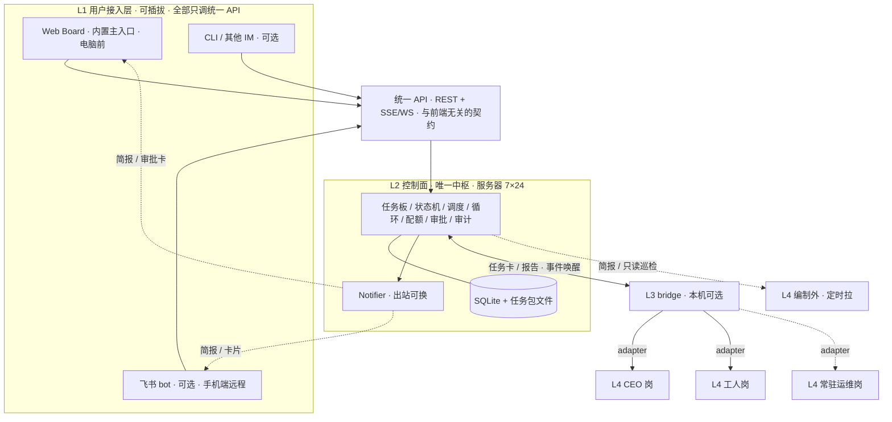
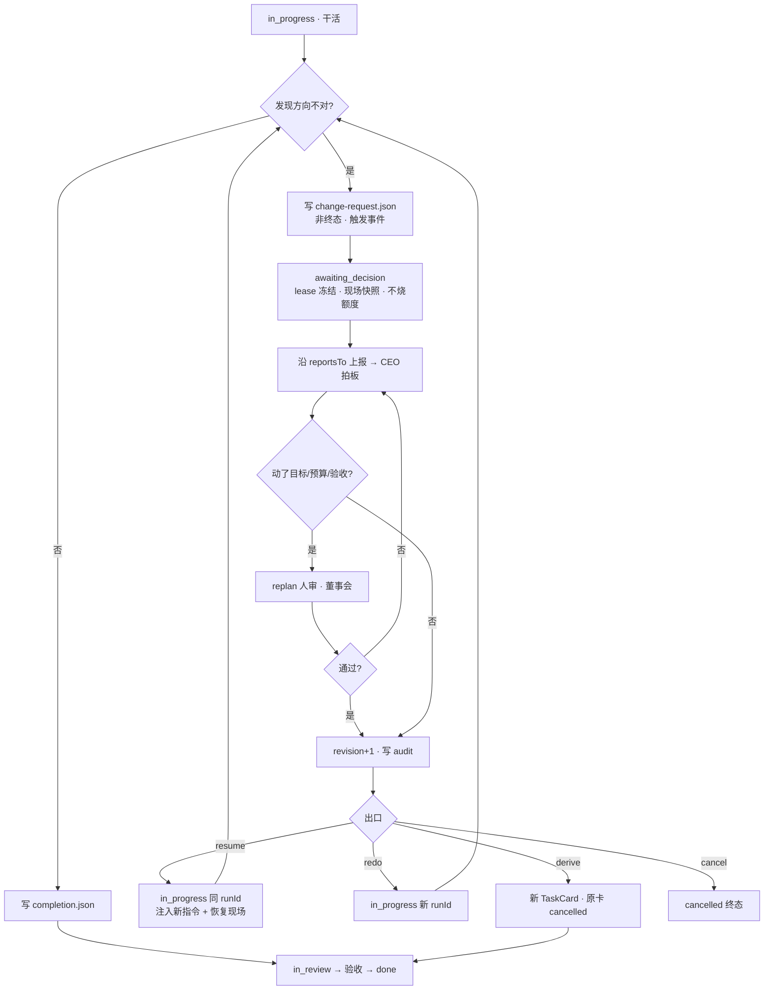

# AICompany 开发任务书

| 项 | 内容 |
|---|---|
| 项目名 | AICompany |
| 版本 | **v1.0 · 设计定稿（可直接用于开发）** |
| 日期 | 2026-11-15 |
| 状态 | 设计定稿，已完成全文一致性复核；**P0 协议冻结 + P1 最小闭环 + P2 控制面分层 / bridge 拉模式 / 循环 L2 + P3 GUI 型 adapter + P4 治理 / §6C §6D 完整档 + P5 试运行观测 / 调参均已实现并自主验收通过**（`npm test` **232/232**；实现与选型偏差见 `docs/P0-协议冻结说明.md` / `docs/P1-最小闭环说明.md` / `docs/P2-交付说明.md` / `docs/P3-交付说明.md` / `docs/P4-交付说明.md` / `docs/P5-交付说明.md`）；按 `docs/开发清单.md` 逐项打勾推进（当前 52/54）。**已能天天用**：`prod` 档常驻 + 一句话下单 + GUI 代价闸门 + 看板看结果/取消/暂停，真机 4 单连跑全 done（见 `docs/P6-天天用.md`）。**G-P5「连续 3 天无脏状态」如实留空**：常驻驱动器与门禁判定已备好，但压缩时钟不能代替真实墙钟，需 `npm run soak:real` 跑满 72 小时。P2 的「服务器化」只是架构分层，**未部署任何真服务器，本地单机演示仍是默认一等公民**；P3 的真实窗口操作命令全部由配置提供（Windows 真机注入见 `docs/P6-真实接入实测.md`）。**P7（项目层与项目记忆）为 2026-11-16 新增阶段：设计已与用户对齐定稿（`docs/P7-项目层与项目记忆设计.md`，核心：公司是大脑、项目是工地；规范人定、员工供料、引擎落笔、AI 只读），代码未开工，见开发清单 P7 段** |
| 位置 | `D:\开源\AICompany\` |
| 本文件 | 唯一技术文档，含 §6A 循环 / §6B 配置 / **§6C 交互模式 / §6D 中途变更**；README.md 只是项目入口索引 |

---

## 0. 一页速览（先看这一段）

**要做什么（大白话）**：给自己开一家「AI 公司」。以后你只对着**一个入口**提需求——电脑前用内置的 **Web Board**，手机端远程可以用飞书，也可以写 CLI 脚本；它们只是同一套 API 的不同客户端，随便换、随便少装一个。需求进去后 DSH 当总经理，自己拆活、派活、催进度、验收、写简报；底下几个 AI 员工各干各的，干完把结果交回公司，公司再决定下一步叫醒谁。你不用再开 4~5 个会话挨个下令。

**为什么不用现成的 Paperclip**：它的制度设计最对味，但原生 Windows 有已确认的阻塞问题（构建脚本用 POSIX 命令、`D:\` 路径 ESM 被 Node 拒、订阅登录依赖 Unix-only 的 `pty`、POSIX 权限断言），修复 PR #18144 至今 open 未合并；还要求 Node ≥ 24.11（本机 22.22.2）、无 Windows 安装包、官方推荐 Docker（本机 Docker 与 WSL2 均未启用）。**它是 MIT，制度可以借鉴，但没必要为了跑这套制度先折腾环境**。

**★ 开源定位（先看这一句）**：本项目交付的是一套**不含任何具体 AI 产品的公司制度引擎**——状态机、循环引擎、调度、配额、审计、人审。岗位编制、汇报线、触发方式、消息通道全部由用户自己的 `company.yaml` 决定，**换一份配置就是另一家公司，源码一行不用改**。详见 **§6B（配置驱动与开源可移植性）**。下面这张编制表是**作者本人这台机器的示例 profile**，不是默认值、不是依赖、不是安装前提。

**作者本人的示例编制（可整个删掉，见 `examples/profiles/windows-local.yaml`）**：

| 岗位 | 作者用谁担任 | 一句话职责 |
|---|---|---|
| 总经理 CEO | DSH | 拆任务、派活、验收、上报阻塞；**不直接叫醒任何人** |
| 技术负责人 / 救火队 | WorkBuddy | 只接疑难杂症和返工两次还没解决的活 |
| 基层执行 | 豆包 | 只接需求明确、步骤写死、能机检验收的批量脏活 |
| 常驻运维 + 控制面宿主 | Hermes（服务器） | 7×24 不掉线，管日志/磁盘/备份/定时，顺带托管公司制度 |
| 编制外只读巡检 | today | 定时读群消息汇总简报，**不派活、不验收、不进状态机** |

**★ 用户入口的结构（v0.4 修正，务必先看）**：**控制面自带一套与前端无关的 API（REST + SSE/WS）和一个内置 Web Board**。电脑前用 Web Board 作主入口，手机端远程用飞书 bot 作可选入口，CLI / 其他 IM 同理——它们**地位平等、全部只读写同一套 API、都在核心链路之外**。飞书**不是消息总线**：agent 之间的通信渠道只有控制面（§4.1），飞书只负责人机两侧的入站与出站。删掉飞书，Web Board 与公司照常运行。三个通信方向的拆分见 **§4.2 / §6B.8**。

**作者的示例架构**：Web Board 为主入口、飞书为手机端可选远程入口，控制面（任务板 + 状态机 + 调度器 + 记账）放服务器由 Hermes 托管，本机只留一个轻量 bridge 把任务卡翻译成各 agent 的触发动作并回收报告。**引擎本身不绑定任何前端、不绑定消息通道、不绑定服务器位置**（§6B.8 的 `Channel` / `Notifier` 可换，§6B.4 的配置可换）。

**★ 交互与弹性（v1.0 新增，务必看 §6C / §6D）**：你有两种帽子。**戴董事长帽**时默认 `delegate`（CEO 统筹），也可 `direct` 指名直投某个席位（跳过 CEO 那一次决策，但仍走控制面）；**戴员工帽**时走 `cowork` / `meeting` 协作空间，直接跟 AI 同事来回改材料，不建任务卡、不验收、不惊动 CEO。四种模式由你在提交时**显式选**，不用模型猜。另外，活干到一半发现方向不对，员工可以写 `ChangeRequest` 刹车 → 挂起并保住半成品 → 沿汇报线到 CEO 拍板（改方案要董事会点头）→ `resume` **带着已干的活接着做**。这补上了 v0.4 只有「事后补救型弹性」的缺口。

**规模与时间**（含 §6A 循环、§6B 配置层、Web Board、**§6C 交互、§6D 中途变更**）：完整版约 **3,950–6,300 行**，第一版可压到 **1,780–2,650 行**（两处数字的逐项加法见 §13）；一个人业余时间约 **2–4 周**（两章的最小档与 P0/P1 并行，完整档落在 P4）。复杂度集中在「GUI 型 adapter」「CEO 自然语言输出 → 结构化动作」「循环的漏跑与重叠判定」三处；§6C / §6D 难度不高但散在五个模块，漏接一处会静默失败。

**实施默认值（§18，未否决即按此执行，均为配置可覆写）**：控制面位置 / today 去留 / GUI 型报告形式 / 工作根目录 / 第一版 Web Board 页面范围 / 飞书何时接 / 清理类是否第一期接 / L3 复盘是否第一期做 / **交互模式第一版范围 / 中途变更第一版档位 / `autoAssign` 开关**。

---

## 1. 背景、痛点与目标

### 1.1 痛点（原始诉求）

- Agent 大小一点事都要问人「选哪个方案」，被反复打断。
- 一步做完了不会主动做下一步，必须人再下一条命令。
- 人的精力只能同时管 4~5 个会话，管多了就乱。
- 想要的状态：**作为老板只管理一个会话，这个 agent 全权负责所有事情，自主安排其他 agent 协作办公**。

### 1.2 目标（可验收）

| 编号 | 目标 | 验收判据 |
|---|---|---|
| G1 | 单一入口 | 用户在**任一已启用的入口**（默认内置 Web Board；可选飞书 / CLI）提交一次需求，不再分别打开各 agent 会话；不同入口提交的同内容请求必须幂等、落到同一张任务卡 |
| G2 | 自主连续推进 | 任务 A 完成后，系统自动触发下一轮（派下一活 / 验收 / 汇总），无需用户下第二条命令 |
| G3 | 岗位分工 | 至少 3 个 agent 按岗位接不同难度的活，且调度器能按岗位选人 |
| G4 | 结果可验收 | 每个任务有标准完成报告，能自动判定「完成 / 打回」，打回可自动重跑 |
| G5 | 可回溯 | 每次唤醒留 Run 记录；每条汇报能追到是哪次执行说的；有成本/额度记账 |
| G6 | 断点可恢复 | 笔记本关机、agent 超时、报告丢失时任务不丢，恢复后自动补投或重试 |
| G7 | 双帽协作 | 用户既能以董事长身份下指令（默认给 CEO / 可指名直投），也能以员工身份进协作空间直接跟某个席位来回改材料；四种交互模式显式可切，直投不产生 CEO 的 Run |
| G8 | 中途可变 | 执行中发现方向不对可刹车挂起、沿汇报线上报、CEO 改方案（动目标须人审）、并带着已有产物 `resume` 续做；全程可回溯、不丢历史 |

> **阶段说明（避免 G7/G8 与 D11/D12 打架）**：G1–G6 是 **P1 最小闭环**的验收目标；**G7 / G8 的完整形态在 P4 完整档达成**（§6C.11 / §6D.10）。P1 按 D11 / D12 的最小档验收：G7 只验 `delegate / direct / cowork` 与 `direct` 不产生 CEO Run，G8 只验「能刹车上报 → 派生新卡 → 原卡 `cancelled`、历史不丢」；`meeting` / `autoAssign` / `awaiting_decision` / `resume` / `revision` 放到 §12 的 P4 门禁与 §15.4 的完整档判据里。**协议字段与 schema 仍必须在 P0 一次定死**，不能因为分阶段就少定字段。

### 1.3 非目标（本期明确不做）

> **开源视角**：凡提到飞书 / DSH / 豆包 / Windows 的地方，都是**作者本人示例部署**的范围说明，不是引擎的功能边界。引擎侧对应的是可换的 `Channel` / `Notifier`、`cli-acp`、`gui-template` 与跨平台部署（§6B）。

- **必须做、且第一版就要有**：控制面自带的 **Web Board 最小单页** + 统一 API（§4.3 / §6B.8）。这是默认用户入口，也是「零外部凭据即可跑通」的前提。
- **不做**（Web Board 之外的部分）：移动端原生 App、多租户 / 用户登录 / 细粒度权限、富文本协作编辑、可视化拖拽编排流程。第一版用单页 + 表单 + 列表 + SSE 推送即可；飞书等外部 channel 属于可选插件，不进 P1 门禁。
- 不做「零人工干预」的完全自治：保留三道**常规**人审门禁（战略、招人/预算、验收打回），外加一类按需的事件型人审 `replan`（§6D.4，只在中途改目标时触发，不增加日常打断）。理由：自主连跑会烧钱、跑偏、误删，所有成熟方案都保留「一次授权 + 例外上报」。
- 不做模型路由 / 自动选模型、不做向量库 / 长期记忆检索（CEO 上下文靠所选 CLI 的 session 续接能力，由 `cli-acp` 配置）。
- **不做 LLM 意图分类器**：四种交互模式（§6C.9）与 `ChangeRequest.kind`（§6D.2）一律由显式字段 / 结构化报告判定。为了省 token 却先花一次模型调用去猜，等于原地踏步，还会丢掉确定性。
- 不改造、不 fork Paperclip 源码；只借鉴制度设计思想。
- **不为任何一家封闭 agent 重写客户端**：GUI 触发只提供参数化的 `gui-template` 通用模板，具体窗口/快捷键由用户配置；作者自己那份填法放 `examples/`。

### 1.4 为什么不直接部署 Paperclip（核实过的证据）

| 事实 | 结论 |
|---|---|
| 安装文档只写 macOS Apple Silicon 与 Linux VPS（Ubuntu 22.04/24.04），**Windows 一个字都没有** | 原生 Windows 无官方支持 |
| issue #18142（open）：构建脚本 `rm -rf` / `mkdir -p` / `xargs` 是 POSIX；runner 的 ESM 用 `D:\...` 绝对路径被 Node 拒；Claude/Codex 订阅登录依赖 Python Unix-only `pty`；POSIX 文件属主/权限断言 | 四类阻塞，不是小补丁 |
| Windows 修复 PR #18144：103 文件、69 提交，**open 未合并**；配套登录修复 #17689 / #19447 也 open | 修是有人在修，没到「可用」 |
| 已合并的 #18250（Windows 构建 + CI 通道）、#14308（doctor 跳过 Windows 权限检查） | 方向在修，仍不等于支持 |
| 要求 Node ≥ 24.11.0；本机 `node -v` = 22.22.2 | 要升运行时 |
| 最近 Release 无 .exe / 桌面包；Cloud 版 waitlist | 无开箱即用 |
| 官方推荐 Docker Compose quickstart；本机 `docker` 未安装、WSL 未启用 | 唯一绕开 Windows 问题的路也要先装环境 |
| 官方明确「不要用 sudo / 管理员 shell 运行」（内嵌 PostgreSQL 拒绝） | 与用户习惯的管理员启动 dsh 相反，容易踩坑 |

> **但 MIT 许可意味着制度可以放心借鉴**：版权保护代码表达，不保护思想/流程/制度。只借设计、自己从零写代码，连 LICENSE 都不用带；若将来 fork 源码，则须遵守 §17.5 的声明义务。

---

## 2. 术语表（先统一叫法，避免后面吵架）

| 词 | 大白话 | 严格定义 |
|---|---|---|
| 控制面 | 公司制度 + 工单系统 + 排班表 + 财务 | 不含智力的服务端：任务板、状态机、事件调度器、配额、审批、审计 |
| 任务卡 | 一张工单 | `TaskCard`，一个 JSON 文件，描述「谁、干什么、交付什么、怎样算做完」 |
| 唤醒 | 叫某个员工来上班一次 | 调度器按事件拉起对应 agent 的一次执行，跑完即退，**不是常驻进程** |
| Run | 一次上班记录 | 一次唤醒的完整 transcript、耗时、成本、结果，带唯一 `runId` |
| adapter | 各员工的「叫醒方式」 | 统一接口 `execute(ctx) → result`，内部差异（CLI / GUI / HTTP）全封装在这里 |
| bridge | 本机传达室 | 常驻本机的轻量程序，向服务器领任务、翻译成触发动作、把报告送回去 |
| lease / checkout | 工位独占牌 | 一个任务同一时刻只能被一个 agent 领走，抢不到返回 409 |
| 汇报线 | 组织架构树 | 每人只有一个上级、不许成环；决定「能派活给谁」和「阻塞往哪报」，**不是通信链路** |
| 完成报告 | 交活单 | `CompletionReport`，标准格式文件，机器可校验，不是屏幕上一段话 |
| 补投 | 关机时活排队，开机补发 | 本机离线期间任务留在服务器，bridge 恢复后自动领取 |
| **席位 / 身份码** | 公司编制里的一个员工身份 | `agentId`（配置里的 `id`），稳定 slug、永不变；与「用哪个软件触发」「这张卡干什么」分离（§6C.2） |
| **交互模式** | 你提交时选的「这消息算什么」 | `delegate / direct / cowork / meeting`，显式字段，不猜意图（§6C.1） |
| `addressedTo` | 指名交付给谁 | **交付**：唤醒、建卡、进状态机；与只可见不唤醒的 `cc` / `@mention` 严格分开（§6C.3） |
| **协作空间** | 不进任务板的一间「小会议室」 | `WorkThread`，你 + 1..N 席位 + 共享材料；不建卡、不验收，唯一出口是 `promote`（§6C.5） |
| `promote` | 把定稿正式交回公司 | 从 `WorkThread` **单向、显式**提升为 `TaskCard` 或附件，此后才进治理链（§6C.5） |
| **变更请求** | 干到一半喊一声「方向不对」 | `ChangeRequest`，run 内的**非终态**报告，每次落盘都触发事件（§6D.2） |
| `awaiting_decision` | 停下等拍板 | 挂起态：lease 冻结、现场快照落盘、不烧额度；补偿扫描必须排除它（§6D.3） |
| **现场快照** | 挂起时把半成品封存 | 产物清单 + checksum + `sessionParams` + transcript 路径，只读不可变（§6D.3） |
| `revision` | 这张卡的指令是第几版 | 一次性卡/循环实例**轮内**改方案用；循环模板**跨轮**改制度用 `jobVersion`，两者不替代（§6D.6） |
| `replan` | 中途改方案的人审 | 事件型人审：动 `instructions` / `acceptance` / `assignee` / 预算时必须董事会点头（§6D.4） |

---

## 3. 岗位编制

> **⚠️ 本章是作者本人这台机器的一份示例 profile，不是产品默认配置，也不是设计前提。** 开源后用户按自己的 agent 写 `company.yaml`（§6B.4），岗位数量、名字、谁当 CEO、每人用什么触发方式都可以完全不同。引擎只认 `capabilities` 与 `reportsTo`（§6B.5），不认本章任何产品名。本章保留的价值是：解释「为什么这样分工」的判断依据，以及如何按开放程度给岗位派活。

### 3.1 编制总表

| Agent | 岗位 | 能力 / 额度 | 触发通道 | 只接什么活 | 绝不接什么活 |
|---|---|---|---|---|---|
| DSH | CEO / 总经理 | 可跨心跳续上下文、最高权限、开源可扩展 | 控制面事件 → `adapter`（bridge 拉取 / IM 推送**可选**）→ `dsh headless --session-id` | 读目标、拆任务、派活、验收、上报阻塞 | 具体执行（写代码、渲染、截图） |
| WorkBuddy | 技术负责人 / 救火队 | 能力强，**每日赠送额度有限** | CLI + 任务包目录 | 疑难攻坚、返工 ≥2 次的活、需要判断力的方案 | 批量脏活、可模板化的重复劳动 |
| 豆包 | 基层执行 | 免费额度高、工作能力弱 | GUI 自动化（C+N → 提示词 → 回车 → 等报告文件） | 需求明确、步骤写死、结果可机检的批量活 | 需要判断、需要多轮澄清、需要返工协商的活 |
| Hermes | 常驻运维 + 控制面宿主 | 服务器 7×24 不掉线 | 服务器本机执行 / SSH / HTTP | 日志巡检、磁盘、备份、定时例程、托管控制面 | 需要本机 GUI 的活、需要人审的决策 |
| today | 编制外只读巡检 | 封闭，**只能定时检查消息，不能被主动触发** | 定时拉群消息 | 汇总当天简报（只读） | 任何有时限、要验收、可能返工的任务 |

### 3.2 关键岗位说明

**DSH 当 CEO 的依据（已核实）**
- `dsh headless "任务"` 支持一次性任务、stdout 出结果；`--json` 出 NDJSON 事件流；`--session-id <id>` 复用已有会话 → **CEO 的判断力可以跨心跳连续**；`--approval-policy never` → 不中途停下来问人；`--permission-mode <preset>` → 用配好的权限预设；`-` 可从 stdin 读任务。
- `cordis.patch.yml` 已配 `sandbox-policy: mode: danger-full-access` 与 `approval: policy: never` → CEO 不会被工具审批打断。
- `@larksuite/channel` 已装且 `lark-channel` 已配置 → 飞书消息能进 dsh 会话（存在 `lark-oc_…` 会话缓存为证）。
- 结论：**不用改 DSH 源码、不用写插件**，一层适配脚本就能让 CEO 上岗。

**WorkBuddy 的配额纪律**：每日赠送额度是硬约束，必须在控制面设「岗位配额」。规则建议：同一任务返工 2 次仍未通过才升级给 WorkBuddy；其余一律先给豆包；配额用到 80% 发警告、100% 暂停派新活并上报。

**豆包的能力边界**：把它当「按图纸拧螺丝的工人」，不是「能商量的人」。任务卡里必须把输入文件、输出路径、报告格式、验收条件全部写死，不留「你看着办」。

**Hermes 的额外价值**：笔记本会合盖、会关机，这是本机方案的天然短板；服务器常驻正好补上——任务在服务器排队，本机上线后再领。这也决定了控制面应该放服务器。

### 3.3 today 的处置决议（明确结论）

**保留，但挂在编制外，不进主任务链路。**

理由：它「不能被主动触发、只能定时检查消息」不是缺陷，而是决定了它天生只适合**拉模式**（自己周期性地去读信箱）。给它安排「定时读统一 API 的状态与事件（或已启用 channel 的消息）→ 汇总当天各 agent 的完成报告 → 经 `Notifier` 发一份简报」，这件事对实时性零要求，正好不需要唤醒能力。

硬边界：
- 不派任务卡、不参与 checkout、不写任务状态、不进汇报线；
- 它的输出只当「公告」，控制面不解析、不依赖、不等它；
- 主链路跑通后可随时砍掉，不影响任何功能（这份活 Hermes 也能做且更可靠）。
- 若后续发现它连简报都发不稳定，直接砍，不做适配投入。

> 反面理由：绝不派有时限/要验收/可能返工的活。因为无法确认它是否收到、何时做完，会破坏状态机的确定性——一个「不知道干没干」的员工比没有员工更糟。

### 3.4 汇报线与权限边界

```
你（董事会 / 老板）
└── DSH（CEO，唯一无上级）
    ├── WorkBuddy（技术负责人）
    ├── 豆包（基层执行，可设多个工位）
    └── Hermes（常驻运维）
today：不在这棵树上（编制外）
```

- CEO 只能派活给汇报子树内的人；不能给平级或上级派活。**agent 之间不得直投**（§6C.1）。
- **人是董事会，不受子树约束**：可以 `direct` 指名直投任意席位，这是「临时兼任 CEO 的派活职能」，仍要建卡、checkout、留审计、进配额（§6C.1 / §6C.3）。
- 阻塞沿汇报线向上报：工人卡住 → 经理/CEO → 董事会（**Web Board 的 Approvals 页**；启用了外部 channel 时同步推送）。**执行中主动发现方向不对**走同一条线，只是换一份非终态报告 `ChangeRequest`（§6D.4）。
- **汇报线是权限与治理边界，不是通信链路**：所有信息仍只经控制面（任务卡、评论、报告、审批、审计）流转，agent 之间不建立任何直连；`cowork` / `meeting` 的协作空间同样挂在控制面上（§6C.5）。

---

## 4. 总体架构

### 4.1 一句话架构

> **AICompany = 一套不含智力的任务状态机（控制面），按事件把外部大脑叫醒一次，收回结果、卡状态、记账，再按制度决定要不要叫下一个。**

所有 agent 只跟控制面读写，彼此不直连。CEO 也**不叫醒任何人**——它只往任务板写；唤醒由控制面的事件监听器发起。这一点是整个设计最容易被想错的地方。

**§6C / §6D 补充但不推翻这一句**：四种交互模式（含人指名直投、不建卡的协作空间）与执行中的 `ChangeRequest` 挂起决策，**全部仍只读写控制面**。变的只是「CEO 是否要被唤醒决策」，不是「谁跟谁通信」。

### 4.2 四层（v0.4 重新定性）

> **v0.3 的错误**：把「飞书」立为 L1「消息总线」，让它同时收老板指令、发唤醒消息、发简报、发人审卡片——这与 §4.1「控制面是唯一通信中介」直接矛盾，也把「人从哪提要求」和「agent 之间怎么通信」混成了一件事。
>
> **修正**：飞书从基础设施层**降级为用户接入层的一个可选 channel 插件**；`Notifier` 也不再是独立一层，归入 L2 的出站组件。**agent 之间的通信只有 L2 一条路，与 L1 用哪个客户端完全无关。**

> **四层结构固定，每层填什么由配置决定**（§6B）。最后一列只是作者本人这台机器的取值，不是安装前提。

| 层 | 引擎侧职责（固定） | 可换的部分 | 作者本人用的是 |
|---|---|---|---|
| **L1 用户接入层 Clients** | 把「需求 / 审批 / 评论 / Run now」写成**统一 API 调用**；把状态呈现给人 | `Channel` 实现：`web`（内置）/ `feishu` / `webhook` / `cli` / `noop` | 电脑前 **Web Board（主）**、手机端飞书（可选） |
| **L2 控制面（唯一中枢）** | 统一 API（REST + SSE/WS）+ 内置 Board 后端 + 任务板 / 状态机 / 事件调度 / 循环引擎 / 配额 / 审批 / 审计 + **出站 `Notifier`** | 部署位置（本机 / 服务器 / 容器）、`Notifier` 实现 | 服务器（Hermes 托管，7×24） |
| L3 bridge | 领任务卡、翻译成触发动作、回收报告、心跳上报 | 是否常驻、补投策略 | 本机 Windows，**会**合盖掉线 |
| L4 agent runtime | 各岗位干活 | `adapter` 类型、岗位数量与名字 | DSH / WorkBuddy / 豆包 / Hermes / today |

**三个通信方向必须分开（这是本节最容易搞错的地方）**：

| 方向 | 从 → 到 | 抽象 | 飞书在不在 |
|---|---|---|---|
| ① 入站 · 人机 | 人 → 控制面 | `Channel`（归一化、去重、白名单、**只翻译不猜模式**）→ 统一 API；请求可带 `mode` / `addressedTo`（§6C） | 可选 |
| ② 出站 · 人机 | 控制面 → 人 | `Notifier`（简报、审批卡、告警） | 可选，可与 Web 站内通知并存 |
| ③ 机机 · 通信 | 控制面 ↔ agent | 事件监听 → `adapter` / bridge 的 `execute()` | **不在**。这一行由 L2 独占 |

**关键推论**：`aicompany init` 只启用 `web` + `noop` 就能跑通全部验收判据——**没有飞书账号、没有手机、没有任何外部服务也能开张**。飞书只是「不想开浏览器时，在手机上一条消息搞定」的便捷通道，删掉它不影响 ③ 的任何一环。

**CEO 怎么醒**：唤醒属于 ③，与 ① 用哪个入口无关。控制面事件监听按 Run Policy 触发该岗位的 `adapter`；作者实例里 DSH 那个 adapter 可选「飞书长连接推送」或「bridge 拉取」两种实现，但那只是 §8 的实现细节，**不是架构层的消息总线**。

### 4.3 拓扑图



> 虚线的飞书节点可整体删除；删掉后 `WEB → API → CP → BR` 这条主链路一行不改。
>
> **§6C / §6D 不新增拓扑节点**：四种交互模式只是 `POST /api/requests` 上的字段与 L2 内的路由分支；`WorkThread` / `ChangeRequest` / 现场快照都是 L2 的数据对象。因此这张拓扑图在 v1.0 仍然成立。

纯文本版（便于在终端里看）：

```
  Web Board(主) ───┐
  飞书(远程·可选) ─┼──> [ 统一 API ] ──> [ L2 控制面 · 唯一中枢 ]
  CLI(可选) ───────┘                          │
                                            ├── Notifier ──> Web 站内 / 飞书(可选) / noop
                                            │
                                            └── 事件唤醒 <──> [L3 bridge] ──> CEO / 工人 / 运维
                                                                  │
                                                                  └── 报告回收 ──> 控制面
```

### 4.4 一次任务的完整时序（从提需求到简报）

| 步 | 谁 | 做什么 | 落到哪 |
|---|---|---|---|
| 1 | 你 | 在 **Web Board** 提交（飞书 / CLI 等价，同幂等键）；**显式选 `mode`**，直投时选 `addressedTo` | `POST /api/requests` |
| 2 | 接入层 `Channel` | 归一化、去重、白名单；`@席位id` **只翻译不猜模式** | 统一 API 契约 |
| 3 | 控制面 | **按模式分流**（§6C.9）：`delegate / direct` → 建 `TaskCard`（`backlog`，绑 `requestId`，`revision=1`）；`cowork / meeting` → 建或复用 `WorkThread`，**不建卡** | SQLite + 任务包 / `threads/` |
| 4 | 调度器 | Run Policy：预算 / 状态 / 并发 / bridge 在线；不允许则排队或 `paused` | Run Policy |
| 5 | 调度器 | `delegate` → 唤醒 CEO；`direct` → **只唤醒 `addressedTo`**（CEO 仅 cc 可见，不产生 CEO 的 Run）；`cowork / meeting` → 按 `wakePolicy` 点名，纯存材料 **0 唤醒** | 事件监听 → `execute()` |
| 6 | 被唤醒席位 | adapter 触发（作者实例里 CEO 是 `headless --session-id <CEO会话>`） | 本机 / 服务器 |
| 7 | CEO | **只写四类**：任务卡 / 验收结论 / 阻塞上报 / **中途决策**（§6.7）；`direct` 时不参与 | `outbox/` |
| 8 | 控制面 | schema 校验；不合格退回重写 ≤2 次；合格则建子任务、指派 | 状态 `todo` |
| 9 | 调度器 | `issue_assigned` 事件 → 唤醒对应岗位的 bridge | 事件监听 |
| 10 | bridge | `checkout` 独占（抢不到返回 409 → 排队）；按 adapter 触发 | `in_progress` |
| 11 | 工人 | 干活；周期性写 `progress.json`（覆盖写、**不触发事件**）；完成写 `completion.json` | 任务包目录 |
| **11a** | 工人 | **发现方向不对** → 写 `change-request.json`（非终态、每次触发事件；汇报对象由控制面按 `reportsTo` 填进提示词） | `tasks/<id>/change-requests/` |
| **11b** | 控制面 | `transition → awaiting_decision`；lease 冻结、现场快照落盘、**不烧额度**；补偿扫描排除此态 | `snapshots/` |
| **11c** | CEO / 董事会 | 沿汇报线决策；动目标 / 验收 / 预算须 `replan` 人审；四出口 `resume / redo / derive / cancel`；`revision+1`、写 `audit` | `decisions/` + `audit` |
| 12 | 控制面 | `resume` 带现场回步 11；报告校验合格 → `in_review`，不合格打回 `in_progress` | 状态机 |
| 13 | CEO | 验收：写「通过 / 打回 + 理由」 | 文件 |
| 14 | 控制面 | 通过 → `done`；`cancelled` 亦为终态；记录 Run transcript、成本、留痕 | 审计表 |
| 15 | 控制面 | 检查后继任务 / 循环实例 → 回到步 4；简报经 `Notifier` 出站；thread 到 TTL 归档 | 审计 + Web 站内 / 已启用 channel |
| 16 | today | （编制外）定时读统一 API 的状态与事件，独立汇总一份简报 | 只读，不回写 |

> **11a–11c 是 §6D 新增的执行中内环**，12 之后仍是原来的验收链；`cowork / meeting` 走的是另一条「不建卡」的旁路，两者都穿过控制面。

**没有「项目结束」这个终点**：新任务、新评论、定时例程会继续触发下一轮，公司一直跑着。但要注意三类差别：**一次性任务**的 `done` 可以 `reopen`；**循环 / 长期任务**不是把 `done` 重新打开，而是由常驻模板每轮新建一张独立任务卡（§6A）；**`cancelled` 是终态**、不得 `reopen`，要复活只能 `derive` 新卡（§6D.5）。协作空间 `WorkThread` 不进这条循环，到 TTL 归档（§6C.5）。「公司一直跑着」指的是模板和队列在跑，不是同一张卡反复重跑。

### 4.5 关键设计决策表

| 决策 | 备选 | 为什么选它 | 代价 |
|---|---|---|---|
| 控制面放服务器 | 放本机 | 笔记本会合盖；服务器 7×24 才能可靠地排队、定时、补投 | 本机 bridge 要跨机器通信 |
| **控制面自带 Web Board + 统一 API；飞书降为可选 channel** | v0.3 的「飞书当唯一消息总线」 | 电脑前开箱可用；**API 是契约、前端只是客户端**，手机远程 / CLI / 别的 IM 平接；`web + noop` 零外部凭据可跑 | 第一版多约 320–460 行单页与 API 层 |
| **通信方向三拆**：入站 `Channel` / 出站 `Notifier` / 机机 `adapter` | 一个「消息总线」把三件事全包 | 飞书可整条删除；agent 间仍只有控制面一条路，与 §4.1 一致 | 多两个薄接口，换来可替换性 |
| 文件任务包 + SQLite 双写 | 纯数据库 / 纯文件 | 工作台已有 `agent-request/progress/response` 协议可直接复用；SQLite 负责并发、checkout、审计 | 要保证两者一致（以 SQLite 为准，文件为对外接口） |
| 事件驱动为主，定时心跳为辅 | 全员定时轮询 | 空转心跳白烧 token、刷噪音 Run；默认应「有事才醒」 | 需要事件监听完整性 |
| CEO 只写**四类**结构化文件（含中途决策） | 让 CEO 直接吐 JSON / 自由文本 | 自由文本解析会幻觉；限定输出种类 + schema 校验最稳 | 要写一份清晰的 CEO 提示词 |
| **四种交互模式显式可选，CEO 从「必经」改为「按需」** | 所有输入一律建卡唤醒 CEO；或用 LLM 猜意图 | 省掉不必要的 `execute()`，又保住控制面唯一中介；显式字段零成本且确定（§6C） | 提交框多一个下拉与「交付给」选择器 |
| **`ChangeRequest` + 挂起 + `revision`** | 出事就推倒重来（派生新卡 / 重跑） | 能带着半成品续做，且改动全程可回溯（§6D） | 协议 / 状态机 / 调度器 / 审计 / 前端五处都要接住，漏一处会静默失败 |
| 豆包报告落文件 | 读屏幕检测完成文案 | 焦点、弹窗、分辨率、加载卡顿都会误判；读文件是确定的 | 要在提示词里强制豆包写文件 |
| 三道人审门禁 | 完全自治 | 防烧钱、防跑偏、防误删；成熟方案都是「一次授权 + 例外上报」 | 仍要偶尔点一下 |
| 自研而非 fork Paperclip | 直接用 / 等 PR 合并 | 绕开 Windows/Node/Docker 门槛，且只借鉴制度不侵权 | 状态机与 adapter 要自己写 |

### 4.6 与 Paperclip 制度的对照：借什么、不借什么

| 借鉴（设计思想，随便用） | 不借鉴（照搬会拖垮本项目） |
|---|---|
| 任务状态机 `backlog → todo → in_progress → in_review → done` | 它整套 TypeScript monorepo、内嵌 PostgreSQL、Rust native runner |
| `checkout` 独占、409 冲突 | 组织架构招人 / 预算审批的完整产品化 UI（第一版用**内置 Web Board 最小页**，不做拖拽编排与权限体系） |
| 严格汇报线、阻塞沿线上报 | `adapterType` 插件市场的完整生命周期（我们只写一个统一接口 + 5 个实现） |
| 公司/岗位双层预算，80% 警告、100% 暂停 | Cloud / 多租户 / 复杂权限 |
| 三道人工门禁：战略、招人、预算与阻塞 | 把它做成强制的 onboarding / 战略模板（我们保留人审，但只在触发时由 Web Board 的 Approvals 页弹一次） |
| 每次唤醒留 Run transcript、每条汇报绑 `runId` | 订阅登录 / API key 双轨凭据（我们只用已有凭据） |
| 事件触发源：任务指派、评论、review 请求、审批结果、定时例程、人工 Run now | 它的 Docker 部署假设 |
| 「@-mention 只是上下文，不唤醒」这条纪律（本项目延伸为 `addressedTo` 交付 / `cc` 抄送严格分开） | 原生 Windows 兼容补丁（我们本来就在 Windows 上从零写） |
| 默认 `heartbeat interval = off`、`wake on demand = on` | — |

> **§6C / §6D 不在上表**：Paperclip 的 Board 只有任务 / 评论 / 审批，没有「不建卡的协作空间」，也没有「执行中的挂起态与续做」。这两块是本项目在借鉴制度之外的自建扩展，不是从它那儿抄来的。

---

## 5. 现成资产清单（本机只读核实结果，2026-11-15）

> 这一节是「为什么**作者自己**工作量比看上去小」的依据。**所有路径均为只读核实，本轮未修改任何文件。**
>
> **⚠️ 开源视角**：下列 `C:\Users\...` / `D:\工作台\...` 全是**作者本机环境记录**，仅作示例与可行性证据，**不是产品依赖、不是安装前提**。引擎源码里不得出现这些路径（§6B.2 / §6B.11）；别人接自己的 agent 时不需要这里的任何一项。

### 5.1 工作台任务包协议（最值钱的一块）

位置：`D:\工作台\项目\<项目名>\stages\NN-<阶段>\`

| 文件 | 作用 | 已观察到的字段 |
|---|---|---|
| `agent-request.json` | 下发任务 | `id`、`kind`、`title`、`createdAt`、`status: "pending"`、`system`（角色与硬规则）、`user`（任务正文）、`meta`（项目/镜头数/时长/引擎/背景图等） |
| `agent-progress.json` | 进度回报 | 实测内容形如 `{"id": "...", "text": "渲染完成 51/51 · 失败 0"}` |
| `agent-response.json` | 完成报告 | `prompt.md` 中明确要求完成后写此文件 |
| `agent-images.json` | 产物清单 | 同上目录 |
| `prompt.md` | 给 agent 的规矩 | 原文含「任务包目录里有 agent-request.json，其中的 id 是本次任务编号」「每渲完一批（建议每 5~10 镜），把进度写到 workDir/agent-progress.json」「完成后写 agent-response.json」 |

另有 `D:\工作台\项目\AI时代读书的价值\修改需求_v3_给豆包.md`，证明这套协议**已经实际用于给豆包派活**；同项目 `重制报告.md` 也记录了豆包产出不合格时人工返工的过程——正好说明「标准报告 + 验收打回」的必要性。

**结论**：这已经是一套带验收的异步交接协议，等价于 Paperclip 的任务板，只是用文件夹代替数据库、用人工/脚本搬运代替事件调度。我们要做的不是发明协议，而是**把它规范化并接上调度器**。

### 5.2 DSH 远程唤醒链路（作者本人示例，证实可用）

> **v0.4 定位**：这一节记录的是「作者实例里 CEO 那个 adapter 恰好可以用 IM 长连接推送来触发」，**不是架构层的消息总线**。引擎侧对应的是 §7.3 的事件监听 → `adapter.execute()`；换用 bridge 拉取同样成立。

| 资产 | 路径 / 内容 |
|---|---|
| Channel SDK | `C:\Users\wuhao\.dsh\profiles\web\node_modules\@larksuite\channel` — WS 长连接、自动重连、心跳保活、握手超时、webhook 模式；L2 归一化（@-mention、merge_forward、card、reaction）；L3 去重 / 白名单 / 过期丢弃 / 按 chat 串行；L4 出站 send、流式卡片、媒体上传 |
| 最小用法 | `createLarkChannel({appId, appSecret})` → `channel.on('message', ...)` → `await channel.connect()` |
| 已配置 | `C:\Users\wuhao\.dsh\profiles\web\cordis.patch.yml` 中有 `lark-channel`（含 cwd）、`sandbox-policy: mode: danger-full-access`、`approval: policy: never`、`agent-default-model` |
| 运行证据 | `C:\Users\wuhao\.dsh\storages\session_projcache\sessions\lark-oc_ad3ba348f3d3bcb5f87e6be306ed1947.json` — 飞书会话确实进来过 |
| 出站工具 | `C:\Users\wuhao\.dsh\tools\feishu_send.js` — 用 `LARK_CHAT` / `LARK_APP_ID` / `LARK_APP_SECRET` 环境变量发文件或文本消息 |

### 5.3 定时唤醒与补投经验

`C:\Users\wuhao\.dsh\tools\xwz-secretary\README.md` 记录了两件可直接复用的事：
- **DSH 内置 schedule 能把消息投递到指定 session**（晨报 08:00 / 晚报 22:00 投到 `session-75c6532b…`）→ 定时唤醒 CEO 不用自己写闹钟。
- **「到点只是排队，实际发出取决于笔记本何时开机」**，关机/合盖时补投；Windows 任务计划程序作后备并配 `StartWhenAvailable`。→ 这正是本项目离线补投策略的现成经验，且它吃过亏、写清了原因。

### 5.4 资产复用映射

| 本项目需要 | 直接用谁 | 还要补多少 |
|---|---|---|
| 任务下发 / 进度 / 完成报告格式 | 工作台 `agent-*.json` 协议 | 只补字段规范与 schema 校验 |
| 可选 IM channel 的收发与去重 | `@larksuite/channel` + `feishu_send.js` | 只补消息模板与路由；**可整体不装**，装不装不影响控制面 |
| CEO 唤醒与连续上下文 | 控制面事件 → `adapter`（bridge 拉取 / IM 推送可选）+ `dsh headless --session-id` | 只补一层适配脚本 |
| 定时唤醒 / 离线补投 | DSH schedule + `StartWhenAvailable` 经验 | 只补与任务卡的绑定 |
| 状态机 / checkout / 审计 / 配额 | **无** | 从头写（约 550–900 行） |
| adapter 统一接口与 5 个实现 | 部分（CLI 类几乎现成） | 豆包 GUI 从零写（约 300–500 行） |
| 交互模式路由 / 协作空间（§6C） | **无现成实现**，但 `agentId` / 能力标签 / 汇报线 / `runs` / `quotas` / `tasks` 已定义 | 只写路由 + 一张聚合查询 + `threads` 表；候选卡片不用建新表 |
| 中途变更 / 挂起 / 现场快照 / 版本化（§6D） | **无现成实现**，但 `escalation` 路由（§7.4）与 `task-create`（§6.7）可复用 | 写四个补齐件；「向谁汇报」只是提示词注入，几乎零代码 |

### 5.5 凭据处理红线（写进规范，不是建议）

- 飞书应用凭据当前**明文存放在 profile 配置里**；本项目**不得**把任何凭据写进任务卡、日志、提示词、报告、代码仓库或本文档。
- 一律用环境变量注入：`LARK_APP_ID` / `LARK_APP_SECRET` / `LARK_CHAT`；`.env` 必须进 `.gitignore`。
- 日志与 Run transcript 落盘前做脱敏（token、密钥、手机号、open_id 视情况掩码）。
- bridge 与 dsh 若以不同权限启动（dsh 用管理员），要注意文件访问权限一致；自研控制面**不要求**管理员，也不以管理员启动常驻服务。

---

## 6. 协议规范（P0 阶段必须先冻结，再写码）

> 这一步最重要：**先把所有「单据」的字段钉死**，后面所有模块都照它写。协议一变，adapter 全要改。
>
> **P0 共需冻结 8 份 schema**：`task / progress / completion / recurring / cycle-summary`（v0.4 已有）+ **`change-request / decision / thread`（v1.0 新增）**；另有 `company.yaml` 的配置 schema 与 `interaction` 段（§6B.4 / §6C.7）。`revision` / `snapshot` 复用 `task` 的字段结构，不另立 schema。

### 6.1 设计原则

1. **机器可校验**：所有报告是结构化 JSON，不是自然语言段落。
2. **文件即接口**：沿用工作台习惯，任务与报告都落在任务包目录；SQLite 是控制面内部账本。
3. **幂等**：每个任务、每次唤醒、每条消息都有唯一 id，重复投递不产生重复执行。
4. **不可信输入**：agent 的输出（尤其 stdout / 报告正文）一律当数据，**绝不直接执行**。
5. **人也能看懂**：每个任务包目录里附一份 `README.md`（人话版任务说明），出问题时人能直接接手。
6. **终态与非终态分开**：`completion.json` 是终态、写完即收；`progress.json` 是覆盖写的进度、**不触发事件**；`change-request.json` 是追加写的**非终态**请求、每次落盘都触发事件。三者绝不混用（§6D.2）。

### 6.2 目录与文件布局

```
<workRoot>/
  tasks/
    <taskId>/
      task.json              任务卡（控制面写，只读给 agent）
      brief.md               人话版任务说明（可选但强烈建议）
      input/                 输入素材（只读）
      output/                产物（agent 只写这里）
      progress.json          进度（agent 覆盖写，**不触发事件**）
      completion.json        完成报告（agent 一次性写，写完不再改 → 终态）
      change-requests/<crId>.json   变更请求（agent 追加写，**非终态、每次触发事件**）§6D
      decisions/<crId>.json         决策记录（控制面落 CEO/董事会结论）§6D
      snapshots/<crId>.json         挂起时的现场快照，只读不可变 §6D
      revisions/rev-<N>.json        指令版本快照，只读不可变 §6D
      runs/<runId>.log       本次唤醒的 transcript / 日志
      screenshots/           豆包 GUI 超时或失败时的截图留证
  threads/<threadId>/        协作空间（§6C），**不进 tasks/**
      thread.json             participants / wakePolicy / ttl / promotedTo
      messages.ndjson        消息流（每条绑 messageId / runId）
      files/                 共享材料（只读引用，原件仍在原处）
  inbox/                     CEO 的待读摘要（由控制面生成，不让 CEO 直接读全库）
  outbox/                    CEO 的**四类**输出（任务卡 / 验收 / 阻塞 / 中途决策）
  events/                    事件日志（NDJSON，按天分片）
```

> **命名约定（避免单复数与路径打架）**：后文出现的 `change-request.json` 是简称，agent 侧实际落 `tasks/<taskId>/change-requests/<crId>.json`（§6D.2）；`outbox/decision-<crId>.json` 是 CEO 提交决策的一种投递方式，`POST /api/change-requests/:id/decision` 是另一种，控制面校验后统一落 `tasks/<taskId>/decisions/<crId>.json` 与 `decisions` 表（§6D.4 / §6.7 / §6B.8）。**文件与 API 只是同一对象的两种入口**，共用同一份 schema 与 `changeRequestId` 幂等键，最终都只写控制面这一份数据。

### 6.3 TaskCard（`task.json`）

```json
{
  "schema": "aicompany.task/v1",
  "taskId": "T-20261115-0001",
  "requestId": "REQ-20261115-0001",
  "parentTaskId": null,
  "title": "把第 3 章译稿转成 16:9 分镜表",
  "role": "batch-render",
  "revision": 1,
  "mode": "direct",
  "addressedTo": "exec-batch-01",
  "cc": ["ceo"],
  "assignedBy": "human",
  "threadId": null,
  "assignee": "exec-batch-01",
  "reportsTo": "tech-lead",
  "status": "todo",
  "priority": "normal",
  "createdAt": "2026-11-15T14:00:00+08:00",
  "lease": null,
  "budget": { "maxRuns": 3, "maxMinutes": 30, "quotaUnits": 1 },
  "input": { "workDir": "<workRoot>/tasks/T-20261115-0001/input", "files": ["chapter3.md"] },
  "instructions": "严格按 brief.md 的 5 步执行；不要自行扩展需求。",
  "acceptance": [
    "output/分镜表.md 存在且非空",
    "completion.json 的 schema 为 aicompany.completion/v1 且 status = success",
    "输出中镜头数与 brief.md 要求一致"
  ],
  "completionReportPath": "output/completion.json",
  "retry": { "attempt": 0, "max": 2, "backoffSec": 30 },
  "tags": ["批量", "可机检"]
}
```

> **★ v1.0 中性化修正**：原示例把 `worker.doubao` / `doubao-01` / `dsh-ceo` 焊进了 `role` / `assignee` / `reportsTo`，与 §6B.2「引擎零产品名」直接矛盾——协议示例会被开源用户照抄，等于把作者的产品写进别人的编制。现全部改为**稳定席位码 + 中性职责名**（§6C.2）。同理 §6.6 / §6A 的示例也一并中性化。

**必填字段**：`schema / taskId / requestId / role / assignee / status / createdAt / instructions / acceptance / completionReportPath / revision`。
**条件必填**：`mode = direct` 时必须有 `addressedTo`；`cowork / meeting` **不产生 TaskCard**（§6C.5）；循环实例额外带 `origin`（§6A.2）。
**字段纪律**：`instructions` 里禁止出现「你看着办」「自行判断」；`acceptance` 必须全部可由程序判定（文件存在、字段匹配、行数、校验和、退出码）；`revision` 只由控制面在人审通过后 +1，**agent 不得改**（§6D.6）。

### 6.4 状态机

```
backlog ──指派──> todo ──checkout──> in_progress ──报告合格──> in_review ──CEO通过──> done
   │                 │                    │  │                     │                 │
   │                 │                    │  │                     └──打回──┘         └──reopen──> todo
   │                 │                    │  └──超时/失败──> blocked                    （仅一次性卡）
   │                 │                    │
   │                 │                    └──ChangeRequest──> awaiting_decision
   │                 │                                          ├─resume──> in_progress（同 runId）
   │                 │                                          ├─redo────> in_progress（新 runId）
   │                 │                                          ├─derive──> 新卡；本卡 cancelled
   │                 │                                          └─cancel──> cancelled（终态）
   └──> paused（预算/状态不允许、等待人审）
```

| 状态 | 谁能改 | 说明 |
|---|---|---|
| `backlog` | CEO / 控制面 | 已建卡，未指派 |
| `todo` | 控制面 | 已指派，等待被领取 |
| `in_progress` | bridge（checkout 成功后） | 同一时刻只允许一个 lease |
| **`awaiting_decision`** | 控制面（收到 `ChangeRequest`） | **挂起**：lease 冻结不释放、不超时重跑、现场快照落盘、**不烧模型额度**；补偿扫描必须排除（§6D.3） |
| `in_review` | 控制面（报告校验通过后） | 等 CEO 验收 |
| `done` | CEO 通过 | 终态；**仅一次性卡**可 `reopen`，循环实例禁止（§6A.1） |
| **`cancelled`** | 控制面（决策 `cancel` / 超时未决 / 预算触顶） | 终态，**不得 `reopen`**；产物与快照保留可查；要复活走 `derive` 新卡（§6D.5） |
| `blocked` | 调度器 / CEO | 超时、报错、预算触顶、被动阻塞；沿汇报线上报（§7.4） |
| `paused` | 控制面 | 排队 / 等人审 / 配额暂停 |

> `awaiting_decision` 与 `blocked` 的区别：前者是**主动刹车、等决策、可续做**；后者是**被动失败、走重试或上报**。`WakeResult.status` 对应新增 `'change_requested'`（§7.8）。

**checkout / lease**：`lease = {runId, assignee, acquiredAt, expiresAt, token}`；写入用 SQLite 事务 + 唯一约束，抢不到返回 409。租约到期未续约自动释放，防止 agent 崩了把任务永久锁死。

### 6.5 ProgressReport（`progress.json`）

```json
{
  "schema": "aicompany.progress/v1",
  "taskId": "T-20261115-0001",
  "runId": "R-20261115-0007",
  "percent": 60,
  "text": "已完成 30/50 条",
  "updatedAt": "2026-11-15T14:12:00+08:00"
}
```

沿用工作台 `agent-progress.json` 的极简风格，只是把字段规范固定下来。允许覆盖写，控制面只取最新一条。

> **★ 它不触发任何事件**：这是 v0.4 的关键缺口——员工在 `progress.text` 里写「方向不对，向 CEO 汇报」，控制面只当进度字符串存着，谁也不会被唤醒。需要被接住的反馈必须写 `change-request.json`（§6D.2），两者不可互相替代。

### 6.6 CompletionReport（`completion.json`）—— 豆包那环的命门

```json
{
  "schema": "aicompany.completion/v1",
  "taskId": "T-20261115-0001",
  "runId": "R-20261115-0007",
  "agent": "exec-batch-01",
  "revision": 1,
  "status": "success",
  "summary": "已生成分镜表，共 50 镜",
  "artifacts": ["output/分镜表.md"],
  "checksum": { "output/分镜表.md": "sha256:..." },
  "acceptanceResults": [
    { "rule": "output/分镜表.md 存在且非空", "pass": true }
  ],
  "usage": { "elapsedSec": 412, "quotaUnits": 1 },
  "finishedAt": "2026-11-15T14:20:00+08:00"
}
```

**铁律**：
- 报告必须由 agent **写到指定文件路径**，脚本只轮询该文件；**禁止用读屏 / OCR / 窗口标题判断「完成」**。
- `status` 只允许 `success | failed | blocked`；`failed` 必须带 `reason`。**`cancelled` 是控制面的任务状态，不是报告里的值**（§6D.5）。
- 写完即视为终态，不允许事后修改（防重复回收）；需要重跑就换 `runId`。
- **挂起时尚未写本文件**，所以 `resume` 沿用原 `runId` 续做并不违反上一条；只有 `redo` 才换新 `runId`（§6D.5）。
- `revision` 记录这次 Run 按哪一版指令验收，避免「用新指令评判旧产物」（§6D.6）。
- 校验不通过一律打回，不进入 `in_review`。

### 6.7 CEO 的四类输出（严格限制）

> **v1.0 从三类扩到四类**：新增 `decision-*.json` 用于「中途改方案拍板」（§6D.4）。**这不是放开自由输出**，仍是同一套封闭枚举 + schema 校验 + 退回重写，只是多了一个受控出口。

CEO 不直接操作数据库、不直接调 adapter、不吐自由格式 JSON。它只能往 `outbox/` 写四类文件：

| 文件 | 用途 | 关键字段 |
|---|---|---|
| `task-create-<seq>.json` | 拆任务 / 派活 | `title / role / instructions / acceptance / parentTaskId / dependsOn` |
| `review-<taskId>.json` | 验收结论 | `taskId / verdict: pass\|reject / reason / nextAction` |
| `escalation-<seq>.json` | 阻塞上报 / 复盘修订建议 | `taskId / reason / needFromHuman / suggestedOptions` |
| **`decision-<crId>.json`** | **对 `ChangeRequest` 拍板** | `changeRequestId / taskId / decision: resume\|redo\|derive\|cancel / chosenOption / newInstructions? / newAcceptance? / needsHumanApproval / reason` |

控制面对四类文件做 schema 校验；**校验失败原样退回 CEO 并附错误原因，让它重写一次**（最多 2 次，仍失败则上报人）。这样把「自然语言 → 结构化动作」的风险关在一个可控的笼子里。

**决策类输出的三条额外纪律**（§6D.4 / §6D.9）：

- 动 `instructions` / `acceptance` / `assignee` / 预算 / 交付范围 → `needsHumanApproval` 必须为 `true`，由控制面生成 `replan` 人审；CEO 不能自己改成 `false`。
- `newAcceptance` 里出现「放宽 / 降低 / 忽略」类字段、或涉及清理类白名单与 `requiresHumanEachCycle` → **schema 直接拒绝**。
- `decision` 只是**建议**，状态流转与 `revision+1` 一律由控制面在人审通过后执行；CEO 不写数据库。

### 6.8 出站消息格式（与 channel 无关）

> **v0.4**：这里定义的是 `Notifier` 的 `OutboundMessage` 内容，**不是某个 IM 的消息格式**。Web 站内通知、浏览器通知、外部 IM 卡片都渲染同一份结构化字段；外部 channel 只负责把它翻译成自己的卡片样式。

| 场景 | 消息体字段 |
|---|---|
| 老板提需求（**入站**，走统一 API） | 自然语言；控制面按 `message_id` 去重，生成 `requestId` |
| 分配通知 | 任务 id / 岗位 / 标题 / 截止 / 验收条件 |
| **直投通知（CEO 仅 cc）** | 任务 id / `addressedTo` 席位码 / 「跳过 CEO」标记 / 验收条件；**不产生 CEO 的唤醒事件** |
| **协作空间 / 会议点名** | `threadId` / 参与席位 / `wakePolicy` / 共享材料**路径**（只放路径不放正文）；`full` 档附预计唤醒数与配额 |
| **变更请求 / 决策 / `replan` 人审** | `crId` / `kind` / 摘要 / 证据路径 / 决策者；改方案时附 **instructions / acceptance 的改动前后对照** |
| 打回通知 | 任务 id / 原因 / 第 N 次重试 |
| 简报 | 固定模板：今日完成 / 进行中 / 阻塞 / 成本与配额 / 待你拍板 |
| 人审门禁 | 结构化动作：通过 / 要求重写 / 驳回（回写统一 API） |

纪律：沿用 Paperclip 那条「**@-mention 只是上下文，不唤醒**」——真正拉人进来必须派任务或请求 review。**v1.0 进一步钉死**：`addressedTo` 是交付（唤醒 + 建卡），`cc` / `@mention` 是抄送（仅可见、零唤醒），**两者绝不复用同一字段**（§6C.3）。消息体只放摘要与 id，大段内容放文件。**「唤醒 CEO」不属于这一节**：它是 §7.3 的事件监听 → `adapter.execute()`，与出站通知是两条独立的路。

### 6.9 写入规则

- 一律 **UTF-8 无 BOM**；时间统一带 `+08:00` 或存 UTC 再展示时转换，二者择一，不混用。
- 所有写入用「写临时文件 → 原子 rename」，防止读到半截 JSON。
- 幂等键：`requestId`（老板需求，Web Board 与外部 channel 共用）、`taskId`（任务）、`runId`（唤醒）、`message_id`（外部 channel 事件去重）、**`changeRequestId`（变更请求，同 run 同 kind 短时重复合并）**、**`threadId` + `messageId`（协作空间消息）**、**`decisionId`（决策，一 `crId` 只允许一条生效决策）**。
- `revision` 快照与现场快照**只追加、不可变**；`task.json` 永远是当前版，冲突以 SQLite 为准（§10.2）。
- 事件日志 NDJSON 按天分片，只追加不改写。

---

## 6A. 循环任务与长期任务（2026-11-15 追加）

> **本节修正 §4.4 / §7.3 的不足**：原文只把「定时例程」当成第 6 个触发源、让流程箭头绕回起点，这本质上仍是「同一条线重跑一遍」，无法表达长期任务。凡涉及循环、周期、定期汇总复盘、定期维护已有产品、定期巡检清理的设计，**一律以本节为准**。

### 6A.1 为什么 `reopen` 不是循环

一次性任务 `done` 之后 `reopen`，对长期任务是错的，不只是「不优雅」：

| 问题 | 后果 |
|---|---|
| 同一张 `taskId` 反复改状态 | `audit` 里新旧值互相覆盖，查不出「第 12 轮做了什么」 |
| 没有 `cycleNo` / 周期区间 | 无法回答「这一轮覆盖哪段时间」「连续几轮在恶化」 |
| `attempt` 与 `cycleNo` 混在一起 | 重试次数和轮次算成一笔，配额、预算、连败判定全错 |
| 上轮结论无处存 | 每轮都从零开始，不会累积经验，等于「每天第一次做这件事」 |
| 模板改了无法追溯 | 旧轮次用的是哪版指令、哪个阈值，说不清 |

**结论：循环任务必须是另一类对象。模板常驻，每轮新建一张独立 `TaskCard`。** 一次性任务才是「一张卡走完就结束」。

### 6A.2 三层数据对象

| 对象 | 是什么 | 状态 | 会不会结束 |
|---|---|---|---|
| `RecurringJob`（循环定义 / 模板） | 一条常驻规则：什么时候跑、跑什么、给谁、多少钱、错过怎么办、多久复盘一次 | `active / paused / archived` | **永不 `done`** |
| `Cycle`（每轮实例） | 一张**普通 `TaskCard`**，只是多了 `origin = {jobId, cycleNo, jobVersion, periodStart, periodEnd}` | 沿用 §6.4 一次性状态机 | 会 `done`，且 `done` 后不再改 |
| `CycleHistory`（周期历史） | 每轮一张只读摘要：指标、趋势、遗留项 `carryOver`、派生了哪些一次性卡、人审结论 | 只追加 | 按 `retention` 裁剪 |

三者关系：`RecurringJob` 1 → N 个 `Cycle`；每个 `Cycle` 1 → 1 张 `CycleHistory`；`CycleHistory[N]` 的 `carryOver` 注入 `Cycle[N+1]` 的 `input`；每 N 轮的复盘卡回头修订 `RecurringJob.jobVersion`。

### 6A.3 `recurring.json` 完整定义

```json
{
  "schema": "aicompany.recurring/v1",
  "jobId": "JOB-cleanup-weekly",
  "jobVersion": 3,
  "title": "每周清理候选文件扫描",
  "kind": "cleanup",
  "owner": "ceo",
  "assignee": "ops-01",
  "reportsTo": "ceo",
  "status": "active",
  "trigger": {
    "type": "cron",
    "rrule": "FREQ=WEEKLY;BYDAY=SU;BYHOUR=3;BYMINUTE=0",
    "timezone": "Asia/Shanghai",
    "eventTrigger": null
  },
  "misfirePolicy": "run_once",
  "misfireGraceMin": 720,
  "overlapPolicy": "skip",
  "concurrencyKey": "JOB-cleanup-weekly",
  "termination": {
    "validUntil": null,
    "maxCycles": null,
    "pauseOnConsecutiveFailures": 3,
    "budgetTotal": { "quotaUnits": 2000 }
  },
  "budgetPerCycle": { "maxRuns": 2, "maxMinutes": 20, "quotaUnits": 1 },
  "retention": { "keepCycles": 52, "keepTranscripts": false },
  "review": { "everyNCycles": 12, "reviewer": "ceo", "requiresHumanApproval": true },
  "requiresHumanEachCycle": true,
  "taskTemplate": {
    "role": "ops.maintenance",
    "instructions": "只读扫描白名单目录，输出候选清单 JSON；不得移动/改名/删除任何文件。",
    "acceptance": [
      "output/candidates.json 存在且 schema = aicompany.cleanup-candidates/v1",
      "报告中每个路径都在 whitelist 内",
      "completion.json 的 status = success 且 deletedCount = 0"
    ],
    "completionReportPath": "output/completion.json"
  },
  "carryOver": { "enabled": true, "maxItems": 20, "injectField": "input.previousFindings" },
  "dedupeWindowMin": 60,
  "lastCycleNo": 41,
  "nextFireAt": "2026-11-22T03:00:00+08:00"
}
```

**容易漏、但必须有字段：**

| 字段 | 解决什么 |
|---|---|
| `jobVersion` | 模板每次修订 +1；每个 `Cycle` 记录自己用的是哪一版，历史才可比 |
| `rrule` + `timezone` | 别用「每 24 小时」这种相对时间；跨时区/夏令时会漂 |
| `eventTrigger` | 除了 cron，还要能「上游循环完成」或「阈值触发」（如磁盘 > 85%），否则周报只能靠猜时间 |
| `misfirePolicy` / `misfireGraceMin` | 笔记本合盖、服务器重启、停机跨过触发点怎么办 |
| `overlapPolicy` | 上一轮还没干完，新一轮到点了怎么办 |
| `pauseOnConsecutiveFailures` | **防止无限循环烧钱**：连败 N 轮自动 `paused` + Notifier 出站通知 |
| `validUntil` / `maxCycles` / `budgetTotal` | 循环必须有终止条件，「长期」不等于「永远」 |
| `requiresHumanEachCycle` | 清理类硬约束，见 §6A.9；`kind=cleanup` 时 schema 强制为 `true` |
| `dedupeWindowMin` | cron 与补偿扫描可能同分钟双触发，必须只生成一张卡 |
| `carryOver.injectField` | 明确上一轮遗留项注入到新卡的哪个字段，别让 CEO 自由发挥 |

### 6A.4 `cycle-summary.json`（每轮收账）

```json
{
  "schema": "aicompany.cycle-summary/v1",
  "jobId": "JOB-cleanup-weekly",
  "jobVersion": 3,
  "cycleNo": 42,
  "periodStart": "2026-11-16T03:00:00+08:00",
  "periodEnd": "2026-11-22T03:00:00+08:00",
  "taskId": "T-20261122-0031",
  "status": "done",
  "metrics": {
    "scannedFiles": 1842,
    "candidates": 37,
    "deletedCount": 0,
    "durationSec": 96,
    "quotaUnits": 1
  },
  "deltaVsPrev": { "candidates": -8, "scannedFiles": 23 },
  "findings": [
    { "id": "F-0117", "text": "D:/临时/2026-09 下有 1.2GB 三个月未动的缓存", "state": "pending_human", "ageCycles": 2 }
  ],
  "carryOver": [
    { "id": "F-0117", "text": "同上，连续 2 轮未处理，建议提级到复盘卡", "ageCycles": 2 }
  ],
  "derivedTasks": ["T-20261122-0032"],
  "humanDecision": "approved_scan_only",
  "runIds": ["RUN-20261122-0088"],
  "transcriptPath": "runs/RUN-20261122-0088.ndjson"
}
```

`metrics` 字段名由 `kind` 约定，但 `deltaVsPrev` 由控制面算，不许 agent 自己填——趋势一旦由模型编，复盘就没意义了。

### 6A.5 实例化算法（P2 实现）

```
on fire(jobId, scheduledAt):
    job = loadRecurringJob(jobId)
    if job.status != "active": return                       # 终止条件
    latenessMin = now - scheduledAt
    if latenessMin > job.misfireGraceMin:
        applyMisfire(job, latenessMin)                      # skip / run_once / catch_up
    if existsActiveCycle(job.jobId):
        applyOverlap(job)                                   # skip / queue / supersede
    dedupeKey = jobId + "#" + scheduledAt.toDateString()
    if events.exists(dedupeKey): return                    # 双触发只建一张卡

    prev = latestCycleSummary(job.jobId)
    card = render(job.taskTemplate, {
        cycleNo: job.lastCycleNo + 1,
        jobVersion: job.jobVersion,
        periodStart: prev?.periodEnd ?? scheduledAt,
        periodEnd: scheduledAt,
        carryOver: job.carryOver.enabled ? prev?.carryOver : [],
        baseline: prev?.metrics
    })
    card.origin = { jobId, cycleNo, jobVersion }
    card.parentTaskId = null                               # 不是任何人的子任务
    transition(card, "todo"); emit("issue_assigned")
    job.lastCycleNo += 1; job.nextFireAt = nextRRule(job.trigger.rrule)
```

**纪律**：实例化只由控制面做；CEO 不能建 `Cycle`，只能写「修订建议」（归入 §6.7 **四类输出**中的「阻塞上报 / 审批」一类）。`jobVersion` 快照写进卡里，模板改了不影响已在跑的轮次。**注意 `jobVersion` 与 `revision` 不互相替代**：前者是模板跨轮改制度（L3 人审），后者是某张卡轮内改方案（§6D.6 `replan` 人审）。

### 6A.6 四个必须有的判定闸

| 闸 | 取值 | 默认 | 说明 |
|---|---|---|---|
| `misfire` | `skip` / `run_once` / `catch_up_all` | `run_once` | 跨过 3 个触发点只补最近 1 次，别一口气补 3 轮；`catch_up_all` 只给纯只读汇总用 |
| `overlap` | `skip` / `queue` / `supersede` | `skip` | 清理/维护类必须 `skip`；`supersede`（顶掉旧轮）只允许纯只读巡检 |
| 终止 | `validUntil` / `maxCycles` / `budgetTotal` / 连败 N 次 | 连败 3 次 | 触发后 `status=paused` + Notifier 出站上报，**不得自动恢复** |
| 去重 | `dedupeWindowMin` | 60 | 复合唯一索引 `(jobId, scheduledAt.date)` |

> 与 §9.3 的离线补投分工要分清：**错过触发点**由 `misfire` 决定要不要补这一轮；**任务卡已生成但本机 bridge 不在线**由补投队列处理。两者不能混，否则会重复补跑。

### 6A.7 三层回路（本项目循环设计的骨架）

| 层 | 范围 | 触发 | 允许改什么 | 谁批准 | 禁止 |
|---|---|---|---|---|---|
| **L1** | 同一实例内 | 验收不通过 / 超时 | `attempt+1`、重跑，仍是同一 `taskId` | 控制面自动 | 不得跨轮、不得新建卡 |
| **L2** | 实例之间 | 本轮 `done` | 写 `CycleHistory`，把 `carryOver` 注入下一张新卡 | 控制面自动 | 不得改模板、不得自动执行清理动作 |
| **L3** | 模板层 | 每 `review.everyNCycles` 轮 | 生成复盘卡 → CEO 提修订建议 → 改 `rrule` / 阈值 / 指令 / 停用 → `jobVersion+1` | **人审必过** | CEO 不得直接写 `recurring_jobs` 表 |

L2 是「公司记得住事」，L3 是「制度自己会进化」。你最初要的「一步做完不用我下令再走下一步」，在长期任务上靠的正是这两层，不是靠 CEO 会话自己记得。

### 6A.8 三类长期任务的落地配置

**① 定期清理垃圾文件**（`kind=cleanup`，`requiresHumanEachCycle=true`）

```json
{
  "trigger": { "type": "cron", "rrule": "FREQ=WEEKLY;BYDAY=SU;BYHOUR=3;BYMINUTE=0" },
  "assignee": "ops-01",
  "misfirePolicy": "run_once",
  "overlapPolicy": "skip",
  "taskTemplate": {
    "instructions": "只读扫描白名单，输出路径/大小/日期清单；不移动、不改名、不删除",
    "acceptance": ["deletedCount = 0", "所有路径命中 whitelist"]
  },
  "review": { "everyNCycles": 12, "requiresHumanApproval": true }
}
```

循环体**只做扫描和出报告**。人审通过后，才派生一张一次性 `TaskCard` 执行清理，并把 `taskId` 记进本轮 `CycleHistory.derivedTasks`。详见 §6A.9。

**② 定期汇总 / 复盘**（`kind=summary`，本身就是 L3 的载体）

```json
{
  "trigger": { "type": "cron", "rrule": "FREQ=WEEKLY;BYDAY=MO;BYHOUR=8;BYMINUTE=0" },
  "assignee": "ceo",
  "eventTrigger": { "afterJob": "JOB-daily-rollup", "onStatus": "done" },
  "taskTemplate": {
    "instructions": "读最近 7 张 cycle-summary + audit + runs，输出简报与趋势；对连续 3 轮未解决的 finding 提修订建议",
    "acceptance": ["output/brief.md 存在", "output/revisions.json schema 合格", "每条建议带 evidenceCycleNos"]
  },
  "review": { "everyNCycles": 4, "requiresHumanApproval": true }
}
```

输入是结构化历史，不是让模型凭记忆复述。`revisions.json` 里的每条建议必须带证据轮次，人审通过才由控制面改 `jobVersion`——**CEO 提建议，控制面落改动**。

**③ 定期维护已开发的产品代码**（`kind=maintenance`）

```json
{
  "trigger": { "type": "cron", "rrule": "FREQ=DAILY;BYHOUR=2;BYMINUTE=0" },
  "assignee": "ops-01",
  "overlapPolicy": "skip",
  "taskTemplate": {
    "instructions": "拉最新代码，跑依赖审计与既有测试集，输出 findings.json；不得自行修改源码",
    "acceptance": ["output/findings.json 存在", "测试结果条数与基线差异已标注"]
  },
  "carryOver": { "enabled": true, "maxItems": 20, "injectField": "input.previousFindings" }
}
```

体检发现问题就**派生一次性卡**：明确、可机检的活给基层执行席；疑难或返工两次的给技术负责人席。修完的报告回写本轮 `CycleHistory.derivedTasks`，下一轮 `carryOver` 带上「这个问题已修 / 未修」，避免每轮重复报同一个问题。派生出来的卡若执行中改方向，走 §6D 的内环，不影响本轮模板。

### 6A.9 清理类循环的硬性安全红线（★ 不可协商）

这一节不是建议，是 schema 校验和代码里的硬约束：

1. **循环体只读**：只列路径、大小、日期，出报告。不移动、不改名、不删除、不清空。
2. **每轮重新确认**：`requiresHumanEachCycle` 在 `kind=cleanup` 时强制 `true`，改成 `false` 直接被 schema 拒绝。授权是逐项、一次性的，**这轮点头不代表下轮点头**。
3. **白名单常量**：扫描目标写在配置白名单里，遇到不在白名单的路径**直接报错退出**，不「顺手」处理。绝不递归 Desktop / Downloads / Documents / Home / 系统盘 / AppData。
4. **真要删，另起一张一次性卡**，且必须依次满足：先备份并确认成功 → 列出每一个受影响路径 → 醒目警告 → 二次确认 → 只走系统回收站（不 `rm`/`del`）→ 每批 ≤ 10 个、每批后校验 → 任何一步失败立即停。
5. **CEO 无权放宽**：把 `requiresHumanEachCycle` 改小、扩大白名单、改成自动执行，都只能由人审通过；CEO 的修订建议里不允许出现这些字段。
6. **隐私**：报告里不得含凭据、不得把个人文件内容贴进提示词或任何出站消息。
7. **留痕**：每一轮的清单、人审结论、派生卡的执行结果都要能按 `cycleNo` 回溯。

> 这条红线的存在意义：循环任务会把「一次性的人工确认」悄悄变成「永久自动执行」，这是长期任务最危险的失效模式。

### 6A.10 循环实例与一次性任务的交叉边

| 边 | 从 | 到 | 说明 |
|---|---|---|---|
| 派生 | `Cycle` 执行中发现的问题 | 一次性 `TaskCard` | `parentTaskId` 记本轮 `taskId`；走自己的状态机；结果回写 `CycleHistory.derivedTasks` |
| 反向修订 | 一次性卡连续失败 / 同类 finding 连续 3 轮 | 复盘卡 → L3 | 自动建「修订建议」，**不直接改模板** |
| 依赖 | 上游循环 `done` | 下游循环触发 | 周报依赖每日汇总，用 `eventTrigger.afterJob`，别再写一个猜时间的 cron |
| 阻塞 | `Cycle` `blocked` | 人审 / CEO | 连败自动 `paused`，恢复必须人工 |

**两类任务共用同一套状态机、同一份 `runs`/`audit`/配额**，区别只在 `origin` 字段和生命周期：一次性卡由人/CEO 建，循环卡由实例化器建。不要为循环任务另写一套状态机。

### 6A.11 与 Paperclip Routines 的差别（为什么不能照抄）

| | Paperclip Routines | 本节 `RecurringJob` |
|---|---|---|
| 本质 | cron 到点建一张任务 | 模板 + 实例 + 历史 + 版本四件套 |
| 跨轮记忆 | 靠 agent 自己的 session state | 结构化 `carryOver` 注入下一张新卡 |
| 历史 | 去 Activity / Runs 里自己翻 | 一等对象 `CycleHistory`，可直接算趋势 |
| 错过 / 重叠 | 只有 cooldown / max concurrent | 显式 `misfire` / `overlap` 策略 |
| 制度进化 | 人自己改 Instructions | 复盘卡 → CEO 提议 → 人审 → `jobVersion+1` |
| 终止 | 无明确 | `validUntil` / `maxCycles` / 连败暂停 / 总预算 |
| 清理类安全 | 无专门约束 | §6A.9 七条硬红线 |

§4.6「借鉴清单」里的「定时例程」因此要升级：借的是「cron 作为触发源之一」，不是「Routines 就是循环任务」。

### 6A.12 对既有章节的修订（已同步）

| 位置 | 原表述 | 修订 |
|---|---|---|
| §4.4 末 / §7.2 | 「`done` 只是任务终态，可以 reopen」 | 一次性任务可 `reopen`；**循环实例 `done` 后不再改**，见 §6A.1 |
| §7.1 | 8 张表 | 新增 `recurring_jobs` / `cycles` / `cycle_history` 三张表 |
| §7.3 | 触发源第 6 项「定时例程（cron）」 | 改为「`RecurringJob` 实例化」，并补「上游循环完成、阈值条件」两个触发源 |
| §12 P2 | 步骤 5「cron 例程（晨报 / 巡检）」 | 升级为完整循环引擎（实例化 / misfire / overlap / CycleHistory / L2） |
| §13 / §14 | 规模与时间 | 见 §6A.13 |
| §15 | 无循环相关用例 | 见 §6A.13 的 7 条测试用例 |
| §19 附录 A | 决议索引 8 条 | 增补「循环任务三层回路」一条 |

### 6A.13 新增代码规模、时间与验收用例

| 模块 | 说明 | 行数 |
|---|---|---|
| 循环引擎 | 实例化器、rrule、misfire / overlap、dedupe、终止 | 180–260 |
| `CycleHistory` 与 `carryOver` | 摘要生成、`deltaVsPrev`、遗留项注入 | 120–180 |
| 复盘卡与 L3 版本修订 | 每 N 轮、CEO 建议、人审、`jobVersion+1` | 150–220 |
| 三类 Job 配置 + 清理白名单校验 | schema 与验收规则 | 80–120 |
| 测试 | 漏跑 / 重叠 / 连败 / 跨轮记忆 / 红线 | 120–180 |
| **新增合计** | | **650–960 行** |

第一版只做 **L2 最小循环**（模板 + 每轮新卡 + carryOver），不做 L3 复盘改版本，可压到 **250–350 行**，并入 P2。完整 L3 与清理类安全校验放 P4。时间：L2 +1 天，完整 L3 +2 天，清理红线校验 +0.5 天；总周期从 1.5–3 周调整为 **2–4 周业余时间**。

**必须通过的验收用例：**

1. **漏跑**：停机跨过 3 个触发点 → 只补最近 1 次（`run_once`），不补 3 次。
2. **重叠**：人为把某轮卡在 `in_progress`，到点 → `skip` 且写 `audit`，不产生新卡。
3. **连败**：连续 3 轮报告不合格 → 自动 `paused` + Notifier 出站通知，之后不再实例化。
4. **跨轮记忆**：第 N 轮写入一个 finding → 第 N+1 轮 `task.json` 的 `input.previousFindings` 里能查到它。
5. **去重**：cron 与补偿扫描同一分钟双触发 → 只生成 1 张卡。
6. **版本**：改 `jobVersion` 后，已在跑的旧轮次仍记旧版本，新轮次记新版本。
7. **清理红线**：把 `requiresHumanEachCycle` 改成 `false` → schema 拒绝；扫描路径里出现 `Desktop` → 报错退出且不写任何文件。

---

## 6B. 配置驱动与开源可移植性（2026-11-15 追加）

> **用户明确要求：项目将来要开源，AI 配置不许写死，别人要能按自己的 agent 配置触发方式；本任务书前面那套 DSH / WorkBuddy / 豆包 / Hermes / today / 飞书只是「我本人的方案」。**
> 本节把项目定位从「一套给自己写的自动化」改为「**不含任何具体 AI 产品的公司制度引擎 + 一份作者示例配置**」。凡 §0 / §3 / §5 / §8 / §11 里把具体产品当成产品本身的描述，**以本节为准**：它们是 `examples/` 里的一个 profile，不是默认值、不是依赖、不是设计前提。

### 6B.1 定位改写

| | v0.1（错误倾向） | v0.3 起（正确） |
|---|---|---|
| 交付物 | 给这台 Windows 写的多 agent 协作脚本 | 一套通用的公司制度引擎（状态机 / 循环 / 调度 / 审计） |
| 五个岗位 | 写在代码与目录结构里 | 一份 `examples/profiles/windows-local.yaml`，可整个删掉 |
| 触发方式 | 五个专属 adapter 是核心模块 | 五个**通用型** adapter 是核心；作者那五个实现放 `examples/adapters/` |
| 用户入口 / 消息通道 | 飞书是架构的一部分，且是唯一入口 | **控制面自带 Web Board + 统一 API**；飞书只是可选 `Channel`（入站）/ `Notifier`（出站）实现，`web + noop` 零外部凭据可跑（§6B.8） |
| **交互与执行弹性（v1.0）** | 所有输入一律建卡唤醒 CEO；出事就重跑 | 四种交互模式 + 协作空间（§6C）、中途变更挂起续做（§6D）**都在引擎层，按 `interaction` 配置启用，不含产品名** |
| 别人怎么用 | 得改源码 | 写一份自己的 `company.yaml`，必要时加一个 adapter 包 |

一句话：**换一份配置就是另一家公司，源码一行不用改。**

### 6B.2 三条硬规矩（进 CI 检查，不是建议）

1. **引擎源码零产品名**：`src/`（含 `core / server / bridge`）里禁止出现 `dsh` / `doubao` / `workbuddy` / `hermes` / `today` / `feishu` / `larksuite` 等字面量。这些词只能出现在 `examples/`、`docs/`、注释和示例文本里。
2. **引擎只认能力标签，不认角色名**：不允许 `if (agent.id === 'ceo')` 或 `if (role.includes('doubao'))`。岗位名只是给人看的字符串，权限全由 `capabilities` 决定（§6B.5）。
3. **找不到 adapter 类型必须报错**：删掉 §7.8 原句「注册表找不到类型时退回最通用的 `process`」。开源后别人把 `type` 拼错一个字母，系统若静默退回 `process`，会用完全错误的方式跑活且难以察觉。正确行为是**拒绝启动**，并在错误里列出全部已注册 `type`。
4. **v1.0 新增对象同样适用 1–3**：`interaction` 模式名、`WorkThread`、`ChangeRequest`、`decision`、`revision` 的字段名与取值里都不得出现产品名；模式判定与决策链只认显式字段与能力标签，**不得引入按名字分支的 `if` 或 LLM 意图分类**（§6C.9 / §6D.8）。

### 6B.3 三层职责表

| 层 | 内容 | 随用户变吗 | 仓库位置 |
|---|---|---|---|
| 引擎层 | 状态机、循环引擎（§6A）、调度器、checkout/lease、报告校验、配额、人审、审计、**交互模式路由 / `WorkThread`（§6C）、变更挂起与决策回环 / `revision`（§6D）** | **不变** | `packages/core/`、`packages/server/` |
| 适配层 | 把「一次唤醒」翻译成某个 agent 的触发动作；统一 `execute()` 契约（§7.8） | 可插拔 | `packages/adapters/builtin/` + 用户自建包 |
| 配置层 | 这家公司有哪些岗位、谁汇报给谁、每岗用哪个 adapter、能力、额度、凭据引用、**启用哪些用户入口与通知通道**、**`interaction` 段（模式 / 直投白名单 / `autoAssign` / thread TTL）** | **用户填** | `config/company.yaml`（不入库，只提交 `.example.yaml`） |

### 6B.4 `company.yaml` 完整示例（配置即协议）

```yaml
schema: aicompany.company/v1
company:
  id: my-company
  goal: "按目标自主推进任务并汇报"
  timezone: Asia/Shanghai

clients:                        # 入站：用户接入层，全部只调统一 API
  enabled: [web]                # web(内置) | im | cli | webhook | noop
  web:
    port: ${AICOMPANY_WEB_PORT:-3100}
    bind: 127.0.0.1
  # 可选：再加一个手机端远程 channel（任意 IM bot），
  # 配 credentials: { appId: ${IM_APP_ID}, appSecret: ${IM_APP_SECRET} }；
  # 注释掉或整段删除，不影响下面任何功能。

notifier:                       # 出站：简报 / 审批卡 / 告警
  channels: [web]               # web(站内) | im | webhook | stdout | noop

storage:
  driver: sqlite
  path: ${AICOMPANY_DB_PATH:-./work/company.db}

adapters:
  extraPaths: ["./adapters", "${AICOMPANY_ADAPTERS:-}"]

agents:
  - id: ceo
    displayName: 总经理
    isCEO: true
    reportsTo: null
    adapter: cli-acp             # 指向注册表里的 type，不是产品名
    adapterConfig:
      command: ${CEO_CLI_BIN}
      args: ["run", "--json", "--session", "${CEO_SESSION_ID}"]
      approvalPolicy: never
    capabilities: [plan, delegate, review, escalate]
    quota: { daily: 200, warnAt: 0.8 }
    heartbeat: { enabled: false }

  - id: worker-1
    displayName: 执行岗
    reportsTo: ceo
    adapter: process
    adapterConfig:
      command: ${WORKER_CLI_BIN}
      cwdFromTask: true
    capabilities: [execute]
    quota: { daily: 500 }
    heartbeat: { enabled: false }

  - id: observer
    displayName: 只读观察员（编制外）
    reportsTo: null
    isCEO: false
    adapter: polling
    adapterConfig: { readonly: true }
    capabilities: [readOnly]
    external: true               # 不进汇报线、不派活、不验收

gates:
  strategy: true
  hire: true
  budget: true
  cleanupEachCycle: true        # §6A.9 硬红线，不允许配置关闭
  replan: true                 # §6D.4 事件型人审，不允许配置关闭

interaction:                   # §6C.7 有完整定义；整段不配时按 defaultMode: delegate
  defaultMode: delegate
  defaultTarget: ceo           # 解析为唯一 isCEO:true 的 id，不是硬编码常量
  autoAssign: false            # 默认只推荐候选、不替人选
  thread: { ttlDays: 30, promoteRequiresExplicit: true }

recurringJobs:
  - $ref: ./recurring/cleanup.yaml
  - $ref: ./recurring/weekly-review.yaml
```

**注意所有值都是引用**：命令、会话 ID、凭据、路径全部 `${ENV}`；配置文件里没有任何一处写死某家产品。

### 6B.5 `AgentConfig` 字段与能力标签

| 字段 | 必填 | 说明 |
|---|---|---|
| `id` / `displayName` | 是 | `id` 是引擎唯一标识，即**稳定席位码、永不变**（改了会断掉 `tasks` / `runs` / `cycle_history` / `audit` 的历史引用，§6C.2）；`displayName` 只给人看，不参与任何判断 |
| `isCEO` / `reportsTo` | 是 | 全局**恰好一个** `isCEO: true` 且 `reportsTo: null`；其余必须有且仅有一个上级 |
| `adapter` | 是 | 注册表 `type`；找不到即拒绝启动（§6B.2-3） |
| `adapterConfig` | 否 | 原样传给该 adapter，引擎**不解释**、不校验其内部结构 |
| `capabilities` | 是 | 见下表 |
| `quota` / `heartbeat` | 否 | 缺省用全局默认；`heartbeat.enabled` 默认 `false`（§7.3） |
| `external` | 否 | `true` 表示编制外只读，不进任务链 |

| 能力标签 | 允许做什么 | 引擎在哪检查 |
|---|---|---|
| `plan` | 建任务卡、拆子任务 | CEO 输出校验（§6.7） |
| `delegate` | 指派给汇报子树内的人 | 派活前查组织树 |
| `review` | 写验收结论 | `in_review → done` 转换 |
| `execute` | `checkout` 领活、写报告 | 领取时 |
| `escalate` | 阻塞上报 | `blocked` 处理 |
| `readOnly` | 只读汇总 | 注册时；与 `execute` 互斥 |

**汇报线校验规则**（启动与每次配置热更新都跑）：无环、每人一个上级、CEO 唯一、`delegate` 只能派给自己的子树、`capabilities` 组合合法、所有 `adapter` 已注册、**所有 `interaction.allowDirectTo` 引用的标签存在**。任一不通过 → 拒绝启动并列出具体哪一条。

**同一产品开多个席位**：不新增字段，用 `adapterConfig.instanceKey` 放窗口句柄 / session 路径 / 端口，由引擎「原样透传、不解释」（§6C.2）。`GET /api/agents` 的候选卡片也只读既有的 `agents / runs / quotas / tasks` 做聚合，**不建新表**。

### 6B.6 内置通用 adapter（按触发形态分，不按产品分）

| `type` | 触发形态 | 适合什么 agent | 配置要点 |
|---|---|---|---|
| `process` | spawn 任意命令，收 stdout / 退出码 | 有 CLI、输出纯文本 | `command / args / cwd / timeout / env` |
| `http` | POST 一个 JSON webhook，服务回调写回结果 | 有 HTTP 服务 / 云 agent | `endpoint / auth / callback / privateAllowlist` |
| `cli-acp` | spawn CLI 并解析 JSONL / ACP 结构化事件流 | 支持事件流的 coding agent | `sessionParam / eventSchema` |
| `gui-template` | 参数化的「激活窗口 → 快捷键 → 输入 → 轮询报告文件 → 截图留证」 | 只有 GUI、没有 CLI 的 agent | `windowTitle / hotkey / promptFile / reportPath` |
| `polling` | 不推；外部脚本自己拉 inbox、领活、回写 | 完全封闭、只能定时检查消息的工具 | `readonly / interval / agentKeyRef` |

**作者那五个实现全部降级为示例插件**，映射关系如下（放 `examples/adapters/`，不进核心包）：

| 作者实现 | 基于哪个通用型 | 只是填了这些参数 |
|---|---|---|
| `dsh-headless`（CEO） | `cli-acp` | `--session-id`、`--approval-policy never`、`--json` |
| `workbuddy-cli` | `process` | CLI 路径 + 任务包目录约定 |
| `doubao-gui` | `gui-template` | 快捷键 `C+N`、报告文件 `completion.json` 轮询、GUI 互斥锁 |
| `hermes-local` | `process`（服务器本机 / SSH 执行目标） | 远程 host / key / cwd |
| `today-readonly` | `polling` | `readonly: true`，不回写状态 |

于是 §8 那五节自动变成「作者本人 profile 的实现说明」，别人可以直接整章忽略。

### 6B.7 自定义 adapter 插件契约

```ts
// 扩展 §7.8 的 Adapter，新增 label / models / configurationDoc / 工厂
export interface AdapterModule {
  type: string;                       // 与 company.yaml 的 adapter 值对应，全局唯一
  label: string;
  models?: string[];
  configurationDoc: string;           // 生成 doctor 输出与配置提示
  testEnvironment(config: AdapterConfig): Promise<{ ok: boolean; reason?: string }>;
  execute(ctx: WakeContext): Promise<WakeResult>;
}
export function createAdapter(config: AdapterConfig): AdapterModule;
```

**加载顺序**：内置 5 个 → `AICOMPANY_ADAPTERS` 指定目录 → `package.json` 的 `aicompany.adapters` 字段 → 项目 `adapters/` 目录。启动时逐个 `testEnvironment()`，失败或 `type` 冲突即拒绝启动。

**安全声明（必须写进开源 README）**：adapter 是**以控制面进程权限运行的第三方代码，不在沙箱内**；工具审批管不到它。用户自行审核来源、锁定版本。项目提供 `aicompany adapter list` 与 `aicompany doctor --dry-run` 让人先看清楚会加载什么，再决定启动。

### 6B.8 用户接入层、统一 API 与出站通知（v0.4 重写）

> **v0.3 的问题**：一个 `Notifier` 接口被当成「消息总线」，同时收需求、发唤醒、发简报、发人审卡片，还把 `readInbox()`（入站）混进出站接口里。v0.4 拆成 **统一 API + `Channel`（入站）+ `Notifier`（出站）** 三件；机机通信归 §7 的 `adapter`，与这三者完全无关。

**① 统一 API（契约，与前端无关）**

控制面自带。所有客户端只认这一层，`Channel` 只是把外部消息翻译成下列调用：

| 端点 | 用途 |
|---|---|
| `POST /api/requests` | 提交一条自然语言需求，幂等键 `requestId`；**可选 `mode` / `addressedTo` / `cc`，缺省按 `delegate`（向下兼容）**（§6C.9） |
| `POST /api/tasks` / `GET /api/tasks` | 建卡 / 看板列表 |
| `POST /api/tasks/:id/comments` | 过程纠偏、回答 agent 提问 |
| `POST /api/approvals/:id/decision` | 战略 / 招人 / 预算审批、**`replan` 改方案审批**（§6D.4），或 Request revision |
| `POST /api/runs/now` | 人工叫醒某个岗位 |
| `POST /api/recurring/:id/pause` / `resume` | 循环任务启停、改频率（§6A） |
| **`GET /api/agents`** | **候选卡片聚合**：席位码 / 能力 / 忙闲 / 配额余 / 上次同类活（§6C.4） |
| **`POST /api/threads`** / `GET /api/threads/:id` | 建 / 读协作空间（§6C.5） |
| **`POST /api/threads/:id/messages`** / `roll-call` / `promote` / `archive` | 发消息 / 点名 / 单向提升为卡 / 归档 |
| **`POST /api/change-requests`** / `GET /api/change-requests/:id` | 上报与读取变更请求（§6D.2） |
| **`POST /api/change-requests/:id/decision`** | CEO 决策；动目标时由控制面生成 `replan` 人审（§6D.4） |
| **`POST /api/tasks/:id/cancel`** / **`GET /api/tasks/:id/revisions`** | 取消收尾 / 查指令版本历史 |
| `GET /api/inbox` / `dashboard` / `runs` / `audit` | 待办 / 状态 / transcript / 审计 |
| `GET /api/events`（SSE 或 WS） | 状态变更主动推给前端，不用轮询；**新增 thread / change / decision 类事件** |

**② 内置 Web Board（默认主入口，第一版就要有）**

一个单页：`Dashboard`、`Tasks`（列表 / 详情 / 评论 / 验收打回）、`Approvals`、`Inbox`、`Runs / Audit`、`RecurringJobs`（含 CycleHistory 趋势）、**`Threads`（协作空间）**、**`ChangeRequests`（挂起 / 决策 / 改动前后对照）**。提交框旁还有**模式下拉 + 「交付给」候选卡片选择器**（§6C.4 / §6C.8）。表单走上面的 API，实时刷新走 SSE。**它不需要任何外部账号或服务**——`aicompany start` 后打开 `http://127.0.0.1:3100` 即可用。电脑前下任务走这里；手机端远程才需要额外启用一个 IM channel。

> **第一版范围（D5）**：只做 `Tasks / Approvals / Inbox` 三页 + **模式下拉与「交付给」选择器**（`delegate / direct / cowork` 必需）；`Threads` 协作页给一个最小消息流即可；`Dashboard / Runs / RecurringJobs / ChangeRequests` 完整页放 P4。

**③ `Channel`（入站，可插拔）**

```ts
export interface Channel {
  start(api: ControlPlaneApi): Promise<void>;
  stop(): Promise<void>;
  onInbound(handler: (msg: InboundMessage) => Promise<void>): void;
}
```

内置 `web`（Board 自身）/ `im`（可选远程）/ `cli` / `noop`。外部 channel 只做三件事：白名单鉴权、`message_id` 去重、把消息翻译成 API 调用；**不得直接写数据库、不得直接唤醒 agent**。

**④ `Notifier`（出站，可换）**

```ts
export interface Notifier {
  send(msg: OutboundMessage): Promise<void>;
  requestApproval(req: ApprovalRequest): Promise<ApprovalResult>;
}
```

内置 `web`（站内 / 浏览器通知）/ `im` / `webhook` / `stdout` / `noop`。**v0.3 的 `readInbox()` 已移出**——读消息是入站职责，不该混在出站接口里。

**⑤ 三个方向的硬边界（写进 CI 与集成测试）**

- 飞书（或任意 IM）只能出现在 ③ 入站与 ④ 出站，**绝不出现在机机链路**；
- 唤醒 agent 一律由控制面事件监听 → `adapter.execute()`（§7.3 / §7.8）发起；
- 所有客户端共用同一套幂等键、能力校验与审计，所以「电脑前 Web 提的需求」和「手机上一句话提的需求」落到**同一张任务卡**，不会双开。
- **§6C / §6D 也不开旁路**：协作空间、直投、变更请求与决策全部只读写这套 API；`Channel` 只把 `mode` / `addressedTo` 翻译成字段，**绝不直接写数据库或唤醒 agent**。

`noop` 是关键：`clients: [web]` + `notifier: [noop]` 就能跑通 P1 全部判据——**零外部凭据、零外部服务**。凭据只在对应 Channel / Notifier 实现内部读环境变量，引擎层拿到的永远是已实例化的接口对象。

### 6B.9 配置加载、插值与凭据

- 优先级：CLI `--config` > `AICOMPANY_CONFIG` 环境变量 > `./config/company.yaml` > **都没有则报错并提示运行 `aicompany init`**（绝不内置一份「默认公司」）。
- 支持 `${VAR}` 与 `${VAR:-default}`；变量未定义且无默认 → 启动失败，**不创建任何文件**。
- 插值后的值不得写回磁盘、不得进日志 / 任务卡 / 提示词 / 任何出站消息（沿用 §5.5 / §17.1）。
- `config/*.yaml` 加入 `.gitignore`；仓库只提交 `config/company.example.yaml` 与 `.env.example`（只放变量名）。
- `aicompany init` 生成最小可跑配置：**内置 Web Board（`clients: [web]`）+ `notifier: [noop]` + 1 个 CEO + 1 个 worker + `process` adapter + `interaction.defaultMode: delegate`**，不含任何产品名、不需要任何外部账号；启动后浏览器打开 `localhost:3100` 即可提需求。
- 配置本身的变更（改岗位、汇报线、配额、门禁）也要写进 `audit`，带操作人与时间。

### 6B.10 目录结构调整（替换 §11 的规划图）

```
AICompany/
├── README.md                     第一屏就说明「这是引擎，作者配置只是示例」
├── LICENSE                      待用户决定开源时创建（本轮不建）
├── docs/开发任务书.md
├── packages/
│   ├── core/                    状态机、循环引擎、数据模型、配额、审计（零产品名）
│   ├── server/                  统一 API（REST + SSE/WS）+ 调度器 + Channel/Notifier 接口
│   ├── web/                     内置 Web Board 单页（默认用户入口，零外部凭据）
│   ├── bridge/                  领任务 / 回写 / 心跳
│   └── adapters/builtin/        process / http / cli-acp / gui-template / polling
├── adapters/                    用户自己写的 adapter 插件包（可空）
├── channels/                    用户自己写的 Channel / Notifier 插件包（可空）
├── config/
│   ├── company.example.yaml     只提交这一份
│   └── recurring/               循环任务示例（§6A.3）
├── examples/
│   ├── profiles/windows-local.yaml        作者本人：DSH CEO + WorkBuddy + 豆包 + Hermes + today
│   ├── adapters/                          作者那五个具体实现，逐一对齐 §6B.6 映射表
│   └── README.md                          明确写「这只是作者环境，不是默认配置」
├── protocol/                    8 份 schema：task / progress / completion / recurring / cycle-summary / change-request / decision / thread
├── scripts/ tests/
└── .env.example                 只有变量名
```

### 6B.11 开源前可移植性检查清单

| # | 检查 | 不通过意味着 |
|---|---|---|
| 1 | `src/` 里 grep 不到任何具体产品名 | 引擎被某家产品绑死了 |
| 2 | `src/` 里 grep 不到 `C:\Users` / `D:\工作台` 等本机绝对路径 | 别人跑不起来 |
| 3 | 删掉整个 `examples/` 后 `npm test` 仍全绿 | 示例被当成依赖了 |
| 4 | `aicompany init` 生成的默认配置不含任何产品名，自带 Web Board 且能跑通最小闭环 | 首次体验失败 |
| 5 | `clients: [web]` + `notifier: [noop]` 时零外部凭据也能完成 P1 判据（浏览器提需求 → 验收） | 强依赖某个 IM |
| 6 | `grep` 不到明文 `api_key/secret/token` 赋值，`.env.example` 只有键名 | 凭据泄露风险 |
| 7 | 所有 `adapter` / `Channel` / `Notifier` 实现都有 `testEnvironment` 且失败可诊断 | 用户排障无门 |
| 8 | 文档把「本机核实路径」「作者编制」明确标注为示例 | 读者误以为是安装前提 |
| 9 | **禁用所有非 `web` channel 后，机机链路与循环任务测试仍全绿** | 飞书被偷偷塞回核心链路 |
| 10 | **一份只有 2 席位、`clients: [web]` + `notifier: [noop]` 的配置，四种交互模式与 `ChangeRequest → 挂起 → resume` 测试仍全绿** | §6C / §6D 被作者实例绑死，或悄悄依赖某个外部服务/产品 |

可挂在 CI 上的近似检查（示例，P0 时定稿）：

```
grep -rniE 'dsh|doubao|workbuddy|hermes|larksuite|feishu' packages/core packages/server && exit 1
grep -rniE '[A-Z]:\\Users|[A-Z]:\\工作台' packages/ && exit 1
```

### 6B.12 别人怎么接自己的 agent（README 要放第一屏）

1. **选触发形态**：有 CLI → `process` / `cli-acp`；有 HTTP → `http`；只有 GUI → `gui-template`；完全封闭只能定时查消息 → `polling`。都不合适就按 §6B.7 写一个包。
2. **填 `company.yaml`**：列岗位、`reportsTo`、能力标签、每个岗位用哪个 `adapter` 与参数、额度；把命令与凭据写成 `${ENV}`。
3. **跑起来**：`aicompany init` → `aicompany doctor`（逐个 `testEnvironment`，列出哪个不可用）→ `aicompany start` → 浏览器打开内置 Web Board 提第一条需求。**需要手机端远程时，才额外配一个 IM `Channel`；不配也完全不影响使用。**

例：一个只有 Claude Code CLI 和一个内部 HTTP 服务的用户，配置里就是 `cli-acp` + `http` 两个 `type`，`clients: [web]`、`notifier: [webhook]`，一个产品名都不用认识。

### 6B.13 对既有章节的修订（已同步）

| 位置 | 修订 |
|---|---|
| §0 一页速览 | 开头声明「五个岗位是作者示例配置」；同步修正过时的规模 / 时间数字 |
| §1.3 非目标 / §4.2 四层 | 把「飞书 / 服务器 / Windows / DSH / 豆包」从功能边界改为「作者实例」，四层表新增「可换的部分」列 |
| **§4.2 / §4.3 / §4.4（v0.4）** | 删掉「L1 飞书消息总线」这层，改为「L1 用户接入层 + L2 控制面自带统一 API」；拓扑图与时序表重画；新增三向通信拆分表 |
| **§1.3 / §6B.8 / §6B.9（v0.4）** | 「不做 Web 界面」改为「第一版必须有内置 Web Board + 统一 API」；`messageBus` 拆成 `clients`（`Channel` 入站）与 `notifier`（出站）；`readInbox()` 从 `Notifier` 移出 |
| §10.3–10.5 技术选型 | 依赖拆成「核心（零产品名）」与「可选实现」；飞书 SDK 与 Python GUI 库降为可选项 |
| §3 岗位编制 | 章首声明「本节是作者本人 profile，不是产品默认」 |
| §5 现成资产 | 章首声明「以下路径是作者本机只读核实记录，仅作示例，不是产品依赖」 |
| §7.8 | 删掉「找不到类型退回 `process`」，改为拒绝启动并列出可用类型；接口扩展见 §6B.7 |
| §8 各 adapter | 章首声明「五节是作者示例实现，核心只认统一接口与五个通用型」 |
| §11 目录结构 | 按 §6B.10 重画，去掉硬编码的专属 adapter 目录 |
| §12 P0 | 新增「配置 schema 与插件契约冻结」 |
| §13 / §14 | 规模与时间加入配置层、通用 adapter 骨架、示例与 doctor |
| §17 | 新增 §17.7 开源可移植性检查 |
| §19 / README | 附录决议索引、变更记录、第一屏定位 |
| **§6C / §6D（v1.0 新增）** | 新增交互模式/身份码/协作空间与中途变更两章；同步修订 §0 / §1.2 / §1.3 / §2 / §3.4 / §4 / §5.4 / §6 / §6A / §7 / §8 / §9 / §11 / §12–§19 / README；`company.yaml` 加 `gates.replan` 与 `interaction` 段，统一 API 与 Web Board 加相应端点与页面 |

### 6B.14 新增工作量与验收用例

| 模块 | 行数 |
|---|---|
| 配置 schema（zod）+ 加载 / 插值 / 校验 / 汇报线检查 | 120–180 |
| 通用 adapter 骨架 + 注册表 + 插件加载 + `doctor` | 120–180 |
| `examples/`（作者 profile + 5 个示例插件 + 说明） | 80–120 |
| `init` / `adapter list` / CI 检查脚本 | 60–100 |
| **新增合计** | **380–580 行** |

时间 **+0.5–1 天**（并入 P0 / P1）。

> **规模数字的版本沿革**：上表的 380–580 行只是 §6B 自身的增量，**不是全项目估算**。全项目数字经历过 v0.3（2,730–4,440 / 第一版 1,300–1,900）→ v0.4 补回 Web Board（3,050–4,900 / 1,450–2,100）→ **v1.0 加 §6C 650–1,000 与 §6D 净增 250–400（3,950–6,300 / 1,780–2,650）**。**开发一律以 §0 / §13 的 v1.0 数字为准**（§13 有逐项加法）；总周期仍约 **2–4 周业余时间**，因为配置层、Web Board、示例写作与交互/变更的最小档都能与 P0 / P1 并行，完整档放 P4。

**验收用例：**

1. 换一份只有 2 个 agent、用 `clients: [web]` + `notifier: [noop]` + `process` adapter 的配置，**不改一行源码**跑通「浏览器提需求 → 拆活 → 干 → 回收 → 验收」。
2. `adapter` 类型拼错 → 拒绝启动，错误信息列出全部可用 `type`。
3. 缺一个必需环境变量 → 启动失败，且不创建任何文件 / 数据库。
4. 删掉整个 `examples/` 目录，`npm test` 全绿。
5. §6B.11 末尾的两条 grep 命令零命中。
6. **只启用 `clients: [web]`、`notifier: [noop]`**：浏览器能提需求并跑通整条链路；禁用全部外部 channel 后测试仍全绿（§6B.11-9）。
7. 修改 `company.yaml` 里某个岗位的配额 → `audit` 里能查到谁、何时、旧值新值。
8. **v1.0**：同一份 2 席位最小配置下，`direct / cowork` 与 `ChangeRequest → awaiting_decision → resume` 用例仍全绿，且不依赖任何外部服务（§6B.11-10）。

---

## 6C. 交互模式、身份码与协作空间（2026-11-15 追加 · v1.0）

> **本节解决的问题**：用户既是董事长（下指令），有时又要亲自当员工（翻译、写稿），需要直接跟某个 AI 同事来回改材料。若所有输入都走「建卡 → 无条件唤醒 CEO」，就会出现「我改了第三段，帮我核对术语」被当成一条新公司指令、CEO 重新立项的折返，白烧一次 `execute()`。语义上这是**拿公司治理协议在跑生产协作**。
>
> 本节与 §6D 的分工：**§6C 管「人从哪进来、交给谁」**（入口与路由），**§6D 管「活干到一半要改方向」**（执行中的刹车与续做）。

### 6C.1 一条原则与四种模式

> **只有 `execute()` 才烧模型额度；转发、落盘、可见、订阅、留痕全部零成本。**
> 所以 CEO 从「默认必经的决策者」改成「默认只被 cc 可见的知情者」——知情但不决策，等写周报时一次性读结构化摘要。

| 模式 | 用户戴的帽子 | 数据落点 | 建 `TaskCard` | 唤醒谁 | CEO 角色 | 模型额度 |
|---|---|---|---|---|---|---|
| `delegate` 指令 | 董事长 | `TaskCard` | 是 | CEO（缺省） | **决策** | ≥2 份 |
| `direct` 直投 | 董事长 | `TaskCard` + `addressedTo` | 是 | **仅**指定席位 | 仅 cc 可见 | 1 份 |
| `cowork` 协作 | **员工** | `WorkThread` | **否** | 仅绑定的协作席位 | 不参与 | 0–1 份 |
| `meeting` 会议 | 主持人 | `WorkThread`（`participants` 1..N） | **否** | 按 `wakePolicy` 点名 | 视是否被点名 | 谁发言谁烧 |

**四条不可动摇的边界**：

1. **四条分支全部穿过控制面**。没有任何一条是「人直接连到某个 agent」；省掉的只是 CEO 那一次 `execute()`，不是控制面这一跳（转发零模型成本）。§4.1「控制面是唯一通信中介」与 §7.3「唤醒 100% 由控制面发起」**不变**。
2. **人直投是「临时兼任 CEO 的派活职能」，不是开后门**：仍要建卡、走 `checkout`、留 `audit`、进配额、要验收。直投时 UI 必须提示「跳过 CEO，验收条件需你自己写清」。
3. **只有人能 `direct`**：人（董事会）不受 §7.4 `reportsTo` 子树约束，可直投任意席位；**agent 之间不得直投**，保住「CEO 不直接叫醒任何人」。每次直投写 `audit` 并让 CEO 可见。
4. **`cowork` / `meeting` 不建卡，但唤醒仍走 §7.3 Run Policy 与 §7.5 配额**。「不建卡」不得变成绕过预算的后门；`readonly` 可见免费，发言照常记账。

### 6C.2 身份码：席位 ≠ 软件 ≠ 这一张卡的活

用户问「直投会不会告诉我每个 agent 的身份码」——**会，而且必须在提交框第一屏，不能让人去翻 YAML**。

| 层 | 字段 | 是什么 | 会不会变 | 例子 |
|---|---|---|---|---|
| **席位** | `agentId` / `config.agents[].id` | 公司编制里的**身份**，人可读的稳定 slug | **永不变** | `exec-batch-01` |
| **软件** | `adapter` + `adapterConfig` | 怎么触发它、用哪个产品 | 可换 | `gui-template` + 窗口/快捷键参数 |
| **这一张卡** | `TaskCard.role` | 本次任务干什么 | 每张卡不同 | `术语校对` / `批量渲染` / `分镜表` |

推论：

- 「同一个豆包这次干批量、下次干校对」= **同一个 `agentId`、不同 `role`**，不是两个 agent。
- 「同一张卡返工两次换人」= `reassign`，改 `assignee`，`audit` 留一条，历史仍指向原席位。
- 「同一个产品开两个窗口」= **两个 `agentId`**，各自用 `adapterConfig.instanceKey` 隔离窗口句柄 / session 路径 / 端口。**不新增字段**：§6B.5 已定义 `adapterConfig` 由引擎「原样透传、不解释」，正好放它。
- `id` 永不变：改了会断掉 `tasks` / `runs` / `cycle_history` / `audit` 里的历史引用。`displayName` 可以随便改。启动时校验 id 唯一性、slug 格式与保留字（`ceo` / `system` / `human` 等不占用冲突）。
- 默认目标的解析方式是「取唯一 `isCEO: true` 的记录，读它的 `id`」，**代码里不得出现 `if (agent.id === 'ceo')`**（§6B.2-2 硬规矩）。§6B.4 示例里的 `id: ceo` 是**配置值**，不是引擎常量。

### 6C.3 `addressedTo` 与 `cc` 必须彻底分开

| 字段 | 语义 | 是否唤醒 | 是否进状态机 | 落库 |
|---|---|---|---|---|
| `addressedTo` | **交付**：这张活给谁 | **是**（产生 `issue_assigned`） | 是 | `tasks.assignee`、审计记 `assignedBy: human` |
| `cc` / `@mention` | **抄送**：仅让谁看得见 | **否** | 否 | 任务卡上落 `tasks.cc`（仅可见性标记）；协作空间落 `threads.participantsJson` / `thread_messages` / `events`；**均不建 `thread_participants` 表**（§7.1） |

沿用 §6.8「@-mention 只是上下文，不唤醒」的纪律。**两者绝不复用同一字段**：否则「提示词里提到了某个席位」就会误唤醒，或反过来「我明明指名了却没人动」。

- 可以按**能力标签**选人（「交给能 review 的」），但**落库必须固化成具体 `agentId`**：标签用来选人，id 用来记账。否则以后调编制，历史任务说不清当年派给了谁。
- `@id` / `#显示名` 由 `Channel` 翻译；译不出来**明确报错并列出候选**，不静默 fallback（§6B.2-3 / §7.8）。

### 6C.4 `GET /api/agents`：怎么知道该给谁

「两个一线 agent 都在干活，该给谁、如何得知」——**系统不替你猜，它把做决定需要的事实摆出来；而且协作大多数时候根本不用选人。**

**① 协作有上下文，不是每次重新寻址（主要答案）**

- 从一张已有任务卡点「进入协作」→ 自动继承该卡 `assignee`；
- 打开一份已有材料的 `WorkThread` → 沿用上次跟你改它的那个席位；
- **只有新建空白协作空间才需要选一次人**。跟 `headless --session-id` 续上下文同理：`threadId` 继承归属比每次重选可靠得多。

**② 真要选时，`GET /api/agents` 返回的是候选卡片，不是裸 id 列表**

| 字段 | 来源（全部是既有表，无需新建） |
|---|---|
| `agentId` / `displayName` / `capabilities` / `status` | `agents`（§7.1） |
| `currentRun` / `isBusy` | `runs` + `leaseToken` |
| `quotaRemaining` | `quotas` |
| `lastSimilarTask` / `passRate` | `tasks` + `runs` 聚合查询 |

Web Board 渲染成：

| 席位 | 岗位 | 能力 | 当前 | 配额余 | 上次同类活 |
|---|---|---|---|---|---|
| `exec-batch-01` | 批量执行一席 | execute | 空闲 | 82% | T-118 分镜表 |
| `exec-batch-02` | 批量执行二席 | execute | 运行中·渲染 | 61% | — |
| `tech-lead` | 技术负责人 | plan / review | 空闲 | 95% | T-097 返工 |

**③ 推荐但不越权**：可按能力匹配 / 忙闲 / 配额 / 历史同类表现排序，**默认只高亮第一项、不自动选**，人点一下即定。要系统替人挑必须显式开 `autoAssign: true`，且审计记 `assignedBy: policy`（区别于 `human`），事后可查、可改派。**默认关闭**。

**④ 落库前统一校验**：`capabilities` 覆盖本次所需、`status = active`、配额未触顶、`adapter` 已注册；任一不合格 → 明确报错 + 列候选，**不静默改派**。

### 6C.5 `WorkThread`：`cowork` 与 `meeting` 是同一个对象

上一轮方案里这两块曾分开估算，实际**只差参与人数与 `wakePolicy`**，合并成一个对象可省约 100–150 行。一个 `WorkThread` 是「你 + 1..N 个席位 + 一份共享材料」的持续会话：

```json
{
  "schema": "aicompany.thread/v1",
  "threadId": "TH-20261115-0001",
  "mode": "cowork",
  "title": "第 3 章译稿 · 术语来回",
  "sourceTaskId": null,
  "participants": ["you", "exec-batch-01"],
  "wakePolicy": "onMessage",
  "ceoVisibility": "none",
  "sharedFiles": ["output/chapter3-zh.md", "input/glossary.md"],
  "ttlDays": 30,
  "state": "active",
  "createdAt": "2026-11-15T15:00:00+08:00",
  "lastActiveAt": "2026-11-15T15:42:00+08:00",
  "archivedAt": null,
  "promotedTo": null
}
```

| 铁律 | 说明 |
|---|---|
| **不是 `TaskCard`** | 不进 §6.4 状态机、不验收、不计 KPI、不写 `tasks` 表；空间里没有 CEO（除非显式 `participants` 含 CEO） |
| **纯存材料 = 0 唤醒** | 人上传/改动材料但没发消息时，控制面只落盘，**不调 `execute()`** |
| **唯一出口是 `promote`** | 把定稿**显式、单向**提升成 `TaskCard` 或附件，这一步才进治理链；`promotedTo` 记录去向，不允许反向把任务卡退回 thread |
| **TTL / 归档** | 超过 `ttlDays` 无活动自动 `archived`，防它退化成没人收尾的无主材料堆（§16 R15） |
| **可见性与审计** | `cowork` 的 `ceoVisibility: none`；`delegate` / `direct` / `meeting` 的 CEO cc 进 inbox 摘要。thread 内每条消息仍绑 `runId` / `messageId`，可回溯 |

**你作为员工，不需要向自己汇报**——这句就是「折返感」的最终解。

### 6C.6 会议：贵的是「让所有人思考」，不是「让所有人看见」

| 档 | `wakePolicy` | 唤醒数 | 用途 |
|---|---|---|---|
| `readonly` 公告 | `never` | **0** | 同步信息、发材料，全员可读但不醒来 |
| `rollCall` 点名 | `onRollCall` | 1–2 | 要某几个席位给专业意见（**默认档**） |
| `full` 全员议事 | `onMessage` | N+1 | 依次发言 + 汇总一次；**默认关闭、要二次确认** |

全部**异步**，不要求同时在线，正好符合 §7.3「事件驱动、别开全员心跳」。点名发言走正常 Run Policy 与配额，但**不建卡、不验收**；`full` 的二次确认必须写明预计唤醒数与配额消耗。

### 6C.7 `interaction` 配置（可选段，不配即旧行为）

```yaml
interaction:
  defaultMode: delegate            # 不配整段时引擎按此值；老配置零改动
  defaultTarget: ceo               # 解析为唯一 isCEO:true 的 agentId，不是硬编码字符串
  allowDirectTo: [plan, delegate, review, execute, escalate, readOnly]  # 能力标签，不是产品名
  autoAssign: false                # 默认只推荐、不替人选
  modes:
    delegate: { createTask: true,  wake: [defaultTarget], ceoVisibility: decide }
    direct:   { createTask: true,  wake: [addressedTo],   ceoVisibility: cc }
    cowork:   { createTask: false, wake: [addressedTo],   ceoVisibility: none, container: workThread }
    meeting:  { createTask: false, wake: [rollCall],      ceoVisibility: cc,    container: workThread }
  meeting:
    defaultStyle: rollCall
    fullRequiresConfirm: true
  thread:
    ttlDays: 30
    promoteRequiresExplicit: true
```

`allowDirectTo` 复用 §6B.5 的能力标签，所以别人换一份 `company.yaml` 就有自己的编制，**源码一行不改**。`aicompany init` 生成的配置必须显式写入 `interaction.defaultMode: delegate`，保证零配置用户行为可预期。

### 6C.8 API 与 Web Board 增量

| 端点 | 用途 |
|---|---|
| `POST /api/requests` | **加可选字段** `mode` / `addressedTo` / `cc`；缺省一律按 `delegate`，向下兼容 |
| `GET /api/agents` | 候选卡片聚合（§6C.4） |
| `POST /api/threads` / `GET /api/threads/:id` | 建 / 读协作空间 |
| `POST /api/threads/:id/messages` | 发消息；按 `wakePolicy` 决定是否唤醒 |
| `POST /api/threads/:id/roll-call` | 点名（含 `readonly` / `full` 的确认） |
| `POST /api/threads/:id/promote` | 显式单向提升为 `TaskCard` 或附件 |
| `POST /api/threads/:id/archive` | TTL 到点或人工归档 |
| `GET /api/events`（SSE/WS） | 复用既有端点，新增 thread 类事件 |

Web Board 增量：提交框旁的**模式下拉 + 「交付给」选择器（候选卡片）**、一个 `Threads` 协作页、任务详情页的「进入协作」按钮。第一版只做 `delegate + direct + cowork` 所需的最小控件，会议控件放 P4。

### 6C.9 路由算法（显式字段，不猜意图）

```
onRequest(req):
    mode = req.mode ?? config.interaction.defaultMode     # 绝不调 LLM 做意图分类
    if mode not in ENABLED_MODES: reject + list modes
    dedupe by requestId; if exists -> return existing card

    if mode in [delegate, direct]:
        target = (mode == direct) ? resolve(req.addressedTo) : resolveCEO()
        validateCapability(target, requiredBy(req))         # 不合格报错 + 候选卡片
        card = createTask({ assignee: target, revision: 1,
                            mode, addressedTo: req.addressedTo,
                            assignedBy: 'human' })
        emit('issue_assigned', target)                      # 只唤醒 target
        if mode == direct: notifyCEO_asCC(card)            # 零 execute() 成本
    else:                                                  # cowork / meeting
        thread = getOrCreateThread(req.threadId, req.sourceTaskId)
        participants = validateParticipants(req.participants, config.allowDirectTo)
        persistMessage(thread, req)                        # 不建卡
        if shouldWake(thread.wakePolicy, req): emit('thread_message', participants)
```

**★ 反模式（明令禁止）**：为了判断模式引入一个 LLM 意图分类器。为了省 token 却先花一次模型调用去猜，等于原地踏步，还把确定性弄丢。判定权永远在显式字段：Web Board 一个下拉、CLI `--to`、IM 里 `@席位id`；`Channel` **只翻译、不猜**。这也正是「董事长有权选择交付给谁」。

### 6C.10 与既有章节的接口

| 既有设计 | 本节如何接 | 是否改动 |
|---|---|---|
| §4.1 / §7.3 控制面唯一中介、唤醒由控制面发起 | 四种模式全部穿过控制面 | **不变** |
| §4.4 步 1 / 3 / 5 | 步 1 带 `mode`；步 5 仅 `delegate` 唤醒 CEO | 见 §4.4 修订 |
| §6.3 `TaskCard` | 加 `mode` / `addressedTo` / `assignedBy` / `revision` / `threadId?` | 见 §6.3 |
| §6.8 消息格式 | 新增直投 / 协作 / 点名 / 变更请求四类模板 | 见 §6.8 |
| §7.1 数据模型 | 加 `threads`（参与者内联在 `participantsJson`，**不另建 `thread_participants` 表**）/ `thread_messages` | 见 §7.1 |
| §7.3 Run Policy / §7.5 配额 | 不建卡的唤醒照常检查 | 加一句纪律 |
| §6B.8 统一 API | 端点增量、Board 增量 | 见 §6B.8 |
| §6B.2 零产品名 | 模式与能力标签均与产品无关 | **不变** |

### 6C.11 验收用例与代码规模

**验收用例**（进 §15）：

1. 不带 `mode` 提需求 → 行为与 v0.4 完全一致（建卡 → 唤醒 CEO），证明向后兼容。
2. `mode: direct` + `addressedTo` → 只产生一次 `execute()`，`runs` 里**没有 CEO 的 Run**；`audit` 有 `assignedBy: human`。
3. 把 `cc` 当 `addressedTo` 用 → 被 schema 拒绝；正文里 `@某席位` 不产生唤醒。
4. `cowork` 发 10 条消息 → `tasks` 表**零新增**；`wakePolicy: never` 时 `runs` 零新增但配额记账为 0。
5. 从任务卡点「进入协作」→ 新 thread 的 `participants` 自动等于该卡 `assignee`，无需人选。
6. `promote` 后 `promotedTo` 指向新卡；反向操作被拒绝；`ttlDays` 到点自动 `archived`。
7. `autoAssign: false` 时候选卡只高亮不选中；改 `true` 后 `audit` 记 `assignedBy: policy`。
8. 换一份只有 2 个席位、不用任何产品的 `company.yaml`，四种模式的路由测试仍全绿。

**代码规模**：

| 模块 | 行数 |
|---|---|
| `InteractionMode` 路由 + schema + 配置 | 80–120 |
| `GET /api/agents` 聚合 + 能力/状态/配额校验 | 60–100 |
| `WorkThread` 表 / API / TTL / `promote`（cowork 与 meeting 合并后） | 180–260 |
| 会议点名、三档策略与汇总 | 100–150 |
| Board 模式选择器 / 候选卡 / Threads 页 | 150–250 |
| 测试 | 80–120 |
| **合计** | **约 650–1,000 行** |

第一版只做 `delegate + direct + cowork`（不含 `meeting`、不含 `autoAssign`），约 **250–400 行**，其中身份码与候选端点属于 P0 协议冻结，**不额外拉长关键路径**。

---

## 6D. 执行中的动态调整：中途变更与决策回环（2026-11-15 追加 · v1.0）

> **本节解决的问题**：现实里活干到一半常发现方向不对，员工要给上级汇报，CEO 要重新调整方案、拍板，并向董事会汇报；随后**带着已经做出来的半成品接着做**，而不是推倒重来。用户原话：「Agent 不能是一次性流程，而是有弹性的、有动态调整的流程结构」。
>
> 核实结论：v0.4 的弹性全是**事后补救型**（打回重跑、`blocked` 上报、循环 L3 改版本、派生新卡、连败暂停），都发生在「这一轮跑完或失败之后」；**实例之内没有刹车与续做**。补齐不用推翻架构，加四样东西即可。

### 6D.1 四个补齐件

| # | 新增 | 解决什么 | 为什么提示词单独解决不了 |
|---|---|---|---|
| 1 | `ChangeRequest` 报告类型 | 员工在**run 内**主动喊一声「方向不对 / 要澄清 / 要改范围」 | §6.5 `progress.json` 覆盖写、**不触发事件**；§6.6 `completion.json` 写完即终态且只有 success/failed/blocked。员工哪怕写了「向 CEO 报方向不对」，控制面只当进度字符串存着，**谁也不会被唤醒** |
| 2 | `awaiting_decision` 挂起态 + 现场快照 | 喊完之后能「停下等拍板再接着干」，不丢半成品 | 现有 run 要么继续跑（反馈被忽略）、要么终止（产物全丢）；状态机无落点 |
| 3 | 决策链与四种出口 | CEO 改方案拍板、董事会汇报、结果落库 | 四种出口、`revision` 快照、`replan` 人审、`decidedBy` 审计是数据模型 + API |
| 4 | 指令版本化 `revision` | 改方案不覆盖原始指令、Run 知道自己按哪版跑 | 循环任务有 `jobVersion`（§6A.6），一次性卡没有，改 `instructions` 会抹掉历史 |

**用户提出的简化是对的那一半**：「反馈时指名向谁汇报」几乎零代码——`reportsTo` 在 §6.3 / §6B.4 / §7.1 已有，§7.4 已有沿汇报线到 CEO 的 `escalation` 路由，§8 的 adapter 本来就把环境变量与渲染好的提示词一次性灌进 agent。**控制面按 `reportsTo` 自动把「你该向谁汇报、对方 `agentId` 是什么、写哪个文件」填进提示词即可**（§6D.9），agent 不用记、不会猜错，用的正是 §6C.2 的稳定席位码。麻烦的不是「说出来」，是「接得住」——上面 1~4 就是接的那一半。

### 6D.2 `ChangeRequest` 协议

`tasks/<taskId>/change-requests/<crId>.json`，**追加写**（与 `progress.json` 的覆盖写相对）：

```json
{
  "schema": "aicompany.change-request/v1",
  "changeRequestId": "CR-20261115-0003",
  "taskId": "T-20261115-0001",
  "runId": "R-20261115-0007",
  "agentId": "exec-batch-01",
  "reportsTo": "tech-lead",
  "revision": 1,
  "kind": "direction",
  "severity": "needsDecision",
  "reason": "brief.md 要求按英式术语，但 input/glossary.md 是美式；继续做会整批返工",
  "evidence": ["input/glossary.md:12", "output/分镜表.md:3", "runs/R-...ndjson#L88"],
  "doneSoFar": { "artifacts": ["output/分镜表.md"], "percent": 40 },
  "suggestedOptions": [
    { "id": "A", "text": "按美式术语续做", "cost": "low" },
    { "id": "B", "text": "改用英式术语，已完成部分重译", "cost": "high" }
  ],
  "requestedDecisionBy": "tech-lead",
  "createdAt": "2026-11-15T14:08:00+08:00"
}
```

| 字段/纪律 | 说明 |
|---|---|
| `kind` | `direction`（方向不对）/ `clarify`（要澄清）/ `scope`（范围要改）/ `blocked`（真卡住）。前三种是本机制新增；`blocked` 走既有 §7.4 |
| `severity` | `needsDecision` → 挂起；`advisory` → 只记事件、不挂起、不打断 |
| **非终态、可多次** | 每次落盘都触发一条 `change_request` 事件（与 `progress` 的关键差别）；按 `changeRequestId` 去重，重复落盘不重复挂起 |
| **非终态不等于绕过** | 不是 `completion.json`；run 以 `WakeResult.status = 'change_requested'` 结束，不算失败、不触发重试（§7.8 / §8.6） |
| `reportsTo` / `requestedDecisionBy` | **由控制面按组织树填好给 agent 看**，agent 不必自己编；也允许 agent 在 `suggestedOptions` 里提建议，但**无权指定决策者** |
| 幂等键 | `changeRequestId`；同一 run 同一 `kind` 短时间内重复提交合并为一条 |

### 6D.3 `awaiting_decision` 挂起态与现场快照

状态机增两个状态（§6.4 同步）：

```
in_progress ──ChangeRequest(needsDecision)──> awaiting_decision ──resume──> in_progress（同 runId）
                                                    ├── redo ──> in_progress（新 runId / attempt+1）
                                                    ├── derive ──> 新 TaskCard（原卡 cancelled）
                                                    └── cancel ──> cancelled（终态）
```

| 规则 | 说明 |
|---|---|
| **lease 冻结** | 不释放、不因超时重跑、不续约失败回收；`leaseToken` 保留，恢复时校验仍是原持有者 |
| **现场快照落盘** | `tasks/<taskId>/snapshots/<crId>.json`：已有产物清单 + checksum、`sessionParams`、transcript 路径、`percent`、当前 `revision`。**只读、不可变** |
| **挂起不烧额度** | 没有 `execute()`；但恢复（`resume` / `redo`）**照常走 §7.3 Run Policy 与 §7.5 配额**，不能变成绕过预算的后门 |
| **补偿扫描必须排除** | §16 R13 的滞留任务补偿扫描只处理 `todo` / `in_progress`，**绝不能把 `awaiting_decision` / `paused` / `cancelled` / `done` 重新入队**，否则挂起中的任务会被自动重跑、现场被覆盖 |
| **超时升级** | 挂起超过 `decisionTimeoutHours`（默认 24）→ 经 `Notifier` 提醒人；超过 `maxPendingHours`（默认 72）→ 自动 `cancel` + 上报，**不自动恢复** |
| **循环实例** | 带 `origin.jobId` 的卡被 `cancel` 后，由 `CycleHistory` 记一轮失败、连败计数 +1，**不自动重开**（§6A.6） |

### 6D.4 决策链与「向董事会汇报」

1. 控制面收到 `ChangeRequest` → `transition(in_progress → awaiting_decision)` → 写 `events` + `audit`。
2. 按 §7.4 的**既有汇报线**生成 `escalation` 事件，逐级到 CEO；`requestedDecisionBy` 是建议的**首问席位**（示例为 `tech-lead`，故下例 `decidedBy` 是它），`decidedBy` 记录实际拍板席位。**CEO 是最终决策者**，可推翻或改判；决策者一律由组织树解析，代码里不写死任何席位（§6C.2 / §7.4）。
3. 拍板席位提交 `decision` 输出（示例文件 `outbox/decision-<crId>.json`；其它席位也可经 `POST /api/change-requests/:id/decision` 提交同一 schema，见 §6.2 命名约定）。这是 §6.7 从三类扩到四类的第四类，仍受同一套 schema 校验与退回重写 ≤2 次约束：

```json
{
  "schema": "aicompany.decision/v1",
  "changeRequestId": "CR-20261115-0003",
  "taskId": "T-20261115-0001",
  "decidedBy": "tech-lead",
  "decision": "resume",
  "chosenOption": "A",
  "newInstructions": "改按美式术语续做，已完成 40% 保留；术语表以 glossary.md 为准",
  "newAcceptance": ["output/分镜表.md 存在", "术语命中 glossary.md 美式条目"],
  "needsHumanApproval": true,
  "reason": "改动验收条件，按 §7.6 必须董事会点头",
  "createdAt": "2026-11-15T14:20:00+08:00"
}
```

4. **人审门禁复用 §7.6**：`approvals.kind` 增加 `replan`（§7.1）。判定规则：

| 决策动了什么 | 要不要人审 |
|---|---|
| 只续做、只澄清（`resume` 且 `instructions` / `acceptance` / 预算全不变） | **不用**，CEO 直接拍板，控制面执行 |
| 动 `instructions` / `acceptance` / `assignee` / 预算 / 交付范围 | **必须** `replan` 人审（Web Board Approvals 页 + 已启用 `Notifier`） |
| 放宽验收条件、清理类 `requiresHumanEachCycle`、白名单 | **永不由 CEO 放宽**，与 §6A.9 同构；schema 直接拒绝 |

> **`replan` 不算第四道常规门禁**：它是「出事才叫你」的事件型人审，只在真改方案时触发，不增加日常打断。§7.6「三道门禁」的表述因此改为「三道常规门禁 + 一类按需事件型人审」。

5. 决策与 `decidedBy` / 人审结论**全部写 `audit`**，董事会看到的是一条结构化审批卡（改动前后对照 + 证据路径），不是一整段 transcript。

### 6D.5 四种出口的精确语义

| 出口 | 状态流 | `runId` | 半成品 | 适用 |
|---|---|---|---|---|
| `resume` **接着做** | `awaiting_decision → in_progress` | **沿用原 `runId`** | 全部保留，注入 `newInstructions` | 方向小改、已有成果可复用（**本机制的核心价值**） |
| `redo` 重做 | `awaiting_decision → in_progress` | **换新 `runId`**，`attempt+1` | 归档不删，新 run 从零开始 | 已有成果不可用 |
| `derive` 另起 | 原卡 → `cancelled`，新建子卡（`parentTaskId` = 原卡） | 新卡新 `runId` | 原卡快照保留作附件 | 拆成另一件独立的活 |
| `cancel` 收尾 | `awaiting_decision → cancelled`（终态） | 不再产生 | 快照 + 产物保留可查 | 方向废弃、超时未决、预算触顶 |

**与 §6.6 铁律不冲突**：挂起时 run **尚未写 `completion.json`**，所以「写完即终态、重跑换 `runId`」没有被破坏——`resume` 是续写同一个未完成的 run，`redo` 才是新 run。`cancelled` 是控制面的终态，不是 agent 报告里的 `status`（`CompletionReport.status` 仍只允许 `success | failed | blocked`）。

**`cancelled` 是新终态**：不得 `reopen`；需要复活就 `derive` 一张新卡。循环实例 `cancelled` 的处理见 §6D.3。

### 6D.6 指令版本化 `revision`

`TaskCard` 增加 `revision`（从 1 起）；`instructions` / `acceptance` 每次被批准改动时 **+1 并把旧值整份存进不可变快照**：

```
tasks/<taskId>/revisions/rev-1.json   { instructions, acceptance, budget, approvedBy, createdAt }
tasks/<taskId>/revisions/rev-2.json   { ... }
```

| 纪律 | 说明 |
|---|---|
| **Run 记自己按哪版跑** | `runs` 加 `revision` 字段；`ChangeRequest` 也带 `revision`，避免「用新指令去评判旧产物」 |
| **只追加，不覆盖** | `task.json` 里始终是当前版，旧版在 `revisions/`；冲突时以 SQLite 为准（§10.2） |
| **与 `jobVersion` 分工** | 一次性卡/循环实例**这一轮内**改方案用 `revision`；`RecurringJob` 模板**跨轮**改制度用 `jobVersion`（§6A.6）。两者不互相替代：一次 `replan` 只改 `revision`，要改频率/模板必须走 L3 人审 |
| **人审通过才 +1** | CEO 提交的是**建议**，控制面落改动；与 §6A.7「CEO 不得直接写 `recurring_jobs` 表」同构 |

### 6D.7 完整回路（mermaid）



> 这张图与 §6A.7 的三层回路不冲突：**L1 同一实例内**现在多了一条「挂起 → 决策 → 续做」的内环；L2/L3 仍是跨轮与模板层，不动。

### 6D.8 提示词注入规范（用户的「指名汇报」简化落在这里）

控制面渲染唤醒提示词时，由 `WakeContext`（§7.8）**自动填入**，不需要 agent 记忆、不需要模型推理、不需要新增配置字段：

| 注入项 | 来源 | 提示词里的一句话 |
|---|---|---|
| 汇报对象 | `agents.reportsTo` → 上级 `agentId` + `displayName` | 「遇到方向/范围问题时，向 `tech-lead`（技术负责人）汇报」 |
| 汇报方式 | 协议固定 | 「写 `change-requests/<crId>.json`，**不要只在回复里说**」 |
| 稳定身份码 | `agents[].id` | 「你的席位码是 `exec-batch-01`，本轮按 `revision=1` 执行」 |
| 决策者 | 组织树 | 「由 CEO 最终决策；动验收条件需董事会批准」 |

§8.1 / §8.3 的 adapter 提示词模板补这一段即可；**这一段几乎零代码**，是本次「基数上不复杂」判断成立的地方。真正要写的是 1~4 的接住逻辑（协议 / 状态 / 决策端点 / 快照）。

### 6D.9 边界与红线

- **CEO 不得单方面放宽验收条件或预算**；`decision` 里出现这类字段，schema 直接拒绝，必须走 `replan` 人审。
- **清理类循环叠加本机制时**：§6A.9 七条红线全部继续生效。「改方案继续做」**不等于**「改白名单继续删」；任何删除动作仍必须派生独立一次性卡、每轮重新确认。
- **挂起不是免费午餐**：不建卡的协作唤醒、挂起后的恢复，全部走 §7.3 Run Policy 与 §7.5 配额；`quotaUnits` 记在 `runs` 上。
- **不可信输出**：`reason` / `newInstructions` / `suggestedOptions` 一律当数据，绝不执行其中的命令式文本（§17.3）。
- **审计完整性**：`ChangeRequest`、决策、人审结论、`revision` 快照、`resume` 恢复点都要能按 `taskId + runId` 串成一条时间线。

### 6D.10 分档实施

| 档 | 内容 | 行数 | 落点 | 代价 |
|---|---|---|---|---|
| **最小档（第一版）** | `change-request.json` → 复用 §7.4 `escalation` 推给 CEO → 复用 §6.7 `task-create` 派生新卡 → 原卡 `cancelled` | **80–150** | P1 | 不保留半成品现场，等于半推倒重来；**没有** `awaiting_decision` / `resume` / `revision` |
| **完整档** | 四件齐全：挂起态 + 现场快照 + 四种出口 + 指令版本化 + 人审 `replan` | **250–400** | P4 | 散在协议 / 状态机 / 调度器 / 审计 / 前端五处，漏一处就出现「提示词让它汇报了、系统没接住」的静默失败 |

> 用户「其实就是提示词里要求 agent 反馈时指名向谁而已」的判断，对应**最小档 + §6D.8** 的组合：技术上确实不复杂。但若要「带着已干的活接着做」，就必须上完整档。**v1.0 文档按完整档写全，实施按最小档起步**（§12 / §18 D12）。

### 6D.11 验收用例与代码规模

**验收用例**（进 §15）：

1. 工人在 run 内写 `change-request.json` → 控制面**确实唤醒了 CEO**（`runs` 有新记录）；只写 `progress.json` 则**不唤醒**（对照）。
2. `severity: advisory` 不挂起、不打断；`needsDecision` 挂起且 `lease` 未释放、快照文件存在。
3. `resume` 沿用原 `runId` 且 `output/` 里已有产物仍在；`redo` 换新 `runId` 且 `attempt+1`。
4. `decision` 改了 `acceptance` 但没走 `replan` → 被拒绝；人审通过后 `revision = 2`，`runs` 里旧 Run 仍记 `revision = 1`。
5. CEO 试图在 `decision` 里放宽验收条件 / 改清理白名单 → schema 拒绝。
6. 挂起任务放 72 小时 → 自动 `cancelled` + 上报，补偿扫描**没有**把它重新入队。
7. 循环实例被 `cancel` → `CycleHistory` 记一轮失败、连败计数 +1，不自动重开。
8. 把 `company.yaml` 换成一份 2 席位、汇报线不同的配置，上述 7 条仍全绿（决策者由组织树解析，不写死）。

**代码规模**：

| 模块 | 行数 |
|---|---|
| `ChangeRequest` schema + 文件监听 + 事件路由 | 60–100 |
| `awaiting_decision` 状态 + lease 冻结 + 现场快照 | 80–120 |
| 决策端点、四种出口、`decidedBy` 审计 | 80–120 |
| `revision` 不可变快照 + `runs` 关联 | 50–80 |
| `replan` 人审 + Board 决策页 | 60–100 |
| 测试 | 60–100 |
| **合计** | **约 390–620 行**（含重叠；实际净增约 **250–400 行**） |

第一版最小档 **80–150 行**。

---

## 7. 控制面详细设计

### 7.1 数据模型（SQLite 表）

> **本表是 v1.0 的最终表清单**；§6A.12 / §6B.13 里的「8 张表」「新增三张表」等数字记录的是各版本**当时**的增量，不是当前值，以本节为准。

| 表 | 关键字段 | 用途 |
|---|---|---|
| `agents` | `agentId`（稳定席位码）, `role, displayName, reportsTo, adapterType, quotaDaily, quotaUsed, status, config` | 编制与汇报线；`agentId` 永不变（§6C.2） |
| `tasks` | `taskId, requestId, parentTaskId, title, role, assignee, status, priority, leaseToken, leaseExpiresAt, attempt, budget, createdAt, updatedAt` **+ `revision, mode, addressedTo, assignedBy, threadId?, origin?, snapshotPath?`** | 任务板主表（§6C / §6D） |
| `task_payload` | `taskId, revision, instructions, acceptanceJson, completionReportPath` | 大字段拆开；按 `revision` 分版 |
| `runs` | `runId, taskId, agentId, wakeReason, startedAt, finishedAt, result, quotaUnits, transcriptPath` **+ `revision, threadId?, changeRequestId?`** | 每次唤醒；记自己按哪一版指令跑 |
| `events` | `eventId, type, source, taskId, agentId, payloadJson, createdAt, dedupeKey` | 事件与去重；新增 `change_request` / `thread_message` / `roll_call` / `decision` 类型 |
| `approvals` | `approvalId, kind(strategy/hire/budget/review/`**`replan`**`), taskId, status, decidedBy, decidedAt` | 三道常规人审 + 一类按需事件型人审（§6D.4） |
| `quotas` | `agentId, period, used, limit, warnAt` | 额度 |
| `audit` | `auditId, actor, action, oldValue, newValue, runId, createdAt` | 变动留痕 |
| `recurring_jobs` | `jobId, jobVersion, kind, status, rrule, timezone, misfirePolicy, overlapPolicy, terminationJson, taskTemplateJson, requiresHumanEachCycle, lastCycleNo, nextFireAt` | **§6A** 循环定义（模板，永不 `done`） |
| `cycles` | `jobId, cycleNo, jobVersion, taskId, periodStart, periodEnd, status, summaryPath` | **§6A** 每轮实例与任务卡的绑定 |
| `cycle_history` | `jobId, cycleNo, metricsJson, deltaJson, findingsJson, carryOverJson, derivedTasksJson, humanDecision, runIds` | **§6A** 周期历史，只追加 |
| **`threads`** | `threadId, mode, title, sourceTaskId?, participantsJson, wakePolicy, ceoVisibility, sharedFilesJson, state, ttlDays, createdAt, lastActiveAt, archivedAt?, promotedTo?` | **§6C** 协作空间（cowork / meeting 同一对象） |
| **`thread_messages`** | `messageId, threadId, author, runId?, bodyPath, createdAt` | **§6C** 消息流；`author` 可为 `human` 或 `agentId` |
| **`change_requests`** | `changeRequestId, taskId, runId, agentId, reportsTo, revision, kind, severity, reason, evidenceJson, doneSoFarJson, suggestedOptionsJson, createdAt, dedupeKey` | **§6D** 非终态变更请求，只追加 |
| **`decisions`** | `decisionId, changeRequestId, taskId, decidedBy, decision, chosenOption?, newInstructions?, newAcceptance?, approvalId?, createdAt` | **§6D** 决策记录；一 `crId` 只允许一条生效决策 |
| **`task_revisions`** | `taskId, revision, instructionsSnapshot, acceptanceSnapshot, budgetSnapshot, approvedBy, createdAt` | **§6D** 不可变指令版本快照，只追加 |

`events.dedupeKey` 建唯一索引，外部 channel 重复投递直接丢弃（Web Board 用 `requestId` 幂等）；`cycles` 上建 `(jobId, scheduledAt.date)` 唯一索引，防 cron 与补偿扫描双触发建出两张卡（§6A.3 / §6A.5）；**`change_requests.dedupeKey` 与 `decisions.changeRequestId` 各建唯一索引**，防同一请求重复挂起或重复决策（§6D.2 / §6.9）。

### 7.2 状态机实现要点

- 所有状态变更走一个 `transition(taskId, from, to, actor, runId)` 函数，内部事务 + 写 `audit` + 发事件；**禁止散落在各 adapter 里直接改状态**。
- 非法跳转抛错并记录，不允许「跳步」。
- `lease` 用 `leaseExpiresAt` + 后台续约；超时自动释放并把任务置 `blocked` → 上报。**例外**：`awaiting_decision` 时 lease **冻结**——不续约、不因到期释放、不重跑；恢复时校验 `leaseToken` 仍是原持有者（§6D.3）。
- `done` 是终态；**一次性任务**允许 `reopen(requestId)` 生成新 attempt，原 Run 记录保留。
- **两个「循环例外」**：带 `origin.jobId` 的循环实例 `done` 后禁止 `reopen`，只能由实例化器生成下一轮新卡（§6A.1 / §6A.5）；循环实例 `cancelled` 后记一轮失败、连败计数 +1，**不自动重开**（§6D.3）。
- **`cancelled` 是新终态**：不得 `reopen`，产物与现场快照保留可查；要复活走 `derive` 新卡（§6D.5）。
- **四种出口的 `runId` 纪律**：`resume` 沿用原 `runId`（挂起时尚无 `completion.json`），`redo` / `derive` 换新 `runId`；不得让 `resume` 违反 §6.6「写完即终态、重跑换 runId」（§6D.5）。
- **`revision` 只由控制面在人审通过后 +1**，并把旧 `instructions` / `acceptance` 整份写进 `task_revisions`；agent 与 adapter 一律无权改（§6D.6）。
- **★ 补偿扫描的状态白名单**：§16 R13 的兜底轮询只处理 `todo` / `in_progress`；`awaiting_decision` / `paused` / `cancelled` / `done` **必须排除**，否则挂起中的任务会被自动重跑、现场被覆盖。

### 7.3 事件调度器

**触发源（Paperclip 那六项 + 本项目扩展）**：

| 触发 | 说明 |
|---|---|
| 新需求 / 任务被指派 `issue_assigned` | 主触发；**`delegate` 给 CEO、`direct` 只给 `addressedTo`**（§6C.9） |
| 任务有新评论 / review 请求 | 督办、返工 |
| 审批出结果 | 战略通过后开始派活；**`replan` 通过后执行四种出口之一**（§6D.4） |
| 完成报告落盘 | 触发验收 |
| **`RecurringJob` 实例化**（cron / rrule） | 晨报、周报、巡检、定期清理、代码维护；**不是把旧卡 reopen**，见 §6A |
| **上游循环完成 / 阈值条件** | 周报依赖每日汇总；磁盘 > 85% 触发巡检；用 `eventTrigger` 表达，不另写猜时间的 cron |
| 人工 `Run now` | 在 **Web Board** 点按钮 / CLI 命令 / 已启用 channel 的一句话；也可手动触发某一轮 |
| **`thread_message` / `roll_call`**（§6C） | 协作空间按 `wakePolicy` 唤醒绑定席位；`readonly` **0 唤醒**，纯存材料不触发 |
| **`change_request`**（§6D） | 非终态报告落盘 → 挂起 + 沿汇报线唤醒决策者；**每次落盘都触发**，按 `changeRequestId` 去重 |
| **`decision` / `replan` 通过**（§6D） | 唤醒 `resume` / `redo`，或建派生卡；不通过则保持挂起 |

> 默认是 **事件驱动**：新 agent `heartbeat interval = off`、`wake on demand = on`（官方原话 *agents stay dormant until real work arrives*）。定时心跳只给 Hermes 巡检和简报用，别给全员开——空转白烧 token 且刷一堆噪音 Run。

**Run Policy（每次唤醒前依次检查）**：

1. agent 状态是否 `active`（`setup / paused / pending_approval / error` 一律拒绝）；
2. **目标任务是否 `awaiting_decision`**：是 → 除「决策出口」外一律拒绝唤醒（§7.2 状态白名单）；
3. 岗位与公司预算是否允许（80% 警告、100% 暂停并上报）——**`cowork` / `meeting` 不建卡但唤醒照样检查**，挂起本身不烧额度、恢复照常记账（§6C.1 / §6D.3）；
4. `max concurrent runs` 与 `cooldown` 是否放行；
5. 本机 bridge 是否在线 → 不在线任务留 `todo`，等待补投；
6. 通过则生成 `runId`、写 `runs`（记当前 `revision`）、调 `adapter.execute(ctx)`；
7. 结果回收 → `transition` → 决定是否触发下一轮。

> 官方提醒过：interval 是 *floor, not a guarantee*，加上 cooldown / 并发 / 状态 / 预算，唤醒可能被延迟、排队或拒绝。我们的调度器也要把「延迟/拒绝」当成正常情况处理，不能假设「派了就立刻跑」。

### 7.4 汇报线与阻塞上报

- 建卡时校验 `reportsTo` 不成环、每人只有一个上级。
- CEO 只能给汇报子树内的岗位派活；**agent 之间不得直投**。人是董事会，**不受子树约束**，可 `direct` 直投任意席位（§6C.1 / §6C.3）。
- `blocked` 状态自动向上级生成一条 `escalation` 事件，直到 CEO；需要人决策时经 `Notifier` 发审批卡（Web Board 的 Approvals 页 + 已启用的外部 channel）。
- **`ChangeRequest` 复用同一条汇报线**，但报告是**非终态**的：控制面按 `reportsTo` 把「向谁汇报、对方席位码是什么」自动填进唤醒提示词（§6D.8），agent 不必记、也不会猜错；`requestedDecisionBy` 是默认落点，**CEO 仍是最终决策者**。
- **阻塞不是通信链路**：所有信息仍写进 `events` / `tasks` / `threads` / `change_requests`，agent 之间不私聊；协作空间也挂在控制面上。

### 7.5 配额、预算与成本

| 对象 | 规则 |
|---|---|
| WorkBuddy | 每日赠送额度为硬上限；只接升级任务；80% 警告、100% 停止派新活 |
| 豆包 | 额度高但设单任务 `maxMinutes` 与 `maxRuns`，防 GUI 卡死无限等 |
| DSH CEO | 按心跳次数记账；inbox 只给摘要，避免每轮灌全量历史导致上下文膨胀 |
| 公司层 | 每日/每月总预算，超阈值 `paused` 并通知老板 |

每次 Run 记录 `quotaUnits`、耗时、transcript 路径、当前 `revision`，简报里给「本月花费 vs 预算 / burn rate」。

**§6C / §6D 的记账纪律（防绕过）**：

| 情形 | 是否烧额度 | 是否记账 |
|---|---|---|
| `direct` 直投 | 1 份（省掉 CEO 那次） | 记在 `addressedTo` 席位 |
| `cowork` / `meeting` 纯存材料、`readonly` 可见 | **0**（不调 `execute()`） | 记 0，不建卡 |
| `cowork` / 点名发言 | 谁发言谁烧 | **照常记进 `runs` + `quotas`** |
| `awaiting_decision` 挂起 | **0**（没有 `execute()`） | 记一条状态事件 |
| `resume` / `redo` 恢复 | 照常 | **照常走 Run Policy 与配额**，不得因「挂起过」而豁免 |
| 变更请求 / 决策 / 人审 | 决策者若被唤醒则记 | 全部写 `audit` |

### 7.6 三道常规人工门禁 + 一类按需人审

| 门禁 | 触发 | 你能做什么 |
|---|---|---|
| 战略 | CEO 提交本轮目标拆解 | 通过 / 要求重写 / 驳回 |
| 招人与预算 | 需要新增岗位或超预算 | 通过 / 驳回 |
| 验收打回 | 报告不合格或返工 ≥2 次 | 决定打回、换人、或放弃 |
| **`replan`（按需，非常规）** | 中途决策动 `instructions` / `acceptance` / `assignee` / 预算 / 交付范围（§6D.4） | 看**改动前后对照 + 证据路径**，通过 / 要求重写 / 驳回；驳回则维持挂起 |

三道常规门禁之外不再打断你；`replan` 属于「出事才叫你」的例外通道，只在真改方案时弹一次，不增加日常打断。这正是把「每步问一次」压缩成「开头批一次 + 出事才叫你」。

**CEO 不得单方面放宽**：放宽验收条件、改清理类 `requiresHumanEachCycle` / 白名单、把 `needsHumanApproval` 置 `false`，均在 schema 层直接拒绝（§6.7 / §6A.9 / §6D.9）。

### 7.7 审计与复盘（诚实说明能力边界）

**系统给的是「留痕 + 汇总 + 可回溯」，不自动写复盘报告。**

- Dashboard：**第一版 Web Board 只做 Tasks / Approvals / Inbox 三页（D5）**，Dashboard 页放 P4；P1 期间用 `GET /api/dashboard` + 一条 CLI 文本命令兜底（agent 状态、任务分布、卡太久的活、花费 vs 预算）。
- Activity Log：每次状态改动记录「谁、做了什么、旧值、新值、时间」。
- Runs / Audit：每次唤醒的完整 transcript、token 与耗时、**当时按哪一版 `revision` 跑**；**每条 agent 汇报都绑 `runId`**，可追到「这句话是哪次心跳说的」。
- **`RecurringJob` 实例化（§6A）**：cron / 阈值到点由模板生成一张**新卡**，内容由 `taskTemplate.instructions` 决定（晨报 / 周报 / 巡检）；**不是把旧卡 `reopen`**。想要什么简报得自己写进 Instructions，**没有内置复盘模板**；`CycleHistory` 提供的是结构化趋势，不是模型写的复盘报告（§6A.11）。
- **`WorkThread` / `ChangeRequest` / `decisions` / `task_revisions` 同样留痕**：协作消息绑 `messageId + runId`；变更请求、决策、人审结论、指令版本快照能按 `taskId + runId` 串成一条完整时间线（§6C.5 / §6D.6）。
- 交付产物收在 `output/`；**仅一次性任务** `done` 后可 `reopen`，循环实例 `done` 与 `cancelled` 均为终态、不得 `reopen`（§6A.1 / §6D.5）。挂起时的现场快照另存 `snapshots/`，只读不可变。

### 7.8 统一 adapter 接口

借鉴 Paperclip 的关键抽象：**统一的是「一次唤醒」，不是「各种 agent」**。前四步和最后一步对所有 agent 一样，只有第五步因 agent 而异。

```ts
// 所有 adapter 共用
interface WakeContext {
  runId: string;
  task?: TaskCard;              // cowork / meeting 不建卡时为 undefined
  agent: AgentConfig;
  wakeReason: 'assigned' | 'commented' | 'review' | 'approval' | 'cron' | 'manual'
            | 'change_request' | 'thread_message' | 'roll_call' | 'decision';  // §6C / §6D
  mode: 'delegate' | 'direct' | 'cowork' | 'meeting';
  threadId?: string;
  changeRequestId?: string;
  revision: number;             // Run 知道自己按哪一版指令跑（§6D.6）
  workDir: string;
  sessionParams?: Record<string, unknown>;   // 会话续接
  resumeFromSnapshot?: string;  // resume 时恢复现场的路径
  reportTo: { agentId: string; displayName: string };  // 由 reportsTo 自动填，供提示词注入（§6D.8）
  env: Record<string, string>;  // 注入的上下文变量（不含凭据）
}

interface WakeResult {
  status: 'success' | 'failed' | 'blocked' | 'change_requested';  // 新增：主动刹车、非失败
  summary: string;
  artifacts: string[];
  usage: { elapsedSec: number; quotaUnits: number };
  sessionState?: Record<string, unknown>;
  transcriptPath: string;
}

interface Adapter {
  type: string;
  testEnvironment(): Promise<{ ok: boolean; reason?: string }>;
  execute(ctx: WakeContext): Promise<WakeResult>;
}
```

`execute()` 六步（照搬已被验证的生命周期）：
1. 读该岗位配置 → 2. 构建上下文环境变量（含 `reportTo` / `revision` / 席位码，§6D.8）→ 3. 从 `sessionParams` 恢复会话（`resume` 时改从 `resumeFromSnapshot` 恢复现场）→ 4. 渲染唤醒提示词 → 5. **spawn 命令 / 调远程服务 / 操作 GUI** → 6. 返回 usage / session / result。

**v1.0 两点补充**：① `task` 变为可选——`cowork` / `meeting` 走 thread，不建卡；② `status: 'change_requested'` 表示 agent 主动写了 `change-request.json` 并结束本次 run，控制面据此 `transition → awaiting_decision`，**不算失败、不触发重试**（§8.6），与 `blocked`（被动失败）严格区分。

新增一种 agent = 加一个 adapter 实现并注册 `type`，**不动核心**。完整插件契约（`label / models / configurationDoc / createAdapter`）与加载顺序见 **§6B.7**，内置五个通用型见 **§6B.6**。

> **★ 注册表找不到 `type` 时必须拒绝启动，并在错误里列出全部已注册类型——绝不静默退回 `process`。**（原稿写过「退回最通用的 `process`」，开源后会让用户配错一个字母就悄悄用错方式跑活，已按 §6B.2-3 修正。）

---

## 8. 各 Adapter 技术方案

> **⚠️ 本章五节是作者本人 profile 的示例实现说明，不是核心模块。** 核心只认 §7.8 的统一接口与 §6B.6 的五个**通用型**（`process / http / cli-acp / gui-template / polling`）。这五个具体实现放在 `examples/adapters/`，开源用户可以整章忽略，直接按自己的 agent 填配置或另写一个插件包（§6B.7）。本章保留的价值是 GUI 型触发的可靠性细节，那部分经验是通用的。

### 8.1 DSH · CEO（最简单）

| 项 | 方案 |
|---|---|
| 触发 | 控制面事件监听 → `execute()` → bridge 拉取或 IM 推送（**可选实现**）→ `dsh headless`；与用户从哪个入口提需求无关 |
| 命令 | `dsh --profile web headless "<唤醒提示词>" --json --session-id <CEO_SESSION_ID> --approval-policy never --permission-mode <preset>`；长文本用 stdin（`-`） |
| 上下文 | 提示词只放：公司目标、inbox 摘要、当前任务卡、汇报线；**不放全量历史**，防上下文膨胀 |
| 会话续接 | 固定一个 `CEO_SESSION_ID`，所有心跳复用 → 判断力连续 |
| 输出约束 | 只允许写 `outbox/` **四类**文件（任务卡 / 验收 / 阻塞 / **中途决策**，§6.7）；stdout 仅作日志，不作为结构化指令来源 |
| 失败 | headless 非零退出 → `blocked` + 上报；不自动无限重试 |
| 现成度 | ★★★★★ 无需改源码、无需写插件 |

### 8.2 WorkBuddy · 救火队

| 项 | 方案 |
|---|---|
| 触发 | CLI 启动一次任务，工作目录指向 `tasks/<taskId>/` |
| 输入 | `task.json` + `brief.md` + `input/` |
| 输出 | `output/` + `progress.json` + `completion.json` |
| 超时 | `maxMinutes`（默认 30）；超时 kill 并置 `blocked` |
| 配额 | 控制面派活前检查 `quotas`，超限改派或排队 |
| 升级规则 | 同一任务豆包返工 ≥2 次仍未通过 → 自动改派本岗位 |
| 现成度 | ★★★★☆ 任务包协议已现成，只需包一层 CLI 调用 |

### 8.3 豆包 · 基层（重点，占开发量大头）

**触发流程（GUI 自动化）**

1. `testEnvironment()`：检查豆包窗口存在、屏幕分辨率、目标目录可写、无其它任务占用 GUI。
2. **全局 GUI 互斥锁**：同一时刻只允许一个豆包任务跑（GUI 不可并发，这点必须硬编码）。
3. 激活窗口 → `C+N` 新建会话（快捷键以实测为准，做成配置项）。
4. 把渲染好的提示词写入剪贴板 → 粘贴 → 回车发送。提示词里**必须**包含：
   - 任务编号 `taskId`；
   - 输入文件绝对路径；
   - 产物必须写到 `output/`；
   - **完成时必须把 `completion.json` 写到指定绝对路径，并给出固定字段模板**；
   - 「不要只在屏幕上回复『已完成』，必须写文件」；
   - **「发现方向不对 / 范围要改时，不要只在屏幕上说明，写 `change-requests/<crId>.json`；汇报对象已在提示词里写好，字段模板在 brief.md」**（§6D.2 / §6D.8）。
4b. 轮询时**先检查 `change-requests/`**：一旦出现 `needsDecision` 的请求，立即停止等待、回收 `change_requested` 结果并交控制面挂起，**不要把它当成超时或失败**。
5. 轮询 `completion.json`（例如每 3 秒一次，最长 `maxMinutes`）；期间可读 `progress.json`（若它也写文件）。
6. 校验 `completion.json` schema 与 `acceptanceResults`；通过则回收产物并计算 checksum。
7. 超时 / 窗口失焦 / 弹窗 / 未产出报告：截图存 `screenshots/`，写 `failed` 报告，`blocked` 上报，按 `retry.backoffSec` 重试（最多 `max` 次，且换新的 `runId`）。

**可靠性设计（这一节比流程本身更重要）**

| 风险 | 对策 |
|---|---|
| 读屏误判「完成」 | **禁止读屏**，只认文件；这是本 adapter 的第一原则 |
| 焦点被抢 / 弹窗 | 每步前后校验前台窗口标题；失焦即中止并截图 |
| 快捷键变化 | 做成配置项，不硬编码在逻辑里 |
| 提示词没被完整粘贴 | 发送前对比剪贴板长度；发送后可选截图留证 |
| 报告写错路径 / 字段缺失 | schema 校验 + 打回，附错误原因让下一轮提示词自动带上 |
| 重复执行 | `runId` 幂等 + GUI 互斥锁 + `completion.json` 写完即终态 |
| 卡死不退出 | `maxMinutes` 硬超时 + kill + 释放锁 |
| 误删 / 越权写文件 | 提示词限定只能写 `output/`；bridge 事后校验产物路径，越界产物不入库 |

> 用户原话描述的痛点是「C+N、输入、回车、等标准完成报告，唯一啰嗦不优雅」。**把「等报告」从读屏改成等文件，这段就从「不优雅且不可靠」变成「不优雅但可靠」**——外形改不了，可靠性可以补。

### 8.4 Hermes · 常驻运维

| 项 | 方案 |
|---|---|
| 位置 | 服务器，与控制面同机 → 直接本地执行，无需跨网络 |
| 触发 | 控制面本地 spawn / HTTP 本地回路 / cron |
| 典型任务 | 日志巡检、磁盘水位、备份校验、服务健康检查、定时例程、简报数据汇总 |
| 优势 | 7×24，笔记本关机期间仍能推进「不依赖本机 GUI」的任务 |
| 额外职责 | 托管控制面进程（pm2 / systemd），提供任务排队与补投的落点 |
| 现成度 | ★★★★☆ 常驻即优势，adapter 本身最简单 |

### 8.5 today · 编制外只读

- 独立定时任务（不经过控制面派活）：定时读统一 API 的状态与事件（或已启用 channel 的消息）→ 汇总一份简报，经 `Notifier` 发出。
- 控制面**不解析、不等待、不依赖**它的输出。
- 不写任务状态、不参与 checkout、不进汇报线。
- 随时可停用，停用不影响任何验收判据。

### 8.6 通用失败处理矩阵

| 失败 | 处理 | 是否叫人 |
|---|---|---|
| adapter `testEnvironment` 失败 | 任务留 `todo`，岗位置 `paused` | 连续 3 次才通知 |
| 唤醒超时 | `blocked` + 重试（≤ max） | 重试耗尽后通知 |
| 报告 schema 不合格 | 打回 `in_progress`，附错误原因 | 否 |
| **收到 `change-request.json`** | `awaiting_decision` 挂起 + 现场快照 + 沿汇报线唤醒决策者；**不算失败、不重试** | 超出 `decisionTimeoutHours` 才提醒 |
| 报告缺失（超时） | 截图留证 + `failed` + 重试 | 重试耗尽后通知 |
| checkout 409 | 排队等下一次事件 | 否 |
| 预算 / 配额触顶 | `paused` + 上报 | 是 |
| CEO 输出校验失败 | 退回重写（≤2 次） | 2 次后通知 |
| 本机 offline | 任务留服务器队列，bridge 上线补领 | 否（超过 N 小时才通知） |

---

## 9. 本机 Bridge 设计

### 9.1 职责（只做四件事）

1. 向服务器**领**任务卡（拉模式，最简单、最抗网络抖动）；
2. 把任务卡翻译成对应 adapter 的触发动作；
3. 把 `progress.json` / `completion.json` / **`change-request.json`** / 产物与现场快照**送回**控制面；
4. 定期上报心跳与本机可用状态（GUI 是否空闲、哪些进程在线）。

> 为什么用「拉」而不是「服务器推」：本机在 NAT 后、会休眠、IP 会变；拉模式不需要内网穿透，也不需要长连接保活，断线自然退化为「任务排队」。这也正是 Paperclip 官方 BYOA Path C 的做法。代价是轮询有延迟（可设 5–15 秒，对办公场景无所谓），且评论触发的即时唤醒会退化成轮询。

### 9.2 连接与鉴权

- 服务器暴露一个最小 HTTP API（本机 → 服务器）：`GET /inbox`、`POST /checkout`、`POST /progress`、`POST /complete`、`POST /heartbeat`、**`POST /change-request`**、**`POST /snapshot`**（§6D）。它们是 §6B.8 统一 API 的本机子集，不是另一套协议。
- 用一把本地自签的 **bridge token**（不是模型 API key、不额外花钱），只授权这一个 bridge 读写自己岗位的任务。
- 所有请求带 `runId` / `taskId` / `leaseToken`，服务端校验 lease 后才接受回写；**挂起态 lease 冻结**，恢复时校验仍是原持有者（§6D.3）。
- 协作空间消息走统一 API 的 `threads` 端点，**不经 bridge 私有接口**（§6B.8）。
- 可选 IM channel 作兜底通道：HTTP 长时间不可用时，控制面把待领提示发到外部 IM，bridge 上线后读到再补领。**没启用任何外部 channel 时，任务仍留在控制面队列里，开机由 bridge 补领，行为等价。**

### 9.3 离线、补投、心跳

- bridge 每 N 秒上报心跳；服务器据此标记 `bridgeOnline`。
- 离线期间任务保持 `todo`，不派不发。
- 恢复后按 `createdAt` 顺序补领，沿用 `xwz-secretary` 的 `StartWhenAvailable` 经验：Windows 任务计划程序设置「登录时启动 + 错过则尽快补跑」。
- 补投时按 `requestId` 去重，防止关机前已领过一半的任务被重复执行。

### 9.4 并发与幂等

- 本机 bridge 内一个**调度队列**：DSH / WorkBuddy 可并发（各自独立进程），**豆包强制串行**（GUI 互斥锁）。
- 每个任务只允许一个 lease；回写必须带 `leaseToken`，过期 token 一律拒绝。
- 所有网络请求带指数退避重试；重试不改变 `taskId`，只换 `runId`。
- **新增幂等键**：`changeRequestId`（同 run 同 `kind` 短时重复合并）、`threadId + messageId`；重复上报不得重复挂起或重复唤醒（§6.9 / §6D.2）。

---

## 10. 技术选型

### 10.1 语言与运行时

| 组件 | 选型 | 理由 |
|---|---|---|
| 控制面 / 统一 API / Web Board / 调度器 / bridge | **Node.js + TypeScript** | 前后端同语言、JSON 协议天然一致；类型能挡住状态机与 schema 的大部分低级错误 |
| 豆包 GUI adapter | **Python 独立进程**（拟用 pywinauto / pyautogui） | Windows GUI 自动化 Python 生态最成熟；独立进程崩了不拖垮 bridge，通过本地 HTTP 或文件与 bridge 通信 |
| 服务器侧 | 同 Node 版本（建议 ≥ 20 LTS） | 避免双运行时维护；**不要求 Node 24** |
| 本机 | 当前 Node 22.22.2 可用 | 不需要升级运行时 |

### 10.2 存储

- **SQLite**（`better-sqlite3`）：任务、lease、事件、审计、配额。选它的唯一但充分的理由是**checkout 独占与事务**——用纯 JSON 文件做并发锁很容易写出竞态。
- **任务包 JSON 文件**：对外接口，保持与工作台 `agent-*.json` 协议兼容，人也能直接打开看。
- 一致性原则：**SQLite 是唯一真相来源**，文件是投影；冲突时以 SQLite 为准并重建文件。

### 10.3 消息与调度

- **引擎侧（与厂商无关）**：统一 API（REST + SSE/WS）+ 内置 Web Board + `Channel` / `Notifier` 接口（§6B.8）；控制面内 `node-cron` / rrule 负责循环实例化（§6A.5）。
- **默认入口（引擎自带）**：内置 Web Board 单页 + 统一 API（REST + SSE/WS），不依赖任何 IM SDK 或外部服务；`aicompany start` 后浏览器直接打开。
- **作者实例（可换）**：外部 IM channel 用现成 SDK 收发（手机端远程）；本机开机补跑用 Windows 任务计划程序 `StartWhenAvailable`。
- 不用 Docker、不用 WSL2、不用消息队列、不用 Redis（第一版规模不值得）——**这是作者本机的取舍，不是引擎限制**，别人可用 `clients: [web]` + `notifier: [noop]` + 纯 CLI 跑通。

### 10.4 部署与进程守护（作者实例，仅示意）

| 组件 | 运行方式 |
|---|---|
| 控制面 | pm2 / systemd 常驻，崩溃自动重启；日志轮转（放本机或服务器由配置定） |
| 常驻运维岗 | 同机本地执行 / SSH / HTTP，由该岗位的 `adapterConfig` 定 |
| bridge | 作者用 Windows 任务计划程序：登录时启动（延迟 1 分钟）+ 错过补跑；Linux/macOS 可用 systemd / launchd |
| GUI 型 agent 进程 | 按需由 bridge 拉起，跑完退出；参数由 `gui-template` 配置 |
| 凭据 | 环境变量 / `.env`（`.gitignore`），各端各自持有；**从不写进配置仓库** |

### 10.5 依赖清单（拟，P0 时确认版本）

**核心依赖（与任何具体产品无关）**：`typescript` / `tsx` / `better-sqlite3` / `js-yaml` / `node-cron` / `zod`（配置与单据 schema 校验）/ `pino`（结构化日志）/ `undici` 或内置 `fetch`。

**可选实现（只在启用对应 Channel / Notifier / adapter 时才装）**：外部 IM SDK（作者实例用 `@larksuite/channel`，对应一个可选 `im` channel）、Python 侧 `pywinauto` / `pyautogui` / `Pillow`（`gui-template` 在 Windows 上的实现）、各家 agent 自己的 CLI。**内置 Web Board 与统一 API 属于核心包；核心包不依赖上述任何一项。**

### 10.6 明确不引入

Docker、WSL2、PostgreSQL、Redis、向量库、消息队列、重型前端框架、可视化拖拽编排 UI、多租户、自动模型路由、**LLM 意图分类器（模式一律显式指定，§6C.9）**、Paperclip 源码。**第一版的目标是把闭环跑通，不是把平台做全。**（内置 Web Board 是核心包自带的单页，不属于这里说的「后台管理 UI」。）

---

## 11. 目录结构与文件规划

**本次已创建**：

```
D:\开源\AICompany\
├── README.md              项目入口索引（简短）
└── docs\
    └── 开发任务书.md       本文档（唯一技术文档）
```

**P0 之后才创建（此处仅规划，不提前建空目录）**：目录树已按 **§6B.10 的配置驱动版重画，以该节为准**（避免两处树不同步）。与初稿的三点关键差别：

1. `packages/adapters/` 下不再是 `dsh-ceo/ workbuddy-cli/ doubao-gui/ hermes-local/` 这些**专属实现目录**，改为 `builtin/` 的五个通用型（`process / http / cli-acp / gui-template / polling`）；
2. 新增 `config/`（`company.example.yaml` + `recurring/`）、`adapters/`（用户插件包）、`examples/`（作者 profile 与五个示例实现，可整个删除）；
3. `protocol/` 共 **8 份** schema（§6 开头清单，P0 一次冻结）：基础 `task / progress / completion` 三份 + §6A 的 `recurring / cycle-summary` 两份 + v1.0 的 `change-request / decision / thread` 三份；`.env.example` 仍只放变量名，`LICENSE` 待决定开源时创建。

---

## 12. 开发步骤

> 一句话原则：**先钉协议，再跑最小闭环，最后才接最难接的豆包。**

### P0 · 协议冻结（约半天，开发第一步）

| 项 | 内容 |
|---|---|
| 目标 | **先钉协议再写码**：冻结 **8 份协议 schema + `company.yaml` 配置 schema + adapter / `Channel` / `Notifier` / 统一 API 契约**，所有后续模块照它写（清单见 §6 开头） |
| 步骤 | 1) 写 `protocol/` 下**八份** JSON Schema：`task / progress / completion / recurring / cycle-summary / change-request / decision / thread`；2) **冻结 `company.yaml` 配置 schema（含 `interaction` 段）、adapter 插件契约、`Channel`/`Notifier` 契约（§6B.4 / §6B.7 / §6B.8 / §6C.7）**；3) 每份写正反例；4) 定目录规范与幂等键（含 `changeRequestId` / `threadId` / `revision` 去重）；5) 定 CEO **四类**结构化输出格式（§6.7）；6) **定统一 API 端点清单与 Web Board 最小页的页面范围**（含模式下拉与「交付给」选择器，§6B.8 / §6C.8）；7) 定出站消息模板（含 `noop`、变更请求与决策卡片，§6.8）；8) 定 `WorkThread` / `ChangeRequest` 的状态与四种决策出口枚举（§6C.5 / §6D.5） |
| 产出 | `protocol/*.schema.json`（8 份）、`config/company.example.yaml`、正反例、API 端点清单、`docs` 中本节定稿 |
| 完成判据 | 假任务卡 + 假报告 + 假变更请求能跑通 `validate()`、反例全被拒；**一份只含 2 个席位 + `clients: [web]` + `notifier: [noop]` 的最小配置能通过汇报线校验与环境变量插值**；四种交互模式与四种决策出口的枚举能被明确接受/拒绝；统一 API 端点清单与 Web Board 页面清单定稿；待拍板事项有结论 |
| 依赖 | §18 的待拍板项（D1–D7 / D9–D13，均有默认倾向，未否决即按倾向执行；D8 已定） |

> **这一步不写任何 adapter、不写任何产品相关代码。** 协议一冻结，后面所有模块（状态机、调度器、Board、bridge、adapter）都只对着同一套字段写，避免 v0.1→v1.0 这种「改一处、漏五处」的返工。

### P1 · 最小闭环（1–2 天，最重要）

| 项 | 内容 |
|---|---|
| 目标 | **只接示例 profile 里的 CEO + 一个执行席位**，跑通「提需求 → 拆活 → 干 → 回收 → 验收 → 简报」。核心价值到这一步就成立 |
| 步骤 | 1) SQLite 建表 + `transition()`；2) 事件表与去重；3) 调度器 Run Policy；**4) 统一 API + 内置 Web Board 最小页（Tasks / Approvals / Inbox）+ SSE 推送**；5) CEO 席位的 `cli-acp` adapter；6) 执行席位的 `process` adapter；7) 报告校验与打回；8) 文本简报（经 `Notifier`）；9) **§6C 最小档：`delegate / direct / cowork` + `GET /api/agents` + 最小 Threads 页**；10) **§6D 最小档：`change-request.json` → 复用 `escalation` → 派生新卡 → 原卡 `cancelled`**。**P1 不接任何外部 channel、不做 `meeting` / `autoAssign` / `awaiting_decision`** |
| 产出 | 可演示的一条完整链路 |
| 完成判据 | **在 Web Board 提交一句**「整理今天的待办并写成文件」→ 无需第二条命令，自动产出文件 + 简报；打回一次能自动重跑；关机再开机任务不丢；`direct` 直投时 `runs` 里没有 CEO 的 Run |
| 依赖 | P0 |

> **门禁**：P1 没跑通之前不接任何新 agent。五个一起接会把调试复杂度相乘。

### P2 · 控制面上服务器 + Hermes（2–3 天）

| 项 | 内容 |
|---|---|
| 目标 | 把控制面挪到服务器，本机退化为 bridge；接 Hermes 运维岗位 |
| 步骤 | 1) 抽出最小 HTTP API；2) bridge 拉模式 + lease 校验；3) 心跳 / 离线队列 / 补投；4) `hermes-local` adapter；5) **循环引擎 L2（§6A.5）：实例化器 + misfire / overlap + `CycleHistory` + `carryOver`**；6) cron / rrule 例程（晨报 / 巡检）；7) pm2 守护与日志轮转 |
| 完成判据 | 关掉本机 bridge 30 分钟，期间新任务排队；开机后自动补领并完成；服务器上 cron 简报照常发出；**停机跨过 3 个触发点只补 1 轮，且第 N 轮的 finding 出现在第 N+1 轮任务卡的 `input.previousFindings` 里**（§6A.13 用例 1 / 4 / 5） |
| 依赖 | P1 |

### P3 · 豆包 adapter（3–5 天，最不确定）

| 项 | 内容 |
|---|---|
| 目标 | 把 GUI 自动化接进来，且失败可控 |
| 步骤 | 1) `testEnvironment` 与 GUI 互斥锁；2) 窗口激活 / C+N / 粘贴 / 回车；3) 提示词模板强制写 `completion.json`；4) 文件轮询 + schema 校验 + checksum；5) 超时截图留证 + 重试；6) 故障注入测试 |
| 完成判据 | 连续 10 个模板化任务，≥9 个自动完成并产出合格报告；人为制造焦点被抢 / 弹窗 / 报告缺失，均能正确 `blocked` 且不留脏状态 |
| 依赖 | P1（P2 可并行） |

### P4 · 治理、配额与看板（1–2 天）

| 项 | 内容 |
|---|---|
| 目标 | 补齐「不烧钱、不跑偏、可回溯」，并把 **§6C / §6D 从最小档升到完整档**（§0 的「完整档落在 P4」指这里） |
| 步骤 | 1) 岗位配额与 80%/100% 阈值；2) 三道常规人审门禁的 **Web Board 审批页 + `Notifier` 出站卡片**；3) 汇报线校验与阻塞上报；4) Activity / Runs / Audit 查询；5) Dashboard 与 RecurringJobs 页；6) 升级规则（返工 2 次转救火席位，由 `company.yaml` 的 `escalationTo` 决定）；7) 可选外部 IM channel 插件（作者实例）；8) **§6C 完整档：`meeting` + 点名三档 + `autoAssign` + Threads 完整页**；9) **§6D 完整档：`awaiting_decision` 挂起 + 现场快照 + 四种出口 + `revision` 版本化 + `replan` 人审与改动前后对照页**；10) 循环 L3 / 清理红线（§6A.13） |
| 完成判据 | 人为把某席位配额打到 100%，系统停止派新活并通知；每条汇报能查到 `runId`；**`resume` 后原 `runId` 不变、`output/` 里已有产物仍在；挂起任务放 72 小时不会补偿扫描重跑；改 `acceptance` 未走 `replan` 被拒绝** |

### P5 · 试运行与复盘（持续）

真实跑 3–5 天，观察误唤醒、空转 Run、报告不合格率、GUI 失败率、额度消耗，据此调 cooldown / 配额 / 提示词模板；同时观察 §6C / §6D 的新指标：直投是否绕开 CEO、`cowork` 是否误建卡、`awaiting_decision` 是否被误重跑、决策超时率。示例 profile 里的 today 席位在此阶段决定去留。

### 12.6 阶段门禁表

| 阶段 | 预计 | 门禁（不过不进下一阶段） |
|---|---|---|
| P0 | 0.5 天 | **8 份** schema 正反例通过 + §18 默认倾向确认 + 2 席位最小配置校验通过 |
| P1 | 1–2 天 | 一条需求全程零第二条命令；`direct` 不产生 CEO 的 Run |
| P2 | 2–3 天 | 断机 30 分钟可补投 |
| P3 | 3–5 天 | 10 个任务 ≥9 自动合格 |
| P4 | 1–2 天 | 配额触顶自动停派；**`resume` 续做不丢产物、挂起态不被补偿扫描重跑** |
| P5 | 3–5 天观察 | 连续 3 天无脏状态 |

---

## 13. 代码规模估算

| 模块 | 说明 | 行数 |
|---|---|---|
| 任务板：状态流 / checkout / lease / 审计 | `core` 主体 | 300–500 |
| 调度器：事件 / cron / 超时 / 重试 / 补投 / Run Policy | 含并发与配额检查 | 250–400 |
| 统一 API（REST + SSE/WS）+ `Channel`/`Notifier` 接口 | 端点、幂等、事件推送、注册表 | 180–280 |
| **内置 Web Board 单页（默认主入口）** | Tasks / Approvals / Inbox / Runs / RecurringJobs | 240–380 |
| 可选外部 channel 插件（作者实例：IM bot） | 收、发、去重、卡片；**可整体不装** | 100–150 |
| Adapter：DSH / WorkBuddy / Hermes | 三个都简单 | 各 80–150 |
| **Adapter：豆包 GUI** | 窗口、焦点、输入、文件轮询、幂等、截图、重试 | **300–500** |
| 报告回收与验收 | schema 校验、checksum、打回 | 150–250 |
| 看板 / CLI | 文本 Dashboard、手工命令 | 200–400 |
| 日志 / 成本 / 留痕 | transcript、脱敏、Run-Id 绑定 | 100–150 |
| 测试 | 单测 + 集成 + 故障注入 | 250–400 |
| **循环引擎（§6A）** | 实例化 / misfire / overlap / CycleHistory / L3 复盘 / 清理红线 | **650–960** |
| **配置层与插件化（§6B）** | schema / 插值 / 汇报线校验 / 通用 adapter 骨架 / 注册表 / doctor / examples | **380–580** |
| **交互模式与协作空间（§6C）** | 模式路由 / `GET /api/agents` / WorkThread / 点名 / Board 增量（§6C.11） | **650–1,000** |
| **中途变更与决策回环（§6D）** | 挂起态 / 快照 / 四种出口 / `revision` / `replan`（**净增**，§6D.11 的毛估 390–620 含与其它模块重叠） | **250–400** |
| **合计** | | **约 3,950–6,300 行**（其中测试约 390–620 行） |

**数字的加法（避免以后再改乱）**：v0.4 基数 `3,050–4,900` + §6C `650–1,000` + §6D 净增 `250–400` = **3,950–6,300**；§0 / §6B.14 用的是同一套数字。

第一版砍掉成本统计、多项目、完整测试、可选外部 channel，把循环压到只做 L2（§6A.13），Web Board 只做 Tasks / Approvals / Inbox 三页 + 模式选择器，§6C 只做 `delegate/direct/cowork`（250–400 行）、§6D 只做最小档（80–150 行），可控制在 **1,780–2,650 行**（v0.4 的 `1,450–2,100` + 两章最小档）。真正从零写的只有八样：**状态机、调度器、循环引擎、配置层、统一 API + Web Board 接入层、交互与协作层、变更决策层、各 adapter**；制度、任务包格式、CEO 唤醒方式都是现成的（对作者本人而言）。版本间的增量：v0.4 相对 v0.3 净增约 320–460 行（补回 Web Board）；**v1.0 相对 v0.4 再净增约 330–550 行**（§6C 250–400 + §6D 80–150，均为第一版最小档），但两章的最小档与 P0/P1 并行，不额外拉长关键路径。

---

## 14. 时间计划与里程碑

| 阶段 | 业余时间 | 累计 | 里程碑 |
|---|---|---|---|
| P0 协议冻结 | 0.5 天 | 0.5 天 | **8 份 schema + 配置 / 插件 / API 契约定稿** |
| P1 最小闭环（含统一 API + Web Board 最小页、§6C/§6D 最小档） | 1–2 天 | 2.5 天 | **在浏览器里下一条需求 → 办成一件事** |
| P2 服务器化 + Hermes + 循环 L2 | 3–4 天 | 4.5–6.5 天 | 关机不丢活 / 跨轮记忆成立 |
| P3 豆包 GUI | 3–5 天 | 7.5–11.5 天 | 基层员工上岗 |
| P4 治理、看板 + 循环 L3 / 清理红线 + **§6C/§6D 完整档** | 3–4 天 | 10.5–15.5 天 | 可放心挂着跑、制度可进化、中途改道能续做 |
| P5 试运行 | 3–5 天观察 | 约 2–4 周 | 进入日常使用 |

**合计约 2–4 周业余时间**（比 v0.1 多出的 2–3 天来自 §6A 循环引擎与清理类安全校验；§6B 配置层 +0.5–1 天、v0.4 的统一 API + Web Board 单页 +0.5 天、**v1.0 的 §6C/§6D 最小档 +0.5 天**，均与 P0/P1 并行，不额外拉长关键路径；两章的完整档并入 P4；外部 IM channel 也挪到 P4，P1 反而少一个联调项）。说明：若由 AI 辅助生成代码，代码产出本身可压到 1 天内，但**联调试跑省不掉**——GUI 型 adapter 的焦点/误判、关机补投、CEO 输出解析、循环的漏跑与重叠判定、以及「换一份别人的配置能否零改源码跑通」这五处都要靠真实跑才能调稳，仍按天计。

---

## 15. 测试方案

### 15.1 单元测试

- 状态机：合法/非法跳转表全覆盖，**含 `awaiting_decision → in_progress / cancelled`、`cancelled` 不得 `reopen`、四种出口的 `runId` 纪律**；`reopen` 后 Run 记录仍保留。
- checkout：并发 10 个领取请求，有且仅有 1 个成功；lease 过期自动释放；**`awaiting_decision` 时 lease 冻结，到期不释放、不重跑**。
- schema：**8 份 schema** 各 3 正例 + 3 反例；缺字段、错类型、越界值全部拒绝；`cc` 当 `addressedTo` 用、`decision` 放宽 `acceptance` 均被拒。
- 汇报线：成环检测、跨子树派活拒绝；**决策者由组织树解析，不写死席位**。
- 配额：80% 警告、100% 停派、周期重置；**挂起态 0 消耗**。
- 交互路由：四种模式 × 建卡/唤醒/CEO 可见性的矩阵全覆盖；`@mention` 零唤醒；`promote` 单向不可逆；`ttlDays` 到点归档。

### 15.2 集成测试

- 最小闭环：**Web Board 提交假需求（走统一 API）** → 建卡 → 唤醒 CEO（mock）→ 派活 → 假报告 → 验收 → 简报，断言每一步状态与事件。
- **多入口幂等**：同一 `requestId` 分别经 Web Board 与外部 channel 投递 → 只建一张卡。
- **入口可裁剪**：禁用全部非 `web` channel 后，最小闭环、机机唤醒与循环任务仍全绿。
- 断机补投：停 bridge → 投 5 个任务 → 启 bridge → 断言 5 个都执行且各一次。
- **回归套件必须收录 §6A.13 / §6B.14 / §6C.11 / §6D.11 四节列出的全部验收用例**（四节写的「进 §15」即指此处）；其中最关键三条：① 2 席位最小配置下四种模式与 `ChangeRequest → awaiting_decision → resume` 全绿且不依赖外部服务；② `cowork` 发 10 条消息 `tasks` 零新增；③ 挂起 72 小时不被补偿扫描重跑、快照不被覆盖。

### 15.3 故障注入（P3 重点）

| 注入 | 期望 |
|---|---|
| 豆包窗口被抢焦点 | 中止 + 截图 + `blocked`，不误判完成 |
| 弹窗遮挡 | 同上 |
| `completion.json` 不产出 | 超时 → `failed` → 按 backoff 重试，≤ max |
| 报告 schema 残缺 | 打回，附错误原因，不进 `in_review` |
| 外部 channel 重复投递同一 `message_id` | 只建一张卡 |
| 禁用全部外部 channel | 统一 API、agent 唤醒、循环任务照常运行 |
| CEO 输出非法 JSON | 退回重写，2 次后通知人 |
| 服务器重启 | 从 SQLite 恢复，未完成任务不丢 |
| 凭据缺失 | `testEnvironment` 明确失败，不静默跳过 |
| **`awaiting_decision` 被兜底扫描捞起** | 拒绝重新入队，现场快照不被覆盖 |
| **`decision` 改了 `acceptance` 但没走 `replan`** | 拒绝，任务维持挂起；人审通过后 `revision+1` |
| **CEO 试图放宽验收 / 改清理白名单** | schema 直接拒绝，不进入决策执行 |
| **`direct` 的 `addressedTo` 指向停用或无能力席位** | 明确报错并列出候选，不静默改派、不回退给 CEO |

### 15.4 上线验收清单（对齐 §1.2 的 G1–G8）

- [ ] G1：在 Web Board（或任一已启用入口）提一句自然语言需求，全程不再打开其它 agent 会话；不同入口提交同内容不双开
- [ ] G2：任务完成后自动触发下一轮，无需第二条命令
- [ ] G3：≥3 个岗位按难度分流，且调度器能按岗位选人
- [ ] G4：标准报告自动判定完成/打回，打回可自动重跑
- [ ] G5：每次唤醒有 Run 记录，每条汇报可追 `runId`，有额度记账
- [ ] G6：关机 30 分钟、agent 超时、报告丢失，恢复后任务不丢
- [ ] **G7（P1 最小档 / P4 完整档）**：P1 验三种模式、`direct` 直投不产生 CEO 的 Run、`cowork` 零建卡；P4 补 `meeting` / 点名三档 / `autoAssign` / `promote` 单向 / TTL 归档
- [ ] **G8（P1 最小档 / P4 完整档）**：P1 验「刹车上报 → 派生新卡 → 原卡 `cancelled`、历史不丢」；P4 验 `ChangeRequest` → `awaiting_decision` 挂起保住半成品 → 决策（改目标须 `replan` 人审）→ `resume` 沿用原 `runId` 且已有产物仍在、`revision` 可回溯
- [ ] 三道**常规**门禁 + 按需的 `replan` 人审可用（通过 / 要求重写 / 驳回）
- [ ] 凭据不出现在任何任务卡、日志、报告、仓库文件中
- [ ] **换一份只有 2 席位、不含任何产品名的 `company.yaml`，G1–G8 仍全绿**（§6B.11-10 / §6C.11-8 / §6D.11-8）

---

## 16. 风险登记册

| # | 风险 | 影响 | 对策 | 触发信号 |
|---|---|---|---|---|
| R1 | 豆包 GUI 焦点/弹窗/分辨率误判 | 误判完成、脏状态 | 报告落文件、窗口校验、截图留证、超时、互斥锁 | 失败率 >10% |
| R2 | CEO 自然语言输出解析幻觉 | 建错任务、派错人 | 限定**四类**输出 + schema 校验 + 退回重写 ≤2 次 | 校验失败率高 |
| R3 | 笔记本合盖/关机 | 任务卡住 | 服务器排队 + 心跳 + 补投 + `StartWhenAvailable` | 心跳中断 |
| R4 | 可选外部 channel 限流 / 重复事件（**不启用则无此风险**） | 漏消息或重复建卡 | `message_id` 唯一索引、指数退避、消息体只放摘要；主入口 Web Board 不经过它 | 4xx / 重复 requestId |
| R5 | WorkBuddy 额度耗尽 | 疑难活没人接 | 岗位配额、80% 警告、100% 停派、排队到次日 | 配额接近上限 |
| R6 | 任务重复执行 | 重复产物、浪费额度 | 幂等键 + lease + `completion.json` 写完即终态 | 同一 taskId 多个成功 Run |
| R7 | CEO 会话上下文膨胀 | 变慢、变贵、跑偏 | inbox 只给摘要、定期压缩、固定 session | transcript 体积快速上涨 |
| R8 | 提示词注入（agent 产出里夹带指令） | 越权操作 | 输出一律当不可信数据，绝不执行 stdout / 报告正文 | 产物含命令式文本 |
| R9 | 凭据泄露 | 安全风险 | 环境变量、`.gitignore`、日志脱敏、不进任务卡 | 日志扫描命中 |
| R10 | today 送达不可确认 | 误以为在干活 | 不进状态机、不派活、输出只当公告 | — |
| R11 | 服务器与本机时间/编码不一致 | 排序错乱、JSON 解析失败 | UTC 存储 + UTF-8 无 BOM + 原子写 | 时间倒序 / 乱码 |
| R12 | GUI adapter 崩了拖垮 bridge | 全站停摆 | 独立 Python 进程 + 超时 kill + 状态隔离 | bridge 异常退出 |
| R13 | 事件监听漏触发 | 「一步做完不主动做下一步」复发 | 以 SQLite 事件表为准 + 兜底轮询 + 状态扫描补偿 | 有 `todo` 长期无人领 |
| **R14** | **§6D 的「汇报了但系统没接住」**：提示词要求 agent 指名反馈，但控制面没监听 `change-requests/` 或漏改状态机 / 调度器 / 审计 / 前端中的一处 | 静默失败：agent 停下了，没人拍板，任务永久卡死 | 结构化文件代替自然语言、`changeRequestId` 唯一索引、**每次落盘触发事件**、§15.2 的「只写 `progress.json` 不唤醒」对照用例；五处接口逐项验收（§6D.3 / §6D.10） | `runs` 里出现 `change_requested` 但任务未进入 `awaiting_decision` |
| **R15** | **交互模式误用**：`cc` 被当成 `addressedTo`、`cowork` 误建任务卡、会议 `full` 档没二次确认 | 误唤醒、烧额度、CEO 不知情、协作材料无限堆积 | 显式 `mode` 字段 + schema 拒绝复用 `cc` / `addressedTo`、零建卡回归用例、`wakePolicy` 配额检查、`ttlDays` 自动归档、`promote` 单向不可逆（§6C） | 同一 `requestId` 出现多张卡 / `tasks` 无故增长 |
| **R16** | **决策越权或 `revision` 漂移**：CEO 单方面放宽验收、`revision` 被 adapter 改、用新指令评判旧产物 | 质量失控、复盘对不上账 | `needsHumanApproval` 强制 + schema 拒绝放宽、放行 / 清理白名单类字段；`revision` 只由控制面在人审通过后 +1；`runs` / `task_revisions` 均记版本（§6.7 / §6D.6） | `runs.revision` 与 `task_revisions` 对不齐 |

> R13 尤其要盯：用户的原始痛点就是「不主动做下一步」，所以补偿扫描（定期把滞留 `todo`/`in_progress` 重新入队）必须做，不能只靠事件；**但白名单只包含 `todo` / `in_progress`，必须排除 `awaiting_decision` / `paused` / `cancelled` / `done`（§6D.3 / §7.2）**，否则 R14 会以另一种形式复发：挂起中的任务被自动重跑、现场快照被覆盖。

---

## 17. 安全与合规

### 17.1 凭据

见 §5.5。一句话：**凭据只进环境变量，不进任何会被 agent 读到的文本**。

### 17.2 最小权限

- bridge token 只能读写本岗位任务，不能改组织、不能改配额。
- 各 agent 的文件写入限定在自家 `tasks/<taskId>/output/`，越界产物不入库（豆包尤其要校验）。
- 控制面与常驻服务**不以管理员权限运行**（dsh 由管理员启动是既有习惯，但不把该权限扩散给新服务）。

### 17.3 不可信输出

沿 Paperclip 官方那句纪律：**把 adapter 输出当作不可信输入，绝不盲目执行它的 stdout**。报告正文、CEO 的 summary、豆包产物一律当数据；只有 schema 校验过的结构字段才能驱动状态变更。

### 17.4 日志脱敏

Run transcript 与 Activity Log 落盘前过滤 token / secret / 完整 open_id；简报里只给任务 id 与摘要。

### 17.5 开源许可（重要）

- **本项目借鉴的是 Paperclip 的制度/流程设计思想**：版权只保护代码表达，不保护思想与流程，因此只借设计、自己从零写代码，**不受 MIT 约束，无需携带其 LICENSE**。
- 本项目自身若开源，建议 **MIT**，`LICENSE` 写自己的版权行。
- **若将来改为 fork / 复制 Paperclip 源码**，则必须：
  1. 原样保留根目录 `LICENSE` 全文；
  2. 保留版权行原文（注意该仓库 LICENSE 写 `Copyright (c) 2025 Paperclip AI`、README 写 `© 2026 Paperclip Labs, Inc`，两处主体名不一致，保守起见都原样保留）；
  3. 一并保留两份第三方 MIT 声明：`packages/adapters/hermes/LICENSE`（© 2026 Nous Research）与 `packages/shared/src/cliplab/LICENSE`（© 2026 Jérémy Perret + Tonio）；
  4. 加一行自己的版权与「基于 XXX 修改，与原项目无关联」的改动说明。
- 该仓库无 CLA / DCO / 商标政策 / 商业授权补充条款；CONTRIBUTING.md 的规矩只约束往官方仓库提 PR，不约束 fork。
- 商标不在 MIT 范围内：本项目叫 AICompany，**不要使用「Paperclip 官方 / Paperclip for Windows」之类名称或其 logo**。
- 文档站 `docs.paperclip.ing` 的文案若大段照搬需另看；若打包 exe 分发，需核一遍各依赖协议。

### 17.6 与既有数据的关系

本项目**只读**复用工作台任务包格式与 dsh 配置；不修改、不移动、不删除任何既有文件。新建任务包一律写在新项目自己的工作根目录下。**注意：这一条约束的是作者本人开发过程，不是产品依赖**——开源用户不需要这些既有数据。

### 17.7 开源可移植性（§6B 的合规落点）

- 完整检查清单见 **§6B.11**，其中两条 grep 检查建议直接挂 CI。
- `examples/` 必须可整体删除后测试仍全绿；`config/` 的真实配置不入库。
- README 第一屏必须写明「这是引擎，作者配置只是示例」，避免读者误以为必须装 DSH / 飞书 / 某个 GUI 客户端；**同时必须写明「内置 Web Board 是默认主入口，零外部凭据可用」**，避免读者误以为还得先配一个 IM 机器人才能下任务。
- 第三方 adapter 的安全声明（§6B.7）必须出现在 README 显眼处：**插件以控制面进程权限运行、不在沙箱内**，用户自行审核来源与锁定版本。
- `LICENSE` 尚未创建，等决定开源时再建（§17.5 已给出 MIT 与 fork 声明义务的区分）。本轮不建、不初始化 git、不发布。

---

## 18. 待拍板事项（请逐条给结论，或默认采用倾向）

| # | 决策 | 倾向（默认采用） | 备选 | 影响 |
|---|---|---|---|---|
| D1 | 控制面放哪 | **服务器（Hermes 托管）+ 本机 bridge** | 全放本机 | 只影响作者本人部署；引擎两种都支持（§6B.4） |
| D2 | today 去留 | **编制外只读巡检，不进状态机** | 直接砍掉 | 只影响作者示例 profile，不影响引擎 |
| D3 | GUI 型 agent 报告形式 | **必须写 `completion.json` 到指定路径** | 只接受读屏检测 | 若不接受，建议该岗位整个不接；`gui-template` 通用型仍保留 |
| D4 | 工作根目录 | P0 时指定（建议 `D:\开源\AICompany\work\`） | — | 作者本机值；开源后由 `${AICOMPANY_WORK_DIR}` 决定 |
| D5 | 第一版 Web Board 的页面范围 | **只做 Tasks / Approvals / Inbox 三页 + SSE**；Dashboard / Runs / RecurringJobs 放 P4 | 全做 | 影响 P1 约 150–250 行 |
| D6 | 清理类循环第一期接不接 | **先不接**，主链路跑稳后再加 | 接 | §6A.9 安全校验 +0.5 天；接早了风险最高 |
| D7 | L3 复盘改版本第一期做不做 | **只做 L2**，L3 放 P4 | 做 | 完整 L3 省 400–600 行、2 天（§6A.13） |
| **D9** | 飞书 / 外部 IM channel 何时接 | **P4 再接**；P1–P3 只跑 Web Board | P1 就接 | 接早了容易把可选通道误写成核心链路，且要处理限流与去重 |
| **D10** | 控制面绑定地址 | **默认 `127.0.0.1:3100`**；手机要直连 Web 时再配反向代理 / 内网穿透并加鉴权 | 直接监听 `0.0.0.0` | 暴露面与鉴权；**别默认开公网**。若控制面放服务器（D1），Web Board 天然跨端，飞书的价值只剩「更轻的一条消息」 |
| **D11** | 第一版交互模式范围（§6C.11） | **`delegate + direct + cowork` 进 P1**（约 250–400 行）；`meeting` / 点名三档 / Threads 完整页放 P4 | 第一版四种全做 | P1 联调量；但四种模式的**协议字段必须在 P0 一次定死**，不能第一版少定 |
| **D12** | 中途变更第一版档位（§6D.10 / §6D.11） | **P1 上最小档**（80–150 行：上报 → 派生新卡 → 原卡 `cancelled`），**完整档（挂起 + 快照 + 四种出口 + `revision` + `replan`）放 P4**（250–400 行） | 第一版直接上完整档 | 决定第一版能否「带着半成品 `resume` 续做」；文档按完整档写全，schema 在 P0 一次定死 |
| **D13** | `autoAssign` 开关（§6C.4 / §6C.7） | **默认 `false`**：只高亮推荐候选，人来点一下；开 `true` 须显式改配置，审计记 `assignedBy: policy` | 默认 `true` | 人工控制权与审计可解释性；第一版不含此项 |

> **D8 已定，不再拍板（故上表无 D8 行）**：配置格式用 **YAML + zod 校验**（对人友好、支持注释），凭据用 `${ENV}` 插值；理由见 §6B.4 / §6B.9。**D9 / D10 是 v0.4 新增的「用户入口层」待拍板项，D11–D13 是 v1.0 新增的「交互与弹性档位」待拍板项。** 全部条目都有默认倾向，**未否决即按倾向执行**，且均为配置可覆写；P0 只要求「条目有结论」，不要求等齐所有答复才开工。

---

## 19. 附录

### A. 与上一轮讨论的决议索引

| 讨论结论 | 落在本文档 |
|---|---|
| Paperclip 是「不含智力的任务状态机，按事件叫醒外部大脑」 | §4.1 |
| 唤醒 100% 由控制面发起，CEO 不叫醒任何人 | §3.4 / §4.4 / §7.3 |
| Paperclip 是 agent 间唯一通信渠道，无点对点消息 / 共享内存 | §3.4 / §4.1 |
| 触发源六个；@-mention 不唤醒；默认事件驱动、心跳可选 | §7.3 / §6.8 |
| 统一的是 `execute()` 一次唤醒，差异封装在 adapter 里 | §7.8 |
| DSH 当 CEO 不需要多买一个模型 API，只需一把本地工牌 | §5.2 / §9.2 |
| 制度是 MIT 可借鉴；fork 代码才有声明义务 | §1.4 / §17.5 |
| 图形界面里用户提需求的三个层次（方向 / 具体活 / 过程纠偏） | §6B.8 ② |
| 复盘是留痕 + 汇总 + 可回溯，不自动写报告 | §7.7 |
| **循环任务不是 reopen，是模板常驻 + 每轮新卡 + 三层回路 L1/L2/L3** | **§6A**（2026-11-15 追加） |
| 定期清理只扫描出报告、每轮重新确认、删除必须派生一次性卡 | §6A.9 |
| **项目要开源：AI 配置不许写死，别人的 agent 自己配触发方式；作者那套只是示例 profile** | **§6B**（2026-11-15 追加） |
| 引擎零产品名、只认能力标签、adapter 找不到必须报错不静默退回 | §6B.2 / §7.8 |
| 换一份 `company.yaml` 就是另一家公司，源码一行不改；`clients: [web]` + `notifier: [noop]` 零凭据可跑 | §6B.4 / §6B.8 / §6B.12 |
| **Web Board 是默认主入口；飞书只是可选远程 channel，不是消息总线** | **§4.2 / §4.3 / §6B.8**（2026-11-15 v0.4 修正） |
| 三个通信方向：入站 `Channel` / 出站 `Notifier` / 机机 `adapter`；飞书不进机机链路 | §4.2 / §6B.8 |
| 控制面自带统一 API，前端只是客户端；删掉外部 channel 主链路不变 | §4.2 / §6B.8 / §6B.11 |
| **双帽协作：`delegate / direct / cowork / meeting` 四种模式显式选择，`agentId` 是稳定席位码**；`direct` 跳过 CEO 那次决策但仍经控制面 | **§6C**（2026-11-15 v1.0 追加） |
| `addressedTo` 是交付（唤醒 + 建卡），`cc` / `@mention` 是抄送（零唤醒），两字段绝不复用 | §6C.3 / §6.8 |
| `cowork` / `meeting` 走 `WorkThread`，不建卡、不进任务状态机，可单向 `promote` 成卡 | §6C.5 / §6C.6 |
| **中途改道：`ChangeRequest` 刹车 → `awaiting_decision` 挂起 + 现场快照 → 沿汇报线由 CEO 决策（改目标须 `replan` 人审）→ `resume` 带着半成品续做** | **§6D**（2026-11-15 v1.0 追加） |
| `revision` 指令版本化、四种出口、决策者由组织树解析而非写死；提示词里「指名向谁反馈」只解决一半，控制面必须接得住 | §6D.5 / §6D.6 / §6D.8 / §7.4 |
| 不做 LLM 意图分类器，模式与 `ChangeRequest.kind` 一律由显式字段判定 | §1.3 / §6C.9 |

### B. 参考路径速查（只读核实过）

```
D:\工作台\项目\<项目>\stages\NN-*\agent-request.json         任务下发
D:\工作台\项目\<项目>\stages\NN-*\agent-progress.json        进度
D:\工作台\项目\<项目>\stages\NN-*\agent-response.json        完成报告
D:\工作台\项目\<项目>\stages\NN-*\prompt.md                  给 agent 的规矩
D:\工作台\项目\AI时代读书的价值\修改需求_v3_给豆包.md          给豆包派活的实例
C:\Users\wuhao\.dsh\profiles\web\node_modules\@larksuite\channel   飞书 SDK
C:\Users\wuhao\.dsh\profiles\web\cordis.patch.yml            lark-channel / 权限 / 审批
C:\Users\wuhao\.dsh\tools\feishu_send.js                     飞书出站
C:\Users\wuhao\.dsh\tools\xwz-secretary\README.md            定时投递与补投经验
C:\Users\wuhao\.dsh\storages\session_projcache\sessions\lark-oc_*.json  飞书会话证据
C:\Users\wuhao\.dsh\start-dsh-web.ps1 / .bat                  dsh 启动脚本
```

### C. 命令速查（P0 时逐条实测确认）

```
dsh --version
dsh --profile web headless --help
dsh --profile web headless "<提示词>" --json --session-id <CEO_SESSION_ID> --approval-policy never --permission-mode <preset>
node -e "require('@larksuite/channel')"      # 确认 SDK 可加载
node C:\Users\wuhao\.dsh\tools\feishu_send.js <file> <name> [text]   # 出站（需环境变量）
```

> 以上命令在写任务书时未执行（本轮只做只读核实与文档撰写）。P0 阶段需逐条实测，尤其 `headless` 的参数名与 `--profile` 位置，以本机帮助输出为准。

### D. 变更记录

| 版本 | 日期 | 内容 |
|---|---|---|
| v0.1 | 2026-11-15 | 立项草案：整合架构调研、岗位编制、现成资产核实、协议规范、开发步骤、规模与时间估算、风险与合规 |
| v0.2 | 2026-11-15 | 追加 **§6A 循环任务与长期任务**：修正「定时例程只是触发源」的线性假设；新增 RecurringJob / Cycle / CycleHistory 三层模型、两份协议、实例化算法、misfire/overlap/终止闸、三层回路、三类长期任务配置、清理类七条安全红线、交叉边、代码规模与 7 条验收用例；同步修订 §4.4 / §7.1 / §7.2 / §7.3 / §12 / §13 / §14 / §19，规模与时间估算相应上调 |
| v0.3 | 2026-11-15 | 追加 **§6B 配置驱动与开源可移植性**：按用户「将来要开源，AI 配置不许写死」的要求，把项目定位改为「不含具体产品的制度引擎 + 作者示例 profile」；新增 `company.yaml` 配置协议、能力标签、五个通用型 adapter、自定义插件契约、可换 `Notifier`、凭据插值与加载优先级、目录结构重画、开源前 8 条可移植性检查、6 条验收用例；同步修订 §0 / §3 / §5 / §7.8（删掉危险的静默 fallback）/ §8 / §11 / §12 P0 / §13 / §14 / §17 / §18 / §19，规模上调至 2,730–4,440 行。本轮未创建 LICENSE、未初始化 git、未发布 |
| v0.4 | 2026-11-15 | 按用户「飞书不是唯一入口，电脑前应通过 Web 界面下任务」的纠正，**重画架构分层**：删除 v0.3 的「L1 飞书消息总线」（与 §4.1「控制面是唯一通信中介」自相矛盾），改为「L1 用户接入层 + L2 控制面自带统一 API 与内置 Web Board」；新增三向通信拆分表（入站 `Channel` / 出站 `Notifier` / 机机 `adapter`，飞书不进机机链路）；§6B.8 重写（统一 API 端点清单、Web Board 页面清单、`Channel` 与 `Notifier` 接口、`readInbox()` 移出 `Notifier`）；`messageBus` 拆成 `clients` / `notifier`；同步修订 §0 / §1.2 / §1.3（删掉「不做 Web 界面」）/ §3 / §4.2 / §4.3 拓扑图 / §4.4 时序 / §4.5 / §4.6 / §5 / §6.8 / §6.9 / §6A 通知措辞 / §6B.1–6B.13 / §7 / §8 / §9 / §10 / §12 P0–P4 / §13 / §14 / §15 / §16 / §17.7 / §18（D5 改写 + 新增 D9/D10）/ §19 与 README；规模 3,050–4,900 行，周期仍 2–4 周。本轮只改两个文档，未写实现代码、未创建 LICENSE、未初始化 git、未发布 |
| **v1.0（设计定稿）** | 2026-11-15 | 按用户「交互与弹性方案加进任务书，这就算最终版」的结论：追加 **§6C 交互模式、身份码与协作空间**（`delegate / direct / cowork / meeting`、`agentId` 席位码、`addressedTo` 与 `cc` 分离、`GET /api/agents` 候选卡、`WorkThread`、点名三档、`interaction` 配置、路由算法）与 **§6D 执行中的动态调整**（`ChangeRequest`、`awaiting_decision` 挂起态 + 现场快照、决策链与 `replan` 人审、`resume/redo/derive/cancel` 四种出口、`revision` 指令版本化、提示词注入规范、分档实施）；同步修订 §0 / §1.2（新增 G7/G8）/ §1.3 / §2 / §3 / §4.4 / §4.5 / §6.2–6.9（`task` 加 `revision/mode/addressedTo/assignedBy`、状态机加 `awaiting_decision/cancelled`、CEO 输出三类→**四类**、`progress` 明确不触发事件）/ §6A 措辞 / §6B.3 / §6B.4 / §6B.8（端点与 Board 增量）/ §6B.10（8 份 schema）/ §6B.11-10 / §6B.14 / §7.1–7.8（表、状态白名单、调度触发源、配额、`replan` 门禁、审计、`WakeResult`）/ §8.6 / §9 / §10 / §12 P0–P5 与门禁表 / §13（新增两章行数与逐项加法）/ §14 / §15 / §16（R2 改四类 + 新增 R14–R16）/ §18（新增 D11–D13）/ §19 决议索引；README 同步到 v1.0。**全文一致性复核完成**：统一 P0 为 8 份 schema、CEO 四类输出、规模 `3,950–6,300 / 1,780–2,650` 行、周期 2–4 周，补齐 §15 的 §6C/§6D 用例与 G7/G8 验收、§18 的 v1.0 待拍板项、§19 的 v1.0 变更记录。本轮仍**只改文档，未写实现代码、未创建 LICENSE、未初始化 git、未发布** | |
